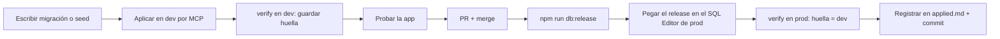

# `db/` — base de datos por ambiente

Manual operativo de la base de Arcade Vault. El porqué y las decisiones están en el [spec 18](../specs/18-ambientes-dev-prod-migracion-v0.8.0.md).

## Ambientes

| Ambiente | Proyecto               | Cómo se aplica                                      | Detalle                                             |
| -------- | ---------------------- | --------------------------------------------------- | --------------------------------------------------- |
| dev      | `fumwaikjxwrhnuyofdxq` | MCP de Supabase (`apply_migration` / `execute_sql`) | [`environments/dev/`](environments/dev/README.md)   |
| prod     | `<ref-prod>`           | **Solo SQL Editor**: se pega un release generado    | [`environments/prod/`](environments/prod/README.md) |

## Qué hay en cada carpeta

| Carpeta              | Ambiente | Contenido                                                                                          |
| -------------------- | -------- | -------------------------------------------------------------------------------------------------- |
| `migrations/`        | común    | Esquema y seguridad (tablas, índices, RLS, políticas, funciones, triggers, grants). **Sin datos.** |
| `seeds/shared/`      | común    | Datos que tienen que ser iguales en todos lados: el catálogo `games`.                              |
| `verify/`            | común    | `post-deploy.sql`: consulta de solo lectura con la **huella** del ambiente.                        |
| `environments/dev/`  | dev      | README, checklist de Auth, `.env.example`, `seeds/` solo de dev.                                   |
| `environments/prod/` | prod     | README, checklist de Auth, `.env.example`, `releases/` (los scripts que se pegan) y `applied.md`.  |

**Qué no pasa nunca de un ambiente a otro:** `auth.users`, `profiles`, `scores`, keys, apps OAuth y configuración de Auth.

## Cómo sabe la app en qué ambiente está

La variable **`NEXT_PUBLIC_APP_ENV`** (`development` | `production`). Se define en cada ambiente y nunca se deduce:

| Ambiente | Dónde | Valor |
|---|---|---|
| dev | `.env.development.local` | `development` |
| prod | env vars del hosting (o `.env.production.local`) | `production` |

**No es lo mismo que `NODE_ENV`.** `NODE_ENV` lo pone Next según el comando (`next dev` → `development`; `next build`/`start` → `production`), así que dice **cómo se compiló**, no **contra qué base corre**: un `next build` local tiene `NODE_ENV=production` aunque lea variables de dev.

- `NODE_ENV` → cosas del build: HSTS, contador de FPS, música de dev.
- `NEXT_PUBLIC_APP_ENV` → cosas del ambiente. Con `production` y la URL de Supabase de dev (`SUPABASE_DEV_PROJECT_REF`), `lib/env.ts` corta. `callbackUrl` solo acepta el `origin` de la request en `development`.

Lleva el prefijo `NEXT_PUBLIC_` porque la leen el proxy y el navegador, así que se fija en `next build`: si se cambia en el hosting, hay que volver a hacer el build. Si falta o tiene otro valor, `lib/env.ts` falla y no asume ningún default.

## Reglas para escribir SQL acá

1. **Una migración por spec** que toque la base: `migrations/000N_<slug>.sql`, con el siguiente número libre. Una migración publicada (que ya está en algún release) **no se edita**: los cambios van en una migración nueva. El script de release compara checksums y falla si una publicada cambió.
2. **Idempotente:** `create table if not exists`, `create index if not exists`, `create or replace function`, `drop policy if exists` + `create policy`, `drop trigger if exists` + `create trigger`, `add column if not exists`.
3. **Sin `begin`/`commit`:** el release envuelve todo en una sola transacción.
4. **Cuerpos de función con `$fn$`.** Nunca `$$` ni `$mig$`: `$mig$` lo usa el release y el script lo rechaza.
5. **Seeds = upsert** (`insert … on conflict (id) do update`) y nunca borran.
6. **Seguridad:** todo cambio de RLS, políticas, `SECURITY DEFINER` o grants se refleja en [`references/security-checklist/politicas-rls.md`](../references/security-checklist/politicas-rls.md).
7. **Nada de `select` suelto en una migración:** el release la ejecuta dentro de un bloque `do` (plpgsql). Para llamar una función se usa `perform f();`.
8. Los `.sql` van con **LF** (`.gitattributes`): la huella compara el texto de las funciones.

## Flujo dev → prod



1. **Escribir** la migración (`migrations/000N_<slug>.sql`) o el cambio de catálogo (`seeds/shared/games.sql`).
2. **Aplicar en dev** por MCP. Ver [`environments/dev/README.md`](environments/dev/README.md).
3. **Verificar en dev:** correr `verify/post-deploy.sql` y anotar la huella.
4. **Probar** la app con `npm run dev`.
5. **PR y merge.**
6. **Generar el release:**

   ```bash
   npm run db:release -- --from <última versión aplicada en prod>
   ```

   Sale `environments/prod/releases/<YYYY-MM-DD>_v<versión>.sql`, con el ledger, las migraciones pendientes y todos los seeds compartidos, dentro de una transacción.

7. **Aplicar en prod:** copiar todo el archivo, pegarlo en el SQL Editor de prod y darle Run.
8. **Verificar en prod:** `verify/post-deploy.sql`. La huella tiene que ser igual a la de dev.
9. **Registrar** la fila en `environments/prod/releases/applied.md` y commitear.

## Ledger (`ops.migration_log`)

Los dos ambientes tienen una tabla `ops.migration_log(version, applied_at, checksum)` con las migraciones aplicadas. El schema `ops` no lo expone la API de Supabase. Cada migración del release se ejecuta solo si su `version` no está en el ledger, así que pegar un release dos veces no hace nada la segunda vez.
