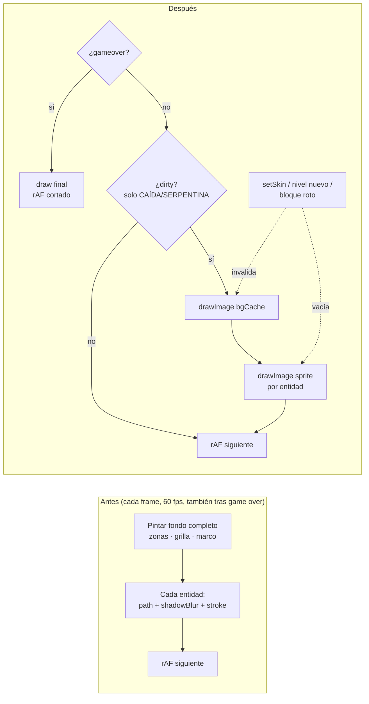

# SPEC 14 — Rendimiento de los motores de juego

> **Estado:** Aprobado

> **Depende de:** 05-rocas-asteroids-motor, 07-caida-tetris-motor-v0.2.1, 09-bloque-buster-arkanoid-motor-v0.2.3, 10-serpentina-snake-motor-v0.2.4, game-jam/03-Frogger/01-frogger-core (RANARIA), 12-controles-tactiles-movil-v0.4.0 (layout táctil), 13-musica-de-fondo-v0.5.0 (shell y panel ⚙)
> **Fecha:** 2026-10-12
> **Versión:** 0.5.1 → 0.5.2 (patch — optimización interna, sin funcionalidad nueva visible: el contador de FPS solo existe en dev)
> **Objetivo:** Que los 5 juegos con motor corran fluidos en escritorio y en celular, eliminando trabajo de dibujo innecesario sin cambiar cómo se ven ni cómo se juegan.

## Contexto (auditoría previa)

Se reportaron problemas de performance en RANARIA, en escritorio con ventana normal y en celular. La auditoría de los motores encontró patrones que se repiten en todos.

**En los 5 motores** (`components/games/*/…-engine.ts`):

1. **El canvas se sigue dibujando tras el game over.** `update()` retorna temprano, pero `draw()` y `requestAnimationFrame` siguen a 60 fps detrás del modal, sin fin.
2. **`shadowBlur` por entidad en la skin NEÓN.** Es la operación más cara de Canvas 2D:
   - RANARIA: ~50 por frame.
   - CAÍDA: hasta 200 bloques.
   - SERPENTINA: una por segmento.
   - BLOQUE BUSTER: una por bloque.
   - ROCAS: una por bala, partícula y asteroide.
3. **Fondo estático repintado en cada frame:**
   - RANARIA: `drawZones`.
   - CAÍDA: grilla con 40 `stroke()` sueltos.
   - SERPENTINA: grilla y un `createLinearGradient` nuevo por frame.
4. **SERPENTINA y CAÍDA pintan a 60 fps** aunque su estado solo cambia por tick o por input.
5. **Allocaciones por frame** en el camino de dibujo, que suman trabajo para el GC:
   - closures de `paint`;
   - arrays temporales;
   - el objeto `angle` en `drawFrogAt`;
   - `forEach`/`filter` en ROCAS.

**En RANARIA:** hace `save/clip/restore` dos veces por frame sobre la misma región.

**En la plataforma** (`app/globals.css`): en escritorio, fuera de pantalla completa, `.av-bg::before` anima `background-position` sobre una capa con `perspective` y `mask-image`. El navegador la recompone junto al canvas en cada frame.

## Alcance

**Incluye:**

- `components/games/game-player-shell.tsx`: contador de FPS **solo en dev** (`process.env.NODE_ENV !== "production"`).
  - Overlay chico en una esquina de la pantalla del CRT.
  - Lo mide el shell con su propio `requestAnimationFrame`.
  - Muestra el FPS promedio y el peor frame en ms (ventana de 1 s).
  - Se actualiza por ref, sin re-renderizar el shell.
  - No toca el contrato del motor.
- `app/globals.css`: mientras hay un `.av-player` en la página (`body:has(.av-player)`), se frena la animación de la grilla del fondo (`.av-bg::before { animation: none }`). Se ve igual, pero quieta. En el resto de las páginas sigue animada.
- Los 5 motores (`rocas`, `caida`, `bloque-buster`, `serpentina`, `ranaria`), con el mismo patrón en todos:
  - **Canvas congelado tras el game over:** se dibuja un frame final y se corta el `requestAnimationFrame`. `restart()` lo vuelve a arrancar.
  - **Fondo estático cacheado** en un canvas offscreen (zonas, grilla, marco, degradado). Se regenera en `setSkin` y cuando el fondo cambia (nivel nuevo, bocas llenas, etc.).
  - **Glow cacheado en sprites:** lo que brilla en NEÓN (`shadowBlur`) se pre-renderiza una vez por skin, tipo y color en un canvas offscreen, y en cada frame se pinta con `drawImage`. El resultado es visualmente equivalente, no idéntico al píxel.
  - **Sin allocaciones por frame en el camino de dibujo:** closures, arrays temporales, objetos literales y `forEach`/`filter` que crean listas nuevas.
- CAÍDA y SERPENTINA: redibujo **solo cuando algo cambió** (flag `dirty`), porque su estado avanza por tick o por input, no de forma continua.
- RANARIA: un solo `save/clip/restore` por frame en vez de dos.
- `components/games/README.md`: sección nueva "Rendimiento" con las reglas de arriba, para motores futuros.
- `.claude/skills/add-game/motor-referencia.md`: las mismas reglas, así `/add-game-impl` ya las aplica a los juegos nuevos.
- `package.json` / `package-lock.json`: versión `0.5.1` → `0.5.2`.
- `CHANGELOG.md`: entrada para `0.5.2` con link a este spec.

**Fuera de alcance:**

- Gameplay, puntuación, velocidades, colisiones, sonidos y música: no cambian.
- `.av-noise` (ruido `feTurbulence`), el `mix-blend-mode` de las scanlines de la página y el `backdrop-filter` del nav: no se tocan (la decisión fue solo frenar la animación).
- El contrato del motor (`components/games/game-engine.ts`) y `app/actions/scores.ts`.
- WebGL, `OffscreenCanvas` en workers y soporte de `devicePixelRatio` / retina.
- Contador de FPS en producción.
- El bug de que ⚙ no pausa la partida (va en otro spec).
- Juegos sin motor (GLOTÓN, INVASORES, DUELO PIXEL).

## Modelo de datos

No se agregan datos persistidos: nada nuevo en Supabase, en `localStorage` ni en el contrato del motor. Lo nuevo es **estado interno en memoria** de cada motor y del shell:

| Dónde                         | Estructura                                                                                                              | Para qué                                                                                               | Se invalida cuando                                                 |
| ----------------------------- | ----------------------------------------------------------------------------------------------------------------------- | ------------------------------------------------------------------------------------------------------ | ------------------------------------------------------------------ |
| Cada motor                    | `bgCache: HTMLCanvasElement \| null` (800×600, o del tamaño de la zona estática)                                        | Fondo estático pre-pintado; cada frame hace un solo `drawImage`                                        | `setSkin`, nivel nuevo, cambio del fondo (bocas llenas en RANARIA) |
| Cada motor                    | `sprites: Map<string, HTMLCanvasElement>`, clave `"<skin>:<tipo>:<color>[:<ancho>:<dir>]"`                              | Entidades con glow pre-renderizadas, con un margen de `glow` px alrededor para que el blur no se corte | `setSkin` (se vacía el `Map`)                                      |
| BLOQUE BUSTER                 | `blocksCache: HTMLCanvasElement \| null`                                                                                | Capa con todos los bloques vivos                                                                       | Se rompe un bloque, nivel nuevo, `setSkin`                         |
| CAÍDA, SERPENTINA             | `dirty: boolean`                                                                                                        | Saltar `draw()` si nada cambió desde el último frame                                                   | Tick, input, `setSkin`, `restart`, cambio de fase                  |
| Todos los motores             | Regla del loop: tras el game over hay un `draw()` final y `rafId = null`                                                | Congelar el canvas detrás del modal                                                                    | Se rearma en `restart()`                                           |
| `game-player-shell.tsx` (dev) | `fpsRef: RefObject<HTMLDivElement>` + `statsRef: { frames, worstMs, lastTs, windowStart, rafId }` (`useRef`, no estado) | Contador de FPS sin re-renderizar el shell                                                             | —                                                                  |

Los sprites se crean con `document.createElement("canvas")`. No hace falta `OffscreenCanvas`, que se descartó.



## Plan de implementación

Cada paso deja el sistema funcional y **se puede probar en el navegador** (`npm run dev`, con el contador de FPS visible) antes de pasar al siguiente.

1. **Contador de FPS en dev** (`game-player-shell.tsx`).
   - Overlay en la esquina superior derecha del CRT con el FPS promedio y el peor frame (ms), medidos por un rAF propio del shell.
   - **Sin re-renders de React:**
     - el acumulador de frames, el peor frame, el timestamp anterior y el `rafId` viven en `useRef`;
     - el overlay es un `<div ref={fpsRef}>` y se actualiza 1 vez/s escribiendo `fpsRef.current.textContent`, sin `setState`.
     - El rAF arranca y se limpia en un `useEffect` (cleanup con `cancelAnimationFrame`).
   - Solo existe en dev: con `process.env.NODE_ENV === "production"` no se renderiza el `<div>` ni corre el rAF.
   - **Línea base:** medir los 5 juegos × 3 skins (30 s jugando, en ventana normal de escritorio y con CPU throttling 4x) y anotar la tabla en la sección "Mediciones" de este spec.
   - _Prueba:_
     - el overlay aparece en dev; en `npm run build && npm start` no aparece;
     - con React DevTools ("Highlight updates"), el shell no se re-renderiza cada segundo por el contador.
2. **Fondo de la página quieto mientras se juega** (`app/globals.css`).
   - `body:has(.av-player) .av-bg::before { animation: none; }`.
   - _Prueba:_ en `/juegos/<id>/jugar` la grilla del fondo no se mueve; en `/` sí. Se compara el FPS contra la línea base.
3. **Canvas congelado tras el game over** (los 5 motores, mismo patrón).
   - En `loop`, si `internalPhase === "gameover"`: `update` (reporta el estado), un `draw()` final y no se pide otro rAF (`rafId = null`).
   - `restart()` ya rearma el rAF si `rafId === null`. `setSkin` ya redibuja si no hay rAF.
   - _Prueba:_ FIN → el canvas queda quieto detrás del modal, JUGAR DE NUEVO arranca normal y cambiar de skin con el juego terminado redibuja.
4. **RANARIA** (`ranaria/frogger-engine.ts`).
   - `bgCache` con las zonas, el oleaje, las líneas de carril, los límites, el marco y las bocas vacías. Las ranas en bocas llenas se siguen dibujando aparte.
   - Sprites por skin para coche (color × ancho × dirección), camión (dirección), tronco (ancho), tortuga (normal y sumergida) y rana (dirección × saltando).
   - Un solo `clip` para entidades y rana.
   - Sin closures, arrays temporales ni objetos literales en `draw`.
   - _Prueba:_ las 3 skins se ven equivalentes a las capturas previas (`.playwright-screenshot/`), y el FPS mejora frente a la línea base, sobre todo en NEÓN.
5. **CAÍDA** (`caida/tetris-engine.ts`).
   - `bgCache` con el fondo del tablero, la grilla (un solo path) y el marco.
   - Sprites de bloque por skin y color, con una variante fantasma.
   - Flag `dirty` que marcan la caída por tick, el input, el limpiado de líneas (incluida su animación, si la tiene) y `setSkin`.
   - _Prueba:_ se juega igual, el preview SIGUIENTE se ve bien y las capturas son equivalentes.
6. **SERPENTINA** (`serpentina/snake-engine.ts`).
   - `bgCache` con el degradado, la grilla y el marco.
   - Sprites de cabeza, cuerpo y fruta por skin. Los ojos se siguen dibujando aparte, porque dependen de la dirección.
   - Flag `dirty` que marcan el tick, `setSkin` y la carga del sprite de manzana.
   - _Prueba:_ con una serpiente larga en NEÓN, el FPS se mantiene.
7. **BLOQUE BUSTER** (`bloque-buster/arkanoid-engine.ts`).
   - `blocksCache` con los bloques vivos, que se regenera al romper uno, en nivel nuevo y en `setSkin`.
   - Sprites de bola y paleta.
   - `bgCache` con el marco.
   - Sin `filter` por frame (las explosiones se compactan en el lugar).
   - _Prueba:_ romper bloques actualiza la capa al instante; pasar de nivel la regenera.
8. **ROCAS** (`rocas/asteroids-engine.ts`).
   - Sprites de bala y partícula por skin, con el alpha del fade aplicado con `globalAlpha` sobre el sprite.
   - Listas compactadas en el lugar, en vez de `filter`/`concat`.
   - Sin `forEach` en el loop.
   - _Prueba:_ con una explosión grande en NEÓN, el FPS no cae como en la línea base.
9. **Documentación y versión.**
   - Sección "Rendimiento" en `components/games/README.md` y las mismas reglas en `.claude/skills/add-game/motor-referencia.md`.
   - Medición final de los 5 juegos × 3 skins anotada en "Mediciones", junto a la línea base.
   - Bump `0.5.1` → `0.5.2` en `package.json` y `package-lock.json`, más la entrada en `CHANGELOG.md`.

## Mediciones

> Se completa durante la implementación: la línea base en el paso 1 y la final en el paso 9.

### Método (ajustado durante el paso 1, decisión del usuario)

La primera línea base salió **saturada**: en la PC de desarrollo (monitor de 160 Hz), los 5 juegos × 3 skins daban ~160 FPS incluso con CPU 4x, así que el FPS no puede mostrar una mejora. Por eso:

- Se sigue midiendo **FPS promedio y peor frame** (lo que pide el spec), y se agregan los **ms de trabajo del hilo principal por frame** (`TaskDuration` de CDP `Performance.getMetrics` ÷ frames).
- Se agrega la condición **sin GPU + CPU 4x** (Chrome con `--disable-gpu`: raster de canvas por software). Hace de proxy de un celular flojo, porque el costo de `shadowBlur` cae en la CPU y aparece en la medición.
- Las corridas son headless (Chrome instalado, vía Playwright), de 30 s por juego × skin, con un bot que manda flechas y Espacio al azar cada 150 ms y aprieta JUGAR DE NUEVO si aparece. Una ventana tapada por otra hace que Chrome frene el rAF y arruine la medición: por eso headless.
- El criterio de "+25 % de FPS con CPU 4x" se reemplazó por "−25 % de ms/frame en NEÓN, sin GPU + CPU 4x" (ver Criterios de aceptación).

Formato de cada celda: `FPS / peor frame ms / ms de trabajo por frame`.

Por decisión del usuario, por ahora se mide **solo RANARIA**. Los otros 4 juegos quedan pendientes.

### Línea base (paso 1, 2026-10-12)

| Juego   | Skin    | Escritorio (GPU, 1x) | CPU 4x (GPU)        | Sin GPU, 1x      | Sin GPU + CPU 4x    |
| ------- | ------- | -------------------- | ------------------- | ---------------- | ------------------- |
| RANARIA | clasico | 160 / 6,6 / 0,40     | 159 / 18,8 / 1,81   | 60 / 16,8 / 1,09 | 60 / 16,8 / 4,46    |
| RANARIA | neon    | 160 / 6,5 / 0,52     | 158,5 / 25 / 2,15   | 60 / 16,8 / 3,57 | 58,9 / 33,5 / 16,13 |
| RANARIA | retro   | 160 / 6,5 / 0,47     | 158,6 / 24,9 / 1,90 | 60 / 16,8 / 1,09 | 60 / 16,8 / 5,01    |

Lectura: con GPU, RANARIA anda holgada en esta PC. Sin GPU + CPU 4x, NEÓN ocupa el **95 % del hilo principal** (16,1 ms de un presupuesto de 16,7 ms) y ya pierde frames: es el caso que reproduce la queja del celular. CLÁSICO y RETRO quedan en ~27–30 %.

### Final (paso 9)

_Pendiente._

### Después del paso 2 (fondo de la página quieto), RANARIA

| Skin    | CPU 4x (GPU): antes → después | Sin GPU + CPU 4x: antes → después |
| ------- | ----------------------------- | --------------------------------- |
| clasico | 1,81 → **1,04** ms/frame      | 4,46 → **3,81** ms/frame          |
| neon    | 2,15 → **1,35** ms/frame      | 16,13 → **15,73** ms/frame        |
| retro   | 1,90 → **1,09** ms/frame      | 5,01 → **4,20** ms/frame          |

## Bitácora de soluciones (receta para re-ejecutar en otros juegos)

> Pedido del usuario durante la implementación: cada solución que se aplica (empezando por RANARIA) queda acá con el problema, el patrón y los gotchas. Así se puede repetir tal cual en CAÍDA, SERPENTINA, BLOQUE BUSTER y ROCAS. Se completa paso a paso.

### S1 — Cómo medir (paso 1)

**Problema:** en una PC con GPU y monitor de alta frecuencia, el FPS se satura al tope del monitor y no muestra nada.

**Solución:**

- Medir en headless con dos condiciones: GPU normal, y `--disable-gpu` + `Emulation.setCPUThrottlingRate` 4x (el proxy de celular).
- Reportar FPS, peor frame y **ms de trabajo por frame**: el delta de `TaskDuration` de `Performance.getMetrics` dividido por la cantidad de frames.

**Gotchas:**

- Con ventana visible, si otra ventana la tapa, Chrome frena el rAF a ~1 FPS (pasó en CAÍDA). Usar headless.
- El bot de input usa `KeyboardEvent` sintéticos sobre `window`. Funciona porque ningún motor filtra `isTrusted` (spec 12).
- La skin se fija con `localStorage["av-skin:<id>"]` antes de cargar `/juegos/<id>/jugar`.
- Playwright no está en el `package.json`: se usa el que trae el MCP desde el caché de `npx`. La ruta es de esta máquina y hay que ajustarla.

**Script** (`node measure.cjs <out.json> <segundos> <game-id...>`, con `HEADLESS=1` y opcionalmente `NOGPU=1`; necesita `npm run dev` en :3000):

```js
const { chromium } = require("<ruta a node_modules/playwright>");
const fs = require("fs");
const [out, secsArg, ...games] = process.argv.slice(2);
const SECS = Number(secsArg) || 30;

function measureInPage(ms) {
  return new Promise((resolve) => {
    const keys = ["ArrowUp", "ArrowDown", "ArrowLeft", "ArrowRight", "Space", "ArrowUp"];
    let frames = 0,
      worst = 0,
      last = 0,
      start = 0,
      gameovers = 0;
    const bot = setInterval(() => {
      const btn = [...document.querySelectorAll("button")].find((b) =>
        b.textContent.includes("JUGAR DE NUEVO")
      );
      if (btn) {
        gameovers++;
        btn.click();
        return;
      }
      const code = keys[Math.floor(Math.random() * keys.length)];
      const key = code === "Space" ? " " : code;
      window.dispatchEvent(new KeyboardEvent("keydown", { code, key, bubbles: true }));
      setTimeout(
        () => window.dispatchEvent(new KeyboardEvent("keyup", { code, key, bubbles: true })),
        80
      );
    }, 150);
    const tick = (ts) => {
      if (!start) start = ts;
      else {
        frames++;
        if (ts - last > worst) worst = ts - last;
      }
      last = ts;
      if (ts - start < ms) return requestAnimationFrame(tick);
      clearInterval(bot);
      resolve({
        fps: +((frames * 1000) / (ts - start)).toFixed(1),
        worstMs: +worst.toFixed(1),
        gameovers,
      });
    };
    requestAnimationFrame(tick);
  });
}

(async () => {
  const browser = await chromium.launch({
    headless: process.env.HEADLESS === "1",
    channel: "chrome",
    args: process.env.NOGPU === "1" ? ["--disable-gpu"] : [],
  });
  const page = await browser.newPage({ viewport: { width: 1280, height: 800 } });
  const cdp = await page.context().newCDPSession(page);
  const metrics = async () =>
    Object.fromEntries(
      (await cdp.send("Performance.getMetrics")).metrics.map((m) => [m.name, m.value])
    );
  const results = {};
  for (const game of games)
    for (const rate of [1, 4])
      for (const skin of ["clasico", "neon", "retro"]) {
        await page.goto("http://localhost:3000/");
        await page.evaluate(([g, s]) => localStorage.setItem("av-skin:" + g, s), [game, skin]);
        await page.goto(`http://localhost:3000/juegos/${game}/jugar`);
        await page.waitForSelector("[data-fps-meter]", { timeout: 60000 });
        await page.waitForTimeout(1500);
        await cdp.send("Emulation.setCPUThrottlingRate", { rate });
        await cdp.send("Performance.enable");
        const m0 = await metrics();
        const r = await page.evaluate(measureInPage, SECS * 1000);
        const m1 = await metrics();
        const frames = Math.max(1, Math.round(r.fps * SECS));
        r.taskMsPerFrame = +(((m1.TaskDuration - m0.TaskDuration) * 1000) / frames).toFixed(2);
        r.busyPct = +(((m1.TaskDuration - m0.TaskDuration) / SECS) * 100).toFixed(1);
        await cdp.send("Emulation.setCPUThrottlingRate", { rate: 1 });
        results[`${game}|${skin}|${rate}x`] = r;
        fs.writeFileSync(out, JSON.stringify(results, null, 2));
        console.log(game, skin, `${rate}x`, JSON.stringify(r));
      }
  await browser.close();
})();
```

### S2 — Fondo de la página quieto mientras se juega (paso 2, plataforma)

**Problema:** `.av-bg::before` anima `background-position` sobre una capa con `perspective` + `mask-image`. El navegador la recompone en cada frame, junto al canvas.

**Solución** (`app/globals.css`): `body:has(.av-player) .av-bg::before { animation: none; }`. Vale para todos los juegos a la vez, porque es de plataforma y no hay que repetirlo por juego.

**Verificación:** `getComputedStyle(document.querySelector(".av-bg"), "::before").animationName` da `gridscroll` en `/` y `/games`, y `none` en `/juegos/<id>/jugar`.

**Efecto en RANARIA:** con GPU y CPU 4x, el trabajo por frame bajó un ~40 % en las 3 skins. Sin GPU casi no cambia: ahí el costo dominante es el canvas (`shadowBlur`), que es lo que ataca el paso 4.

## Criterios de aceptación

**Medición**

- [ ] El contador de FPS se ve en `npm run dev` y **no** aparece en `npm run build && npm start`.
- [ ] Con React DevTools ("Highlight updates"), el contador no re-renderiza `GamePlayerShell` (se actualiza por ref).
- [ ] La sección "Mediciones" tiene la tabla de línea base (paso 1) y la final (paso 9) para los 5 juegos × 3 skins: FPS promedio y peor frame. Una tabla para escritorio con ventana normal y otra con CPU throttling 4x.

**Rendimiento**

- [ ] En escritorio, con ventana normal y sin throttling, los 5 juegos × 3 skins promedian ≥ 58 FPS en 30 s de juego, con un peor frame < 33 ms.
- [ ] ~~Con CPU throttling 4x, el FPS promedio de cada juego en NEÓN mejora al menos un 25 % frente a su línea base. Si la línea base ya está en ≥ 58 FPS, alcanza con que se mantenga.~~ → Reemplazado (ver "Mediciones → Método"): en la condición **sin GPU + CPU 4x**, los **ms de trabajo por frame** de cada juego en NEÓN bajan al menos un 25 % frente a su línea base, y el FPS no baja.
- [ ] Tras el game over, un trace de Performance de 3 s no muestra callbacks del rAF del motor.

**Comportamiento**

- [ ] JUGAR DE NUEVO, tras el game over, arranca la partida normal (el canvas vuelve a animarse).
- [ ] Cambiar de skin en vivo, en pausa y con el juego terminado actualiza el canvas al instante, sin restos de la skin anterior (los cachés se regeneran).
- [ ] Nivel nuevo, bocas llenas (RANARIA) y bloque roto (BLOQUE BUSTER) se reflejan en el siguiente frame.
- [ ] En `/juegos/<id>/jugar`, la grilla de fondo de la página no se anima. En `/` y en `/games` sí.

**Fidelidad**

- [ ] Las capturas antes y después de cada juego × skin están en `.playwright-screenshot/`, comparadas a la par, y cada skin es visualmente equivalente. El glow no aparece recortado.
- [ ] Gameplay, puntuación, velocidades y sonidos no cambian. Una partida jugada con sesión iniciada se guarda y aparece en `/juegos/<id>` y en `/salon-de-la-fama`.
- [ ] Los controles táctiles (viewport de celular) siguen funcionando en los 5 juegos.

**Higiene**

- [ ] `npm run lint` y `npm run build` pasan sin errores.
- [ ] No se modificaron `components/games/game-engine.ts` ni `app/actions/scores.ts`.
- [ ] `components/games/README.md` y `.claude/skills/add-game/motor-referencia.md` tienen la sección "Rendimiento".
- [ ] `package.json` y `package-lock.json` están en `0.5.2`, y `CHANGELOG.md` tiene la entrada `[0.5.2]` con link a este spec.

## Decisiones

**Tomadas:**

| Decisión                                                       | Por qué                                                                                                                                                                                       |
| -------------------------------------------------------------- | --------------------------------------------------------------------------------------------------------------------------------------------------------------------------------------------- |
| Alcance: los 5 motores + la plataforma en un solo spec         | Los problemas son los mismos patrones repetidos (loop tras el game over, `shadowBlur` por entidad, fondo repintado). Arreglarlos juntos deja una sola regla documentada para motores futuros. |
| "Visualmente equivalente", no idéntico al píxel                | Cachear el glow en sprites es lo que más ahorra. Exigir identidad al píxel lo impediría por diferencias mínimas de antialias.                                                                 |
| Glow pre-renderizado en sprites (`drawImage`)                  | `shadowBlur` se recalcula en cada llamada; un sprite cuesta un blit. Mantiene el look de NEÓN sin bajarle el brillo.                                                                          |
| Fondo estático en un canvas offscreen                          | Zonas, grilla y marco no cambian entre frames: un `drawImage` reemplaza decenas de `fillRect`/`stroke`.                                                                                       |
| `dirty` solo en CAÍDA y SERPENTINA                             | Su estado avanza por tick o input. En RANARIA, ROCAS y BLOQUE BUSTER hay movimiento continuo, así que siempre cambia algo.                                                                    |
| Congelar el canvas tras el game over en los 5 (ROCAS incluido) | Detrás del modal no se ve casi nada. Repintar 60 fps indefinidamente gasta batería en el celular. Se pierde la deriva de asteroides de ROCAS: aceptado.                                       |
| Contador de FPS solo en dev, medido en el shell                | Sirve para medir sin tocar el contrato del motor ni exponer nada en producción.                                                                                                               |
| Contador por `useRef` + `textContent`, sin `useState`          | Medir no debe costar un render de React por segundo. Si no, el instrumento afecta lo que mide.                                                                                                |
| Fondo de la página: solo frenar la animación de `.av-bg`       | Lo pidió el usuario: se mantiene el look y se quita el repintado continuo de la capa con `perspective` + `mask-image`.                                                                        |
| Versión 0.5.1 → 0.5.2 (patch)                                  | Optimización interna; no hay funcionalidad nueva para el usuario.                                                                                                                             |

**Descartadas:**

| Alternativa                                                        | Por qué no                                                                               |
| ------------------------------------------------------------------ | ---------------------------------------------------------------------------------------- |
| Migrar a WebGL                                                     | Reescribe los 5 motores para un problema que se resuelve en Canvas 2D.                   |
| `OffscreenCanvas` en un worker                                     | Cambia el contrato del motor (input, `onState`) y el soporte en Safari iOS es irregular. |
| Bajar el `shadowBlur` o la cantidad de cosas que brillan en NEÓN   | Cambia la identidad de la skin. Con sprites no hace falta.                               |
| Ocultar `.av-bg`/`.av-noise` al jugar                              | El usuario prefirió conservarlos visibles y solo frenarlos.                              |
| Tocar `.av-noise`, `mix-blend-mode` o el `backdrop-filter` del nav | Fuera de lo decidido. Si la medición final muestra que siguen pesando, va en otro spec.  |
| Métricas que reporte cada motor (campo nuevo en `EngineState`)     | Más precisas, pero tocan `game-engine.ts` y los 5 motores sin necesidad.                 |
| Contador de FPS activable en producción (`?fps=1`)                 | No se pidió. Para probar en un celular real basta con `npm run dev` en la red local.     |
| Soporte de `devicePixelRatio`                                      | Aumentaría los píxeles a pintar: va en contra del objetivo.                              |

## Riesgos

| Riesgo                                                                                                                     | Impacto                                            | Mitigación                                                                                                                         |
| -------------------------------------------------------------------------------------------------------------------------- | -------------------------------------------------- | ---------------------------------------------------------------------------------------------------------------------------------- |
| **Caché desactualizado** tras `setSkin`, nivel nuevo, bocas llenas o bloque roto                                           | Se ve la skin anterior o un bloque "fantasma"      | Una sola función `invalidateCaches()` por motor, llamada desde todos esos puntos. Criterio de aceptación explícito para cada caso. |
| **`dirty` se olvida de marcar algo** (animación de limpiado de líneas en CAÍDA, carga del sprite de manzana en SERPENTINA) | Una animación se congela o un cambio aparece tarde | Inventariar en el paso 5 y el 6 todo lo que muta estado visible. Ante la duda, marcar `dirty`: es barato.                          |
| **Glow recortado** en los sprites                                                                                          | El brillo de NEÓN termina en un borde duro         | Sprite de `tamaño + 2 × glow` px, dibujado con offset `-glow`. Se verifica con las capturas comparadas.                            |
| **Memoria de sprites** (combinaciones color × ancho × dirección)                                                           | Uso de memoria creciente                           | Las claves son finitas y conocidas por skin. El `Map` se vacía en `setSkin` y se libera en `destroy()`.                            |
| **Freeze tras el game over rompe `setSkin` o `restart`**                                                                   | Canvas negro o que no arranca                      | Ya están las guardas `if (rafId === null) draw()` / rearmar el rAF. Hay un criterio de aceptación que lo cubre.                    |
| **Equivalencia visual subjetiva**                                                                                          | Discusión sobre si "se ve igual"                   | Capturas a la par en `.playwright-screenshot/`; el usuario da el OK por juego.                                                     |
| **El celular real no se mide desde acá**                                                                                   | La mejora en móvil no queda verificada             | Playwright con CPU throttling 4x como proxy. La prueba en un celular real (vía `npm run dev` en la red local) la hace el usuario.  |
| **El costo dominante puede estar fuera del canvas** (`.av-noise`, `mix-blend-mode`, `backdrop-filter`)                     | Tras el spec el FPS en escritorio mejora poco      | La tabla de "Mediciones" lo deja en evidencia. Si pasa, se abre un spec aparte para esos efectos (decisión ya registrada).         |
