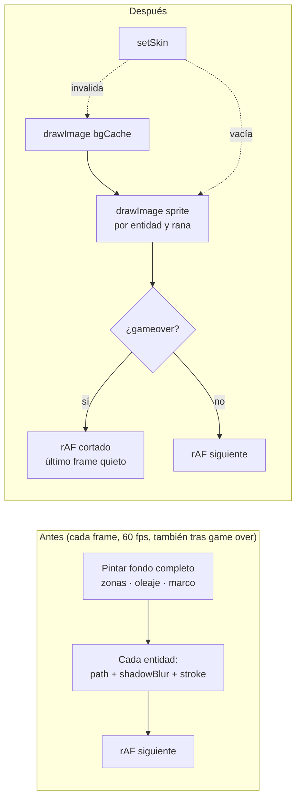

# SPEC 14 — Rendimiento del motor de RANARIA

> **Estado:** Aprobado

> **Depende de:** game-jam/03-Frogger/01-frogger-core (RANARIA), 12-controles-tactiles-movil-v0.4.0 (layout táctil), 13-musica-de-fondo-v0.5.0 (shell y panel ⚙)
> **Fecha:** 2026-10-12
> **Versión:** 0.5.1 → 0.5.2 (patch — optimización interna, sin funcionalidad nueva visible: el contador de FPS solo existe en dev)
> **Objetivo:** Que RANARIA corra fluida en escritorio y en celular, eliminando trabajo de dibujo innecesario sin cambiar cómo se ve ni cómo se juega.

> **Alcance reducido durante la implementación (decisión del usuario, 2026-10-12):** el spec original cubría los 5 motores. Ahora se aplica **solo a RANARIA**, más los dos cambios de plataforma que ya estaban hechos (contador de FPS y fondo quieto). CAÍDA, SERPENTINA, BLOQUE BUSTER y ROCAS quedan para specs futuros, que pueden reusar la "Bitácora de soluciones" de abajo como receta.

## Contexto (auditoría previa)

Se reportaron problemas de performance en RANARIA, en escritorio con ventana normal y en celular. La auditoría de su motor (`components/games/ranaria/frogger-engine.ts`) encontró:

1. **El canvas se sigue dibujando tras el game over.** `update()` retorna temprano, pero `draw()` y `requestAnimationFrame` siguen a 60 fps detrás del modal, sin fin.
2. **`shadowBlur` por entidad en la skin NEÓN**, ~50 por frame. Es la operación más cara de Canvas 2D.
3. **Fondo estático repintado en cada frame** (`drawZones`: zonas, oleaje, carriles, límites y bocas).
4. **Allocaciones por frame** en el camino de dibujo, que suman trabajo para el GC:
   - closures de `paint`;
   - arrays temporales;
   - el objeto `angle` en `drawFrogAt`.
5. **Doble `save/clip/restore` por frame** sobre la misma región.

**En la plataforma** (`app/globals.css`): en escritorio, fuera de pantalla completa, `.av-bg::before` anima `background-position` sobre una capa con `perspective` y `mask-image`. El navegador la recompone junto al canvas en cada frame.

## Alcance

**Incluye:**

- `components/games/game-player-shell.tsx`: contador de FPS **solo en dev** (`process.env.NODE_ENV !== "production"`).
  - Overlay chico en una esquina de la pantalla del CRT.
  - Lo mide el shell con su propio `requestAnimationFrame`.
  - Muestra el FPS promedio y el peor frame en ms (ventana de 1 s).
  - Se actualiza por ref, sin re-renderizar el shell.
  - No toca el contrato del motor.
- `app/globals.css`: mientras hay un `.av-player` en la página (`body:has(.av-player)`), se frena la animación de la grilla del fondo (`.av-bg::before { animation: none }`). Se ve igual, pero quieta. En el resto de las páginas sigue animada.
- El motor de RANARIA (`components/games/ranaria/frogger-engine.ts`):
  - **Canvas congelado tras el game over:** se dibuja un frame final y se corta el `requestAnimationFrame`. `restart()` lo vuelve a arrancar.
  - **Fondo estático cacheado** en un canvas offscreen: zonas, oleaje, carriles, límites, bocas vacías y marco. Se regenera en `setSkin`.
  - **Glow cacheado en sprites:** lo que brilla en NEÓN (`shadowBlur`) se pre-renderiza una vez por skin, tipo y color en un canvas offscreen, y en cada frame se pinta con `drawImage`. El resultado es visualmente equivalente, no idéntico al píxel.
  - **Sin allocaciones por frame en el camino de dibujo:** closures, arrays temporales y objetos literales.
  - Un solo `save/clip/restore` por frame en vez de dos.
- `components/games/README.md`: sección nueva "Rendimiento" con las reglas de arriba, para motores futuros.
- `.claude/skills/add-game/motor-referencia.md`: las mismas reglas, así `/add-game-impl` ya las aplica a los juegos nuevos.
- `package.json` / `package-lock.json`: versión `0.5.1` → `0.5.2`.
- `CHANGELOG.md`: entrada para `0.5.2` con link a este spec.

**Fuera de alcance:**

- **CAÍDA, SERPENTINA, BLOQUE BUSTER y ROCAS** (decisión del usuario): van en specs futuros, usando la bitácora como receta.
- Gameplay, puntuación, velocidades, colisiones, sonidos y música: no cambian.
- `.av-noise` (ruido `feTurbulence`), el `mix-blend-mode` de las scanlines de la página y el `backdrop-filter` del nav: no se tocan (la decisión fue solo frenar la animación).
- El contrato del motor (`components/games/game-engine.ts`) y `app/actions/scores.ts`.
- WebGL, `OffscreenCanvas` en workers y soporte de `devicePixelRatio` / retina.
- Contador de FPS en producción.
- El bug de que ⚙ no pausa la partida (va en otro spec).
- Juegos sin motor (GLOTÓN, INVASORES, DUELO PIXEL).

## Modelo de datos

No se agregan datos persistidos: nada nuevo en Supabase, en `localStorage` ni en el contrato del motor. Lo nuevo es **estado interno en memoria** del motor de RANARIA y del shell:

| Dónde                         | Estructura                                                                                                              | Para qué                                                                                    | Se invalida cuando            |
| ----------------------------- | ----------------------------------------------------------------------------------------------------------------------- | ------------------------------------------------------------------------------------------- | ----------------------------- |
| Motor de RANARIA              | `bgCache: HTMLCanvasElement \| null` (800×600)                                                                          | Fondo estático pre-pintado; cada frame hace un solo `drawImage`                             | `setSkin`                     |
| Motor de RANARIA              | `sprites: Map<string, HTMLCanvasElement>`, clave `"<skin>:<tipo>:<color>[:<ancho>:<dir>]"`                              | Entidades con glow pre-renderizadas, con un margen de `pad` px para que el blur no se corte | `setSkin` (se vacía el `Map`) |
| Motor de RANARIA              | `laneSprites`, `turtleUp`/`turtleDown`, `frogSprites`, `timeSprites` (referencias resueltas del `Map`)                  | Que `draw()` no arme claves ni allocque nada por frame                                      | `setSkin`                     |
| Motor de RANARIA              | Regla del loop: tras el game over hay un `draw()` final y `rafId = null`                                                | Congelar el canvas detrás del modal                                                         | Se rearma en `restart()`      |
| `game-player-shell.tsx` (dev) | `fpsRef: RefObject<HTMLDivElement>` + `statsRef: { frames, worstMs, lastTs, windowStart, rafId }` (`useRef`, no estado) | Contador de FPS sin re-renderizar el shell                                                  | —                             |

Los sprites se crean con `document.createElement("canvas")`. No hace falta `OffscreenCanvas`, que se descartó.



## Plan de implementación

Cada paso deja el sistema funcional y **se puede probar en el navegador** (`npm run dev`, con el contador de FPS visible) antes de pasar al siguiente.

1. ✅ **Contador de FPS en dev** (`game-player-shell.tsx`). _Hecho (commit `7a03ab1`)._
   - Overlay en la esquina superior derecha del CRT con el FPS promedio y el peor frame (ms), medidos por un rAF propio del shell.
   - **Sin re-renders de React:**
     - el acumulador de frames, el peor frame, el timestamp anterior y el `rafId` viven en `useRef`;
     - el overlay es un `<div ref={fpsRef}>` y se actualiza 1 vez/s escribiendo `fpsRef.current.textContent`, sin `setState`.
     - El rAF arranca y se limpia en un `useEffect` (cleanup con `cancelAnimationFrame`).
   - Solo existe en dev: con `process.env.NODE_ENV === "production"` no se renderiza el `<div>` ni corre el rAF.
   - **Línea base:** medir RANARIA × 3 skins (30 s jugando) y anotar la tabla en la sección "Mediciones" de este spec.
   - _Prueba:_
     - el overlay aparece en dev; en `npm run build && npm start` no aparece;
     - con React DevTools ("Highlight updates"), el shell no se re-renderiza cada segundo por el contador.
2. ✅ **Fondo de la página quieto mientras se juega** (`app/globals.css`). _Hecho (commit `7a03ab1`)._
   - `body:has(.av-player) .av-bg::before { animation: none; }`.
   - _Prueba:_ en `/juegos/ranaria/jugar` la grilla del fondo no se mueve; en `/` sí. Se compara contra la línea base.
3. ✅ **Canvas congelado tras el game over** (`ranaria/frogger-engine.ts`). _Hecho._
   - En `loop`, después de `update` y `draw`, si `internalPhase === "gameover"` no se pide otro rAF (`rafId = null`).
   - `restart()` ya rearma el rAF si `rafId === null`. `setSkin` ya redibuja si no hay rAF.
   - _Prueba:_ FIN → el canvas queda quieto detrás del modal, JUGAR DE NUEVO arranca normal y cambiar de skin sin rAF corriendo redibuja.
4. ✅ **Cachés de dibujo de RANARIA** (`ranaria/frogger-engine.ts`). _Hecho._
   - `bgCache` con las zonas, el oleaje, las líneas de carril, los límites, el marco y las bocas vacías. Las ranas en bocas llenas se siguen dibujando aparte.
   - Sprites por skin para coche (color × ancho × dirección), camión (dirección), tronco (ancho), tortuga (normal y sumergida), rana (dirección × saltando) y barra de tiempo (3 colores).
   - Un solo `clip` para entidades y rana.
   - Sin closures, arrays temporales ni objetos literales en `draw`.
   - _Prueba:_ las 3 skins se ven equivalentes a las capturas previas (`.playwright-screenshot/`), y el trabajo por frame baja frente a la línea base, sobre todo en NEÓN.
5. **Documentación y versión.**
   - Sección "Rendimiento" en `components/games/README.md` y las mismas reglas en `.claude/skills/add-game/motor-referencia.md`.
   - Medición final de RANARIA × 3 skins anotada en "Mediciones", junto a la línea base.
   - Bump `0.5.1` → `0.5.2` en `package.json` y `package-lock.json`, más la entrada en `CHANGELOG.md`.

## Mediciones

### Método (ajustado durante el paso 1, decisión del usuario)

La primera línea base salió **saturada**: en la PC de desarrollo (monitor de 160 Hz), todo daba ~160 FPS incluso con CPU 4x, así que el FPS no puede mostrar una mejora. Por eso:

- Se sigue midiendo **FPS promedio y peor frame** (lo que pide el spec), y se agregan los **ms de trabajo del hilo principal por frame** (`TaskDuration` de CDP `Performance.getMetrics` ÷ frames).
- Se agrega la condición **sin GPU + CPU 4x** (Chrome con `--disable-gpu`: raster de canvas por software). Hace de proxy de un celular flojo, porque el costo de `shadowBlur` cae en la CPU y aparece en la medición.
- Las corridas son headless (Chrome instalado, vía Playwright), de 30 s por skin, con un bot que manda flechas y Espacio al azar cada 150 ms y aprieta JUGAR DE NUEVO si aparece. Una ventana tapada por otra hace que Chrome frene el rAF y arruine la medición: por eso headless.
- El criterio de "+25 % de FPS con CPU 4x" se reemplazó por "−25 % de ms/frame en NEÓN, sin GPU + CPU 4x" (ver Criterios de aceptación).

Formato de cada celda: `FPS / peor frame ms / ms de trabajo por frame`.

### Línea base (paso 1, 2026-10-12)

| Skin    | Escritorio (GPU, 1x) | CPU 4x (GPU)        | Sin GPU, 1x      | Sin GPU + CPU 4x    |
| ------- | -------------------- | ------------------- | ---------------- | ------------------- |
| clasico | 160 / 6,6 / 0,40     | 159 / 18,8 / 1,81   | 60 / 16,8 / 1,09 | 60 / 16,8 / 4,46    |
| neon    | 160 / 6,5 / 0,52     | 158,5 / 25 / 2,15   | 60 / 16,8 / 3,57 | 58,9 / 33,5 / 16,13 |
| retro   | 160 / 6,5 / 0,47     | 158,6 / 24,9 / 1,90 | 60 / 16,8 / 1,09 | 60 / 16,8 / 5,01    |

Lectura: con GPU, RANARIA anda holgada en esta PC. Sin GPU + CPU 4x, NEÓN ocupa el **95 % del hilo principal** (16,1 ms de un presupuesto de 16,7 ms) y ya pierde frames: es el caso que reproduce la queja del celular. CLÁSICO y RETRO quedan en ~27–30 %.

### Después del paso 2 (fondo de la página quieto)

| Skin    | Escritorio (GPU, 1x) | CPU 4x (GPU)        | Sin GPU, 1x      | Sin GPU + CPU 4x    |
| ------- | -------------------- | ------------------- | ---------------- | ------------------- |
| clasico | 160 / 6,7 / 0,29     | 159,4 / 18,8 / 1,04 | 60 / 16,8 / 0,94 | 60 / 16,8 / 3,81    |
| neon    | 160 / 6,5 / 0,34     | 159,4 / 18,8 / 1,35 | 60 / 16,8 / 3,25 | 58,9 / 33,4 / 15,73 |
| retro   | 160 / 6,5 / 0,31     | 159,5 / 18,8 / 1,09 | 60 / 16,8 / 0,97 | 60 / 16,8 / 4,20    |

### Después de los pasos 3–4 (motor de RANARIA)

| Skin    | Escritorio (GPU, 1x) | CPU 4x (GPU)        | Sin GPU, 1x      | Sin GPU + CPU 4x     |
| ------- | -------------------- | ------------------- | ---------------- | -------------------- |
| clasico | 160 / 6,8 / 0,27     | 159,5 / 25 / 0,98   | 60 / 16,8 / 0,62 | 60 / 16,8 / **2,49** |
| neon    | 160 / 6,7 / 0,27     | 159,5 / 18,9 / 1,01 | 60 / 16,8 / 0,70 | 60 / 16,8 / **2,99** |
| retro   | 160 / 6,7 / 0,28     | 159,5 / 18,8 / 0,99 | 60 / 16,8 / 0,63 | 60 / 16,8 / **2,61** |

Lectura: en NEÓN sin GPU + CPU 4x, el trabajo por frame bajó de **16,13 a 2,99 ms (−81 %)**, el hilo pasó del 95 % al 18 % ocupado, y el peor frame bajó de 33,5 a 16,8 ms (ya no se pierden frames). Las 3 skins quedaron con el mismo costo: el glow ya no se paga por frame.

### Final (paso 5)

_Pendiente: se repite la medición después de la documentación y el bump, para confirmar._

## Bitácora de soluciones (receta para re-ejecutar en otros juegos)

> Pedido del usuario durante la implementación: cada solución que se aplica queda acá con el problema, el patrón y los gotchas, para repetirla en CAÍDA, SERPENTINA, BLOQUE BUSTER y ROCAS en specs futuros. Los puntos de cada uno vienen de la auditoría original:
>
> - **CAÍDA:** hasta 200 bloques con `shadowBlur`, y la grilla con 40 `stroke()` sueltos. Su estado solo cambia por tick o input, así que conviene sumarle un flag `dirty`.
> - **SERPENTINA:** un `shadowBlur` por segmento, y la grilla más un `createLinearGradient` nuevo en cada frame. También conviene `dirty`.
> - **BLOQUE BUSTER:** un `shadowBlur` por bloque. Conviene una capa `blocksCache` que se regenere al romper un bloque, y compactar las explosiones en el lugar en vez de usar `filter`.
> - **ROCAS:** un `shadowBlur` por bala, partícula y asteroide, y `forEach`/`filter`/`concat` por frame.

### S1 — Cómo medir (paso 1)

**Problema:** en una PC con GPU y monitor de alta frecuencia, el FPS se satura al tope del monitor y no muestra nada.

**Solución:**

- Medir en headless con dos condiciones: GPU normal, y `--disable-gpu` + `Emulation.setCPUThrottlingRate` 4x (el proxy de celular).
- Reportar FPS, peor frame y **ms de trabajo por frame**: el delta de `TaskDuration` de `Performance.getMetrics` dividido por la cantidad de frames.

**Gotchas:**

- Con ventana visible, si otra ventana la tapa, Chrome frena el rAF a ~1 FPS (pasó en CAÍDA). Usar headless.
- El bot de input usa `KeyboardEvent` sintéticos sobre `window`. Funciona porque ningún motor filtra `isTrusted` (spec 12).
- La skin se fija con `localStorage["av-skin:<id>"]` antes de cargar `/juegos/<id>/jugar`.
- Playwright no está en el `package.json`: se usa el que trae el MCP desde el caché de `npx`. La ruta es de esta máquina y hay que ajustarla.

**Script** (`node measure.cjs <out.json> <segundos> <game-id...>`, con `HEADLESS=1` y opcionalmente `NOGPU=1`; necesita `npm run dev` en :3000):

```js
const { chromium } = require("<ruta a node_modules/playwright>");
const fs = require("fs");
const [out, secsArg, ...games] = process.argv.slice(2);
const SECS = Number(secsArg) || 30;

function measureInPage(ms) {
  return new Promise((resolve) => {
    const keys = ["ArrowUp", "ArrowDown", "ArrowLeft", "ArrowRight", "Space", "ArrowUp"];
    let frames = 0,
      worst = 0,
      last = 0,
      start = 0,
      gameovers = 0;
    const bot = setInterval(() => {
      const btn = [...document.querySelectorAll("button")].find((b) =>
        b.textContent.includes("JUGAR DE NUEVO")
      );
      if (btn) {
        gameovers++;
        btn.click();
        return;
      }
      const code = keys[Math.floor(Math.random() * keys.length)];
      const key = code === "Space" ? " " : code;
      window.dispatchEvent(new KeyboardEvent("keydown", { code, key, bubbles: true }));
      setTimeout(
        () => window.dispatchEvent(new KeyboardEvent("keyup", { code, key, bubbles: true })),
        80
      );
    }, 150);
    const tick = (ts) => {
      if (!start) start = ts;
      else {
        frames++;
        if (ts - last > worst) worst = ts - last;
      }
      last = ts;
      if (ts - start < ms) return requestAnimationFrame(tick);
      clearInterval(bot);
      resolve({
        fps: +((frames * 1000) / (ts - start)).toFixed(1),
        worstMs: +worst.toFixed(1),
        gameovers,
      });
    };
    requestAnimationFrame(tick);
  });
}

(async () => {
  const browser = await chromium.launch({
    headless: process.env.HEADLESS === "1",
    channel: "chrome",
    args: process.env.NOGPU === "1" ? ["--disable-gpu"] : [],
  });
  const page = await browser.newPage({ viewport: { width: 1280, height: 800 } });
  const cdp = await page.context().newCDPSession(page);
  const metrics = async () =>
    Object.fromEntries(
      (await cdp.send("Performance.getMetrics")).metrics.map((m) => [m.name, m.value])
    );
  const results = {};
  for (const game of games)
    for (const rate of [1, 4])
      for (const skin of ["clasico", "neon", "retro"]) {
        await page.goto("http://localhost:3000/");
        await page.evaluate(([g, s]) => localStorage.setItem("av-skin:" + g, s), [game, skin]);
        await page.goto(`http://localhost:3000/juegos/${game}/jugar`);
        await page.waitForSelector("[data-fps-meter]", { timeout: 60000 });
        await page.waitForTimeout(1500);
        await cdp.send("Emulation.setCPUThrottlingRate", { rate });
        await cdp.send("Performance.enable");
        const m0 = await metrics();
        const r = await page.evaluate(measureInPage, SECS * 1000);
        const m1 = await metrics();
        const frames = Math.max(1, Math.round(r.fps * SECS));
        r.taskMsPerFrame = +(((m1.TaskDuration - m0.TaskDuration) * 1000) / frames).toFixed(2);
        r.busyPct = +(((m1.TaskDuration - m0.TaskDuration) / SECS) * 100).toFixed(1);
        await cdp.send("Emulation.setCPUThrottlingRate", { rate: 1 });
        results[`${game}|${skin}|${rate}x`] = r;
        fs.writeFileSync(out, JSON.stringify(results, null, 2));
        console.log(game, skin, `${rate}x`, JSON.stringify(r));
      }
  await browser.close();
})();
```

### S2 — Fondo de la página quieto mientras se juega (paso 2, plataforma)

**Problema:** `.av-bg::before` anima `background-position` sobre una capa con `perspective` + `mask-image`. El navegador la recompone en cada frame, junto al canvas.

**Solución** (`app/globals.css`): `body:has(.av-player) .av-bg::before { animation: none; }`. Vale para todos los juegos a la vez, porque es de plataforma y no hay que repetirlo por juego.

**Verificación:** `getComputedStyle(document.querySelector(".av-bg"), "::before").animationName` da `gridscroll` en `/` y `/games`, y `none` en `/juegos/<id>/jugar`.

**Efecto en RANARIA:** con GPU y CPU 4x, el trabajo por frame bajó un ~40 % en las 3 skins. Sin GPU casi no cambia: ahí el costo dominante es el canvas (`shadowBlur`), que es lo que ataca el paso 4.

### S3 — Congelar el canvas tras el game over (paso 3)

**Problema:** al terminar la partida, `update()` solo reporta el estado, pero `draw()` y el rAF siguen a la frecuencia del monitor, para siempre, detrás del modal.

**Solución** (en `loop`, después de `update(dt); draw();`):

```ts
if (internalPhase === "gameover") {
  rafId = null;
  return;
}
rafId = requestAnimationFrame(loop);
```

No hace falta tocar nada más, porque los motores ya traían las guardas:

- `endGame()` pide un rAF si no había uno, así que dibuja el frame final y se corta solo.
- `restart()` rearma el rAF si `rafId === null`.
- `setSkin` redibuja si `rafId === null`.

**Verificación:** después de FIN, 0 llamadas a `drawImage` sobre el canvas del juego en 1,5 s, y el canvas no cambia. JUGAR DE NUEVO lo vuelve a animar.

**Gotchas:**

- Con el juego terminado, el modal tapa el ⚙. Desde la interfaz no se puede cambiar la skin en ese estado, así que se prueba en pausa, que usa el mismo camino (`rafId === null`).
- En ROCAS se pierde la deriva de los asteroides detrás del modal. Ya estaba aceptado en las decisiones originales.

### S4 — Fondo cacheado + glow en sprites + dibujo sin allocaciones (paso 4)

**Problema:** cada frame repintaba todo el fondo y cada entidad con `path + shadowBlur + stroke`. En NEÓN eran ~50 `shadowBlur` por frame: sin GPU, el 95 % del hilo.

**Solución (patrón):**

1. **Helpers de dibujo con el contexto como parámetro** (`paint(c, color, path)`, `drawCar(c, w, color, dir)`…) y en coordenadas locales (0, 0) de la entidad. El mismo código dibuja en el sprite o en el canvas, y el look de cada skin no se reescribe: solo cambia el destino.
2. **`sprite(key, w, h, render)`:**
   - crea un `<canvas>` de `w + 2·pad` × `h + 2·pad`, hace `translate(pad, pad)` y llama a `render(c)`;
   - lo guarda en un `Map` con clave `"<skin>:<tipo>:<color>:<ancho>:<dir>"`.
   - `pad = ceil(glow × 1,5) + 2`, o 2 si la skin no tiene glow, así el blur no se corta.
3. **`buildCaches()`** (perezoso: lo llama `draw()` si `bgCache` es `null`):
   - arma `bgCache`, que es el canvas entero con fondo, zonas y marco;
   - resuelve las referencias que usa `draw()`: `laneSprites[carril][entidad]`, `turtleUp`/`turtleDown`, `frogSprites[dirección·2 + saltando]` y `timeSprites[color]`.
   - Las claves `string` se arman solo acá, nunca por frame.
4. **`invalidateCaches()`** es el único punto de invalidación: vacía el `Map` y pone `bgCache = null`. Lo llaman `setSkin` (antes del redibujo) y `destroy`.
5. **`draw()`:**
   - hace `drawImage(bgCache)` y dibuja las ranas de las bocas llenas;
   - aplica un solo `clip`;
   - por cada entidad hace `drawImage(sprite, round(x) − pad, round(y) − pad)`;
   - por último, la barra de tiempo.
   - Usa `for` con índice, sin `forEach`, sin `[a, b]` literales y sin closures.

**Gotchas:**

- **Posiciones redondeadas** (`Math.round`) al pintar sprites: con coordenadas fraccionarias, `drawImage` suaviza bilinealmente y RETRO pierde los bordes duros.
- **El marco va dentro de `bgCache`**, debajo de las entidades. Su glow interior queda tapado donde pasa una entidad, que igual estaba recortada a la grilla. Se ve equivalente.
- **Rotación:** la rana se pre-renderiza por dirección (4) × saltando (2), para no rotar en cada frame. Por eso `FACING_ANGLE`/`FACING_INDEX` son constantes de módulo y no un objeto literal por llamada.
- **La asignación de sprites depende solo de `LANE_SPECS` y la skin.** Los niveles cambian velocidades, no tipos, anchos ni colores, así que `laneSprites` no se invalida en nivel nuevo. En otro juego, si un nivel cambia lo que se dibuja, hay que invalidar también ahí.
- **Barra de tiempo con glow:** el sprite de la barra llena se recorta al largo actual (`drawImage` con rect fuente) y se le pega la punta derecha del sprite. Así el glow también cierra en el extremo.
- **Bocas llenas fuera del caché:** se dibujan aparte con el sprite de la rana. Llenar una boca no invalida nada.
- **Hook de formato:** el hook `format-on-write` aplica `prefer-const`. Si declarás `let x` y la reasignación todavía no existe en el archivo, te lo cambia a `const`.

**Verificación:**

- Capturas antes y después a la par: `.playwright-screenshot/spec14-ranaria-<skin>-antes-vs-despues.png`.
- El cambio de skin en pausa y en vivo redibuja al instante.
- Con `tsc` y `eslint` limpios.

**Efecto:** NEÓN sin GPU + CPU 4x pasó de 16,13 a 2,99 ms/frame (−81 %).

## Lecciones aprendidas

> Pedido del usuario. Lo que la bitácora no dice paso a paso: qué haríamos distinto y qué conviene saber antes de arrancar el próximo juego.

1. **Medir antes de optimizar, y con una métrica que discrimine.** El FPS mostraba "todo perfecto" (160 FPS) en una PC con GPU y monitor de 160 Hz. La queja real (celular) solo se vio midiendo ms de trabajo por frame sin GPU. Antes de comparar, conviene confirmar que la métrica no está saturada.
2. **El costo real estaba en un solo lugar.** Sin GPU, el `shadowBlur` de NEÓN era casi todo el costo (16,1 ms contra ~~4,5 ms de CLÁSICO y RETRO). Frenar el fondo de la página ayudó con GPU (~~−40 %), pero casi nada en el caso del celular. Hay que atacar primero lo que domina la medición.
3. **Cachear el glow rinde mucho más que micro-optimizar.** Pasar el glow a sprites bajó NEÓN un 81 % y dejó las 3 skins con el mismo costo. Las allocaciones por frame y el doble `clip` suman poco por separado: valen como higiene, no como la solución.
4. **Separar "cómo se dibuja" de "dónde se dibuja".** Los helpers que reciben el contexto (`c`) y dibujan en coordenadas locales permitieron cachear sin reescribir el look de ninguna skin. Para el próximo juego, este refactor va primero, y recién después el caché.
5. **La clave del caché va armada fuera del frame.** Usar un `Map` con claves `string` en `draw()` habría vuelto a allocar en cada frame. Resolver las referencias una vez (`laneSprites`, `frogSprites`…) en `buildCaches()` deja el frame limpio.
6. **Un solo punto de invalidación.** Con `invalidateCaches()` llamado desde `setSkin` y `destroy`, no hubo restos de la skin anterior. Antes de cachear algo, conviene inventariar qué lo cambia (skin, nivel, bocas llenas…) y decidir si va al caché o se dibuja aparte, como las ranas en las bocas llenas.
7. **Redondear al pintar sprites.** `drawImage` en coordenadas fraccionarias suaviza, y en RETRO se nota. `Math.round` en la posición dibujada no toca la física.
8. **Headless para medir, y verificación objetiva.** Una ventana visible tapada por otra frenó el rAF y arruinó una corrida (CAÍDA a 1 FPS). Para el comportamiento, contar las llamadas a `drawImage` (0 tras el game over) fue más confiable que mirar capturas.
9. **Las capturas de comparación, sin mover al jugador.** Con el bot moviendo la rana, la partida terminó y el modal tapó el canvas. Las capturas de fidelidad se sacan en un estado estable (recién cargado), y "antes" se obtiene con `git stash` del motor.
10. **Acotar el alcance a tiempo.** Hacer un juego completo, medido y documentado, deja una receta probada para los otros 4. Hacer los 5 a medias no la deja.
11. **Cuidado con los hooks de formato.** El hook `format-on-write` aplicó `prefer-const` sobre un `let` cuya reasignación todavía no existía y rompió el typecheck. Correr `tsc` después de cada edición en varios pasos.

## Criterios de aceptación

**Medición**

- [ ] El contador de FPS se ve en `npm run dev` y **no** aparece en `npm run build && npm start`.
- [ ] Con React DevTools ("Highlight updates"), el contador no re-renderiza `GamePlayerShell` (se actualiza por ref).
- [ ] La sección "Mediciones" tiene la tabla de línea base (paso 1) y la final (paso 5) para RANARIA × 3 skins: FPS promedio, peor frame y ms de trabajo por frame, en las condiciones del "Método".

**Rendimiento**

- [ ] En escritorio, con ventana normal y sin throttling, RANARIA promedia ≥ 58 FPS en las 3 skins en 30 s de juego, con un peor frame < 33 ms.
- [ ] En la condición **sin GPU + CPU 4x**, los **ms de trabajo por frame** de RANARIA en NEÓN bajan al menos un 25 % frente a su línea base, y el FPS no baja. (Reemplaza al criterio original de "+25 % de FPS con CPU 4x"; ver "Mediciones → Método".)
- [ ] Tras el game over, el motor no dibuja más: 0 frames del rAF del motor en 3 s.

**Comportamiento**

- [ ] JUGAR DE NUEVO, tras el game over, arranca la partida normal (el canvas vuelve a animarse).
- [ ] Cambiar de skin en vivo y en pausa actualiza el canvas al instante, sin restos de la skin anterior (los cachés se regeneran).
- [ ] Nivel nuevo y bocas llenas se reflejan en el siguiente frame.
- [ ] En `/juegos/ranaria/jugar`, la grilla de fondo de la página no se anima. En `/` y en `/games` sí.

**Fidelidad**

- [ ] Las capturas antes y después de cada skin están en `.playwright-screenshot/`, comparadas a la par, y cada skin es visualmente equivalente. El glow no aparece recortado.
- [ ] Gameplay, puntuación, velocidades y sonidos no cambian. Una partida jugada con sesión iniciada se guarda y aparece en `/juegos/ranaria` y en `/salon-de-la-fama`.
- [ ] Los controles táctiles (viewport de celular) siguen funcionando en RANARIA.

**Higiene**

- [ ] `npm run lint` y `npm run build` pasan sin errores.
- [ ] No se modificaron `components/games/game-engine.ts` ni `app/actions/scores.ts`.
- [ ] `components/games/README.md` y `.claude/skills/add-game/motor-referencia.md` tienen la sección "Rendimiento".
- [ ] `package.json` y `package-lock.json` están en `0.5.2`, y `CHANGELOG.md` tiene la entrada `[0.5.2]` con link a este spec.

## Decisiones

**Tomadas:**

| Decisión                                                 | Por qué                                                                                                                                                        |
| -------------------------------------------------------- | -------------------------------------------------------------------------------------------------------------------------------------------------------------- |
| Alcance: solo RANARIA + la plataforma                    | Decisión del usuario durante la implementación (antes eran los 5 motores). Los otros 4 van en specs futuros, con la bitácora como receta.                      |
| Medir ms de trabajo por frame, también sin GPU           | El FPS sale saturado en la PC de desarrollo. El trabajo por frame sin GPU + CPU 4x es lo que discrimina y reproduce el celular (decisión del usuario, paso 1). |
| Bitácora de soluciones dentro del spec                   | Pedido del usuario: que cada solución quede documentada para re-ejecutarla en los otros juegos.                                                                |
| "Visualmente equivalente", no idéntico al píxel          | Cachear el glow en sprites es lo que más ahorra. Exigir identidad al píxel lo impediría por diferencias mínimas de antialias.                                  |
| Glow pre-renderizado en sprites (`drawImage`)            | `shadowBlur` se recalcula en cada llamada; un sprite cuesta un blit. Mantiene el look de NEÓN sin bajarle el brillo.                                           |
| Fondo estático en un canvas offscreen                    | Zonas, oleaje, carriles y marco no cambian entre frames: un `drawImage` reemplaza decenas de `fillRect`/`stroke`.                                              |
| Congelar el canvas tras el game over                     | Detrás del modal no se ve casi nada. Repintar sin fin gasta batería en el celular.                                                                             |
| Contador de FPS solo en dev, medido en el shell          | Sirve para medir sin tocar el contrato del motor ni exponer nada en producción.                                                                                |
| Contador por `useRef` + `textContent`, sin `useState`    | Medir no debe costar un render de React por segundo. Si no, el instrumento afecta lo que mide.                                                                 |
| Fondo de la página: solo frenar la animación de `.av-bg` | Lo pidió el usuario: se mantiene el look y se quita el repintado continuo de la capa con `perspective` + `mask-image`.                                         |
| Versión 0.5.1 → 0.5.2 (patch)                            | Optimización interna; no hay funcionalidad nueva para el usuario.                                                                                              |

**Descartadas:**

| Alternativa                                                        | Por qué no                                                                               |
| ------------------------------------------------------------------ | ---------------------------------------------------------------------------------------- |
| Optimizar los 5 motores en este spec                               | El usuario prefirió acotarlo a RANARIA. Los otros 4 van en specs futuros.                |
| Migrar a WebGL                                                     | Reescribe el motor para un problema que se resuelve en Canvas 2D.                        |
| `OffscreenCanvas` en un worker                                     | Cambia el contrato del motor (input, `onState`) y el soporte en Safari iOS es irregular. |
| Bajar el `shadowBlur` o la cantidad de cosas que brillan en NEÓN   | Cambia la identidad de la skin. Con sprites no hace falta.                               |
| Ocultar `.av-bg`/`.av-noise` al jugar                              | El usuario prefirió conservarlos visibles y solo frenarlos.                              |
| Tocar `.av-noise`, `mix-blend-mode` o el `backdrop-filter` del nav | Fuera de lo decidido. Si la medición final muestra que siguen pesando, va en otro spec.  |
| Métricas que reporte cada motor (campo nuevo en `EngineState`)     | Más precisas, pero tocan `game-engine.ts` sin necesidad.                                 |
| Contador de FPS activable en producción (`?fps=1`)                 | No se pidió. Para probar en un celular real basta con `npm run dev` en la red local.     |
| Soporte de `devicePixelRatio`                                      | Aumentaría los píxeles a pintar: va en contra del objetivo.                              |

## Riesgos

| Riesgo                                                                                                 | Impacto                                       | Mitigación                                                                                                                       |
| ------------------------------------------------------------------------------------------------------ | --------------------------------------------- | -------------------------------------------------------------------------------------------------------------------------------- |
| **Caché desactualizado** tras `setSkin`                                                                | Se ve la skin anterior                        | Una sola función `invalidateCaches()`, llamada desde `setSkin` y `destroy`. Criterio de aceptación explícito.                    |
| **Glow recortado** en los sprites                                                                      | El brillo de NEÓN termina en un borde duro    | Sprite de `tamaño + 2 × pad` px, con `pad = ceil(glow × 1,5) + 2`, dibujado con offset `-pad`. Verificado con capturas a la par. |
| **Memoria de sprites** (combinaciones color × ancho × dirección)                                       | Uso de memoria creciente                      | Las claves son finitas y conocidas por skin. El `Map` se vacía en `setSkin` y se libera en `destroy()`.                          |
| **Freeze tras el game over rompe `setSkin` o `restart`**                                               | Canvas negro o que no arranca                 | Ya están las guardas `if (rafId === null) draw()` / rearmar el rAF. Verificado.                                                  |
| **Equivalencia visual subjetiva**                                                                      | Discusión sobre si "se ve igual"              | Capturas a la par en `.playwright-screenshot/`; el usuario da el OK.                                                             |
| **El celular real no se mide desde acá**                                                               | La mejora en móvil no queda verificada        | Sin GPU + CPU 4x como proxy. La prueba en un celular real (vía `npm run dev` en la red local) la hace el usuario.                |
| **El costo dominante puede estar fuera del canvas** (`.av-noise`, `mix-blend-mode`, `backdrop-filter`) | Tras el spec el FPS en escritorio mejora poco | La tabla de "Mediciones" lo deja en evidencia. Si pasa, se abre un spec aparte para esos efectos (decisión ya registrada).       |
