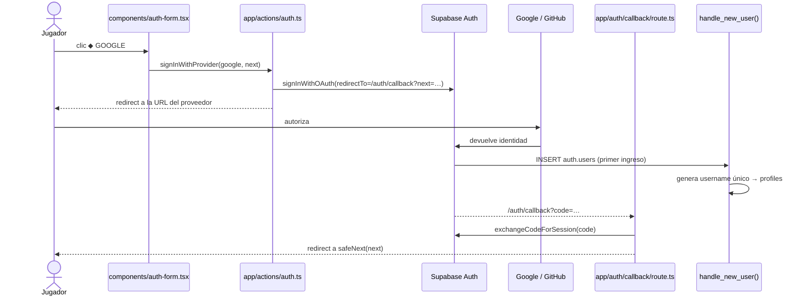
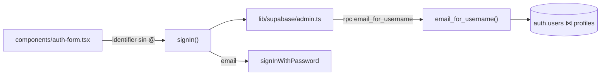

# SPEC 15 — Autenticación con Google, GitHub y usuario/contraseña

> **Estado:** Aprobado
> **Depende de:** 04-supabase-auth-scores (cliente de Supabase, `profiles`, trigger `handle_new_user`, Server Actions de auth)
> **Fecha:** 2026-10-24
> **Versión:** 0.5.2 → 0.6.0 (minor: funcionalidad nueva visible para el usuario)
> **Objetivo:** Que un jugador pueda crear su cuenta y entrar a Arcade Vault con Google, con GitHub o con usuario/email y contraseña, y recuperarla si olvida la contraseña.

## Alcance

**Incluye:**

- **Google OAuth y GitHub OAuth** con `supabase.auth.signInWithOAuth`. Los botones ◆ GOOGLE y ▣ GITHUB de `/auth` pasan a funcionar.
- **`app/auth/callback/route.ts`** (Route Handler nuevo). Recibe el `code` y llama a `exchangeCodeForSession`. Después redirige a `next`, o a `/`. Lo usan OAuth, la confirmación de email y la recuperación de contraseña.
- **Usuario automático para OAuth:**
  - `handle_new_user()` deja de fallar cuando no llega `username`.
  - Lo genera a partir del `user_name` de GitHub o de la parte del email antes de la @. Lo limpia a `[a-z0-9_]` y lo ajusta a 3–16 caracteres.
  - Si ya existe, le agrega un sufijo numérico.
  - Migración `sql/005_oauth_usernames_y_login_por_usuario.sql`.
- **Ingreso con usuario o email + contraseña:**
  - Un solo campo "Usuario o correo".
  - Si el valor no contiene `@`, la Server Action busca el email con la función SQL `email_for_username(text)`. Esa función solo la puede ejecutar `service_role`.
  - La búsqueda se hace con un cliente admin en `lib/supabase/admin.ts`, que usa `SUPABASE_SECRET_KEY` y solo corre en el servidor.
- **Validación en el registro:**
  - Usuario `^[a-z0-9_]{3,16}$` que no esté tomado. Se verifica antes de llamar a `signUp`.
  - Contraseña de al menos 8 caracteres.
  - Email con formato válido.
- **Errores en español:** los mensajes de Supabase se traducen en `lib/auth-errors.ts`. Si falla el login, siempre se muestra el mismo mensaje genérico, "Usuario o contraseña incorrectos", para no revelar qué usuarios existen.
- **Confirmación de email, con o sin "Confirm email" activado:** si `signUp` no devuelve sesión, la tarjeta muestra "REVISA TU CORREO". El enlace del correo termina en `/auth/callback`.
- **Olvidé mi contraseña:**
  - Un enlace en `/auth` abre un formulario de email, que llama a `resetPasswordForEmail`.
  - El enlace del correo pasa por `/auth/callback` y lleva a **`app/auth/restablecer/page.tsx`** (página nueva), donde se elige la contraseña nueva con `updateUser`.
- **Redirecciones:**
  - `/auth` redirige a `/` si ya hay sesión.
  - Todos los ingresos vuelven a `?next=`, pero solo si es una ruta interna que empieza con `/`.
  - El "Iniciar Sesión" del Nav pasa la página actual como `next`.
  - JUGAR COMO INVITADO lleva a `/games`.
- **Separación de `/auth`:** `app/auth/page.tsx` pasa a ser Server Component (revisa la sesión y lee `next`). El formulario se muda a `components/auth-form.tsx`, que es Client Component.
- **Versión real en la tarjeta:** `ACCESO AL SISTEMA · v2.6` pasa a mostrar la versión de `package.json`.
- **Guía de configuración en el spec:** pasos para crear el OAuth Client en Google Cloud y la OAuth App en GitHub, cargarlos en Supabase → Authentication → Providers, y registrar las Redirect URLs de `localhost:3000`. También cómo copiar `SUPABASE_SECRET_KEY`. Esa parte la hace el usuario.
- Bump a `0.6.0` en `package.json` y entrada nueva en `CHANGELOG.md`.

**Fuera de alcance (para specs futuros):**

- **URLs de producción.** Por ahora solo `http://localhost:3000`. Agregar un dominio real es solo configuración y va en su propio spec.
- **Pantalla para cambiar el usuario.** El usuario que se genera en OAuth queda así por ahora.
- **Otros proveedores** (Discord, Apple, etc.) y magic link.
- **UI para vincular o desvincular proveedores** en una cuenta. Se usa el comportamiento por defecto de Supabase: si el email coincide y está verificado, es la misma cuenta.
- **Proteger rutas por sesión.** Los invitados siguen pudiendo jugar sin cuenta.
- **Página de perfil, borrar cuenta y plantillas de email personalizadas.** Se usan las plantillas por defecto de Supabase.
- **Captcha o límites de intentos propios.** Se usan los límites de Supabase.

## Modelo de datos

**Migración `sql/005_oauth_usernames_y_login_por_usuario.sql`.** Se aplica con el MCP de Supabase (`apply_migration`), como el spec 04. La tabla `profiles` no cambia.

```sql
-- 1) handle_new_user(): username propio (email/contraseña) o generado (OAuth)
CREATE OR REPLACE FUNCTION public.handle_new_user()
RETURNS TRIGGER LANGUAGE plpgsql SECURITY DEFINER SET search_path = public AS $$
DECLARE
  base text;
  candidate text;
  n int := 0;
BEGIN
  base := coalesce(
    new.raw_user_meta_data->>'username',    -- registro con email/contraseña
    new.raw_user_meta_data->>'user_name',   -- GitHub
    split_part(new.email, '@', 1)           -- Google
  );
  base := left(regexp_replace(lower(base), '[^a-z0-9_]', '', 'g'), 12);
  IF length(base) < 3 THEN base := 'jugador'; END IF;
  candidate := base;
  WHILE EXISTS (SELECT 1 FROM profiles WHERE username = candidate) LOOP
    n := n + 1;
    candidate := base || n;                 -- px_kai → px_kai1, px_kai2…
  END LOOP;
  INSERT INTO profiles (id, username) VALUES (new.id, candidate);
  RETURN new;
END; $$;

-- 2) usuario → email, solo para service_role (cliente admin del servidor)
CREATE FUNCTION public.email_for_username(p_username text)
RETURNS text LANGUAGE sql SECURITY DEFINER SET search_path = public, auth AS $$
  SELECT u.email FROM auth.users u
  JOIN profiles p ON p.id = u.id
  WHERE p.username = lower(p_username);
$$;
REVOKE EXECUTE ON FUNCTION public.email_for_username(text) FROM public, anon, authenticated;
GRANT  EXECUTE ON FUNCTION public.email_for_username(text) TO service_role;
```

**Variable de entorno nueva** en `.env.local`. Solo la usa el servidor y nunca lleva el prefijo `NEXT_PUBLIC_`.

```bash
SUPABASE_SECRET_KEY=sb_secret_...   # Supabase → Project Settings → API Keys
```

**Contratos en TypeScript:**

```ts
// app/actions/auth.ts
export type AuthFormState =
  { error: string } | { notice: "check-email" | "reset-sent" } | undefined;

signIn(prev, formData); // campos: identifier, password, next
signUp(prev, formData); // campos: username, email, password, next
signInWithProvider(formData); // campos: provider ("google" | "github"), next
requestPasswordReset(prev, formData); // campo: email
updatePassword(prev, formData); // campos: password, confirm
signOut(); // sin cambios

// lib/supabase/admin.ts: cliente con SUPABASE_SECRET_KEY, sin cookies, solo en el servidor
export function createAdminClient(): SupabaseClient;

// lib/auth-errors.ts
export function translateAuthError(message: string): string; // inglés de Supabase → español
export function safeNext(next: string | null): string; // solo rutas internas "/…"; si no, "/"
```

**Rutas y parámetros:**

- `/auth?next=/juegos/caida`: el ingreso vuelve a `next`.
- `/auth/callback?code=…&next=…`: el Route Handler intercambia el `code` por una sesión.
- `/auth/restablecer`: solo funciona con sesión, la que deja el enlace de recuperación.





Convenciones:

- El usuario siempre se guarda en minúsculas.
- La base generada se corta a 12 caracteres para dejar lugar al sufijo y no pasar de 16.
- Las cuentas de email/contraseña ya validan el `username` en la Server Action antes de llegar al trigger. El trigger solo lo limpia por si acaso.
- La tarjeta muestra la versión importando `version` desde `@/package.json`, igual que ya hace `components/nav.tsx`.

## Plan de implementación

Cada paso deja la app funcionando y se puede commitear por separado. Los pasos 5 y 6 empiezan con una **pausa**: el usuario hace la configuración del Anexo antes de que se escriba código.

1. ✅ **Migración del trigger y búsqueda por usuario.**
   - Crear `sql/005_oauth_usernames_y_login_por_usuario.sql` y aplicarlo con `apply_migration`.
   - _Prueba:_ registrar una cuenta con email y contraseña sigue creando `profiles` con su `username`. Un `INSERT` de prueba en `auth.users` con solo `email` genera un usuario válido, que después se borra. `email_for_username` responde con `service_role` y da error de permiso con `anon`.
2. **Errores en español y validación del registro.**
   - Crear `lib/auth-errors.ts` con `translateAuthError` y `safeNext`.
   - Usar `translateAuthError` en `signIn` y `signUp`.
   - En `signUp`, validar usuario `^[a-z0-9_]{3,16}$`, contraseña de al menos 8 caracteres y formato de email. Verificar que el usuario no exista consultando `profiles`.
   - _Prueba:_ contraseña corta, usuario con mayúsculas o espacios, y usuario repetido muestran errores en español. Un login fallido muestra "Usuario o contraseña incorrectos".
3. **Callback y confirmación de email.**
   - _Pausa:_ el usuario registra la Redirect URL en Supabase (Anexo, B).
   - Crear `app/auth/callback/route.ts` con `exchangeCodeForSession` y redirect a `safeNext(next)`.
   - Pasar `emailRedirectTo` a `signUp`. Si no devuelve sesión, `signUp` responde `{ notice: "check-email" }` y la tarjeta muestra "REVISA TU CORREO".
   - _Prueba:_ registrarse funciona con "Confirm email" activado y desactivado. Un `code` inválido en `/auth/callback` lleva a `/auth` con un error.
4. **Separar `/auth` y agregar redirecciones.**
   - `app/auth/page.tsx` pasa a ser Server Component: si hay sesión, redirige a `/`, y le pasa `next` al formulario.
   - El formulario se muda a `components/auth-form.tsx`, sin cambios visuales.
   - JUGAR COMO INVITADO lleva a `/games`, y `v2.6` se reemplaza por la `version` de `@/package.json`.
   - `components/nav.tsx` arma `/auth?next=<ruta actual>` en desktop y móvil.
   - _Prueba:_ con sesión, `/auth` lleva a `/`. Entrando desde `/juegos/caida` se vuelve a `/juegos/caida`. `?next=https://evil.com` y `?next=//evil.com` terminan en `/`.
5. **Ingreso con usuario o email.**
   - _Pausa:_ el usuario agrega `SUPABASE_SECRET_KEY` a `.env.local` (Anexo, A).
   - Crear `lib/supabase/admin.ts`.
   - `signIn` recibe `identifier`: si no tiene `@`, consulta `rpc("email_for_username")` y después llama a `signInWithPassword`.
   - El campo pasa a llamarse "Usuario o correo".
   - _Prueba:_ se entra con el usuario y con el email. Un usuario inexistente muestra el mismo error genérico que una contraseña incorrecta.
6. **Google y GitHub.**
   - _Pausa:_ el usuario configura los dos proveedores (Anexo, C y D).
   - Agregar `signInWithProvider` con `redirectTo` a `/auth/callback?next=…`.
   - Conectar los botones ◆ GOOGLE y ▣ GITHUB, que muestran "CONECTANDO…" mientras esperan.
   - _Prueba:_ el primer ingreso con cada proveedor crea `profiles` con un usuario generado, y el Nav lo muestra. El segundo ingreso no crea un perfil nuevo.
7. **Olvidé mi contraseña.**
   - Agregar el enlace "¿Olvidaste tu contraseña?" en `/auth`, que abre el formulario de email.
   - Agregar `requestPasswordReset`, que llama a `resetPasswordForEmail` con `redirectTo` a `/auth/callback?next=/auth/restablecer`. Siempre responde `{ notice: "reset-sent" }`, para no revelar si el email existe.
   - Crear `app/auth/restablecer/page.tsx`, que pide contraseña y confirmación y llama a `updatePassword`. Sin sesión, redirige a `/auth`.
   - _Prueba:_ llega el correo, el enlace abre `/auth/restablecer`, se cambia la contraseña y se puede entrar con la nueva.
8. **Versión y documentación.**
   - Bump a `0.6.0` en `package.json`.
   - Entrada `[0.6.0]` en `CHANGELOG.md` con enlace a este spec.

## Criterios de aceptación

### Registro e ingreso con contraseña

- [ ] Crear una cuenta con usuario, email y contraseña válidos crea una fila en `profiles` con ese usuario en minúsculas.
- [ ] Un usuario fuera de `^[a-z0-9_]{3,16}$` muestra un error en español y no llama a Supabase.
- [ ] Un usuario ya tomado muestra "Ese usuario ya está en uso" y no crea la cuenta.
- [ ] Una contraseña de menos de 8 caracteres muestra un error en español.
- [ ] Si "Confirm email" está activado, registrarse muestra "REVISA TU CORREO", y el enlace del correo deja la sesión iniciada.
- [ ] Se puede entrar escribiendo el usuario o el email en el mismo campo.
- [ ] Un usuario inexistente y una contraseña incorrecta muestran el mismo mensaje: "Usuario o contraseña incorrectos".
- [ ] Ningún mensaje de error de `/auth` aparece en inglés.

### Google y GitHub

- [ ] ◆ GOOGLE lleva a la pantalla de Google y, al autorizar, vuelve con la sesión iniciada.
- [ ] ▣ GITHUB lleva a la pantalla de GitHub y, al autorizar, vuelve con la sesión iniciada.
- [ ] El primer ingreso con OAuth crea `profiles` con un usuario válido (`^[a-z0-9_]{3,16}$`), sin el error "Database error saving new user".
- [ ] Si el usuario generado ya existe, se le agrega un sufijo numérico (`px_kai` → `px_kai1`).
- [ ] Un segundo ingreso con el mismo proveedor no crea otra fila en `profiles`.

### Recuperar contraseña

- [ ] "¿Olvidaste tu contraseña?" envía el correo y muestra el mismo aviso exista o no el email.
- [ ] El enlace del correo abre `/auth/restablecer`, y después de guardar se puede entrar con la contraseña nueva.
- [ ] Entrar a `/auth/restablecer` sin sesión redirige a `/auth`.

### Redirecciones y pantalla

- [ ] Con sesión iniciada, visitar `/auth` redirige a `/`.
- [ ] Hacer clic en "Iniciar Sesión" desde `/juegos/caida` y entrar (con contraseña, Google o GitHub) vuelve a `/juegos/caida`.
- [ ] `?next=https://evil.com` y `?next=//evil.com` terminan en `/`.
- [ ] JUGAR COMO INVITADO lleva a `/games`.
- [ ] La tarjeta muestra `ACCESO AL SISTEMA · v0.6.0`, la misma versión que `package.json`.

### Seguridad y proyecto

- [ ] Con la clave pública (`anon`), `rpc("email_for_username")` responde un error de permiso.
- [ ] `SUPABASE_SECRET_KEY` no aparece en el bundle del navegador (`grep` sobre `.next/static` sin resultados).
- [ ] `package.json` está en `0.6.0` y `CHANGELOG.md` tiene la entrada `[0.6.0]` con enlace a este spec.
- [ ] `npx tsc --noEmit`, `npm run lint` y `npm run build` pasan sin errores.

## Decisiones

- **Sí:** Google y GitHub en este spec, con el `signInWithOAuth` de Supabase. Son los que pidió el usuario y los dos botones ya existían en la pantalla.
- **No:** otros proveedores ni magic link. Cada uno suma configuración y no se pidieron.
- **Sí:** usuario generado automáticamente en el primer ingreso con OAuth. El login es de un solo paso.
- **No:** pantalla obligatoria de "elige tu usuario". Agrega un estado intermedio (sesión sin perfil) que todas las páginas tendrían que manejar.
- **Sí:** generar el usuario dentro de `handle_new_user()`. Es el único lugar que corre en todos los registros, por cualquier método.
- **Sí:** misma cuenta cuando el email coincide y está verificado. Es el comportamiento por defecto de Supabase y no requiere código.
- **Sí:** ingreso con usuario o email en un solo campo. Los jugadores recuerdan su usuario, que es lo que ven en el ranking.
- **Sí:** buscar el email con `SUPABASE_SECRET_KEY` y una función que solo ejecuta `service_role`.
- **No:** función ejecutable por `anon`. Cualquiera podría obtener el email de cualquier jugador desde la API pública.
- **Sí:** el mismo error genérico para usuario inexistente y contraseña incorrecta, y el mismo aviso en la recuperación exista o no el email. Así no se puede averiguar qué cuentas existen.
- **Sí:** una sola ruta `/auth/callback` para OAuth, confirmación de email y recuperación. Las tres usan el mismo intercambio de `code` por sesión.
- **Sí:** soportar "Confirm email" activado y desactivado. La configuración del proyecto no se puede leer con las herramientas disponibles y puede cambiar.
- **Sí:** `safeNext` acepta solo rutas que empiezan con `/` y no con `//`. Evita usar el login para redirigir a sitios externos.
- **Sí:** separar `/auth` en Server Component y `components/auth-form.tsx`. La redirección con sesión se hace en el servidor, sin mostrar el formulario un instante.
- **Sí:** solo `http://localhost:3000` por ahora. Producción es solo configuración y va en otro spec.
- **Sí:** mostrar la versión real en la tarjeta. `v2.6` estaba escrito a mano y no coincidía con `package.json`.
- **Sí:** bump minor `0.5.2 → 0.6.0`. Es funcionalidad nueva visible, igual que en los specs anteriores.

## Riesgos

| Riesgo                                                                | Mitigación                                                                                                                    |
| --------------------------------------------------------------------- | ----------------------------------------------------------------------------------------------------------------------------- |
| Los proveedores no están configurados cuando se llega al paso 6.      | El paso 6 empieza con una pausa. Si `signInWithOAuth` falla, la tarjeta muestra "Proveedor no disponible" en lugar de romper. |
| La Redirect URL no coincide entre Google o GitHub, Supabase y la app. | El Anexo lista las URLs exactas. Los pasos 3 y 6 incluyen una prueba manual de ida y vuelta.                                  |
| `SUPABASE_SECRET_KEY` termina en el navegador.                        | Solo se lee en `lib/supabase/admin.ts`, que importan únicamente las Server Actions. Un criterio lo revisa en `.next/static`.  |
| Dos registros OAuth simultáneos generan el mismo usuario.             | `profiles.username` es `UNIQUE`: el segundo falla y el jugador vuelve a intentar. Es muy improbable con pocos usuarios.       |
| Cambiar `handle_new_user()` rompe el registro con contraseña.         | El paso 1 prueba primero que el registro con email y contraseña sigue funcionando.                                            |
| El enlace de recuperación expira o ya se usó.                         | `/auth/callback` redirige a `/auth` con el error "El enlace expiró. Pide uno nuevo."                                          |

## Anexo — Guía de configuración

Esto lo hace el usuario, fuera del código. `<ref>` es el identificador del proyecto de Supabase, que aparece en `NEXT_PUBLIC_SUPABASE_URL` (`https://<ref>.supabase.co`).

### A. Secret key (antes del paso 5)

1. Supabase → Project Settings → API Keys → **Secret keys** → copiar la clave `sb_secret_…`.
2. Agregar a `.env.local`: `SUPABASE_SECRET_KEY=sb_secret_…`. Nunca con el prefijo `NEXT_PUBLIC_`.
3. Reiniciar `npm run dev`.

### B. Redirect URLs de Supabase (antes del paso 3)

1. Supabase → Authentication → URL Configuration.
2. **Site URL:** `http://localhost:3000`.
3. **Redirect URLs:** agregar `http://localhost:3000/auth/callback`.

### C. Google (antes del paso 6)

1. [Google Cloud Console](https://console.cloud.google.com/) → crear o elegir un proyecto.
2. APIs & Services → OAuth consent screen → tipo **External**, nombre "Arcade Vault", tu email de soporte.
3. APIs & Services → Credentials → Create credentials → **OAuth client ID** → tipo **Web application**.
4. **Authorized JavaScript origins:** `http://localhost:3000`.
5. **Authorized redirect URIs:** `https://<ref>.supabase.co/auth/v1/callback`.
6. Copiar el Client ID y el Client secret.
7. Supabase → Authentication → Providers → **Google** → activar y pegar las dos credenciales.

### D. GitHub (antes del paso 6)

1. GitHub → Settings → Developer settings → OAuth Apps → **New OAuth App**.
2. **Homepage URL:** `http://localhost:3000`.
3. **Authorization callback URL:** `https://<ref>.supabase.co/auth/v1/callback`.
4. Crear la app, generar un **Client secret** y copiar el Client ID y el secret.
5. Supabase → Authentication → Providers → **GitHub** → activar y pegar las dos credenciales.

## Lo que **no** entra en este spec

- URLs de producción.
- Pantalla para cambiar el usuario.
- Otros proveedores OAuth y magic link.
- UI para vincular o desvincular proveedores.
- Proteger rutas por sesión.
- Página de perfil, borrar cuenta y plantillas de email personalizadas.
- Captcha o límites de intentos propios.

Si alguno de estos llega a hacerse, va en su propio spec.

## Bitácora de soluciones

### Paso 1 — Migración (2026-10-24)

- Migración `oauth_usernames_y_login_por_usuario` aplicada con `apply_migration`. Copia versionada en `sql/005_oauth_usernames_y_login_por_usuario.sql`.
- **Desvío del snippet del modelo de datos:** se agregó `''` como último valor del `coalesce`. Sin email (GitHub con email privado) y sin `user_name`, `base` quedaba `NULL`. `length(NULL) < 3` no es verdadero, así que se insertaba `NULL` en `username`, que es el mismo error que este spec corrige.
- Se repitió el `REVOKE EXECUTE` de `handle_new_user()`, porque `CREATE OR REPLACE` no lo garantiza si la función se recrea en otro entorno.
- **Prueba (bloque `DO` que termina en `RAISE EXCEPTION`, así todo se revierte):**
  - `px.kai@gmail.com` → `pxkai`. `px-kai@otro.com` → `pxkai1` (sufijo).
  - GitHub `user_name: "Octo-Cat"` → `octocat`.
  - Sin email ni `user_name` → `jugador`. `ab@x.com`, que es demasiado corto → `jugador1`.
  - Registro con contraseña `username: "prueba_pwd"` → `prueba_pwd`, sin cambios.
  - Email largo → recortado a 12 caracteres (`unnombremuyl`).
  - `email_for_username('PRUEBA_PWD')` → `pwd@x.com`, sin importar mayúsculas.
- **Permisos:** `email_for_username` es ejecutable solo por `service_role`, no por `anon` ni `authenticated`. Después de la prueba quedan 0 usuarios de prueba y los mismos 3 perfiles.

### Lecciones aprendidas

- Para probar triggers de `auth.users` en la base real sin dejar basura, sirve un bloque `DO` que inserta, junta el resultado en un texto y termina con `RAISE EXCEPTION`: el mensaje de error trae el resultado y la transacción se revierte entera.
