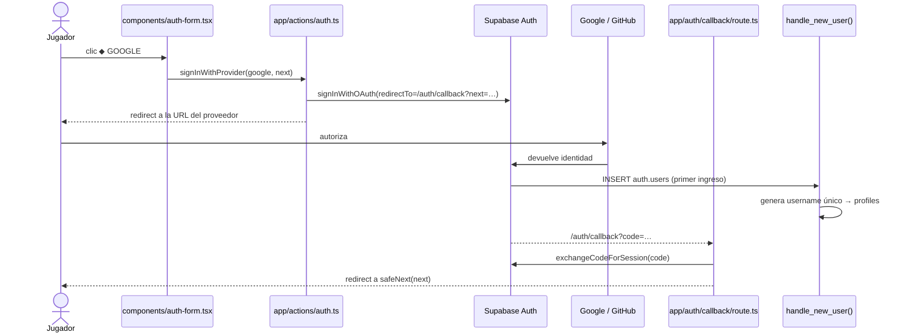
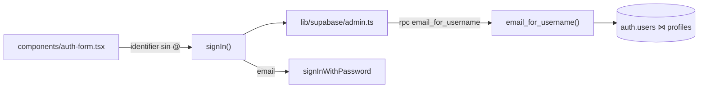

# SPEC 15 — Autenticación con Google, GitHub y usuario/contraseña

> **Estado:** Implementado
> **Depende de:** 04-supabase-auth-scores (cliente de Supabase, `profiles`, trigger `handle_new_user`, Server Actions de auth)
> **Fecha:** 2026-10-24
> **Versión:** 0.5.3 → 0.6.0 (minor: funcionalidad nueva visible para el usuario. El spec se escribió sobre 0.5.2; `master` pasó a 0.5.3 con el PR #24 antes del merge)
> **Objetivo:** Que un jugador pueda crear su cuenta y entrar a Arcade Vault con Google, con GitHub o con usuario/email y contraseña, y recuperarla si olvida la contraseña.

## Alcance

**Incluye:**

- **Google OAuth y GitHub OAuth** con `supabase.auth.signInWithOAuth`. Los botones ◆ GOOGLE y ▣ GITHUB de `/auth` pasan a funcionar.
- **`app/auth/callback/route.ts`** (Route Handler nuevo). Recibe el `code` y llama a `exchangeCodeForSession`. Después redirige a `next`, o a `/`. Lo usan OAuth, la confirmación de email y la recuperación de contraseña.
- **Usuario automático para OAuth:**
  - `handle_new_user()` deja de fallar cuando no llega `username`.
  - Lo genera a partir del `user_name` de GitHub o de la parte del email antes de la @. Lo limpia a `[a-z0-9_]` y lo ajusta a 3–16 caracteres.
  - Si ya existe, le agrega un sufijo numérico.
  - Migración `sql/005_oauth_usernames_y_login_por_usuario.sql`.
- **Ingreso con usuario o email + contraseña:**
  - Un solo campo "Usuario o correo".
  - Si el valor no contiene `@`, la Server Action busca el email con la función SQL `email_for_username(text)`. Esa función solo la puede ejecutar `service_role`.
  - La búsqueda se hace con un cliente admin en `lib/supabase/admin.ts`, que usa `SUPABASE_SECRET_KEY` y solo corre en el servidor.
- **Validación en el registro:**
  - Usuario `^[a-z0-9_]{3,16}$` que no esté tomado. Se verifica antes de llamar a `signUp`.
  - Contraseña de al menos 8 caracteres.
  - Email con formato válido.
- **Errores en español:** los mensajes de Supabase se traducen en `lib/auth-errors.ts`. Si falla el login, siempre se muestra el mismo mensaje genérico, "Usuario o contraseña incorrectos", para no revelar qué usuarios existen.
- **Confirmación de email, con o sin "Confirm email" activado:** si `signUp` no devuelve sesión, la tarjeta muestra "REVISA TU CORREO". El enlace del correo termina en `/auth/callback`.
- **Olvidé mi contraseña:**
  - Un enlace en `/auth` abre un formulario de email, que llama a `resetPasswordForEmail`.
  - El enlace del correo pasa por `/auth/callback` y lleva a **`app/auth/restablecer/page.tsx`** (página nueva), donde se elige la contraseña nueva con `updateUser`.
- **Redirecciones:**
  - `/auth` redirige a `/` si ya hay sesión.
  - Todos los ingresos vuelven a `?next=`, pero solo si es una ruta interna que empieza con `/`.
  - El "Iniciar Sesión" del Nav pasa la página actual como `next`.
  - JUGAR COMO INVITADO lleva a `/games`.
- **Separación de `/auth`:** `app/auth/page.tsx` pasa a ser Server Component (revisa la sesión y lee `next`). El formulario se muda a `components/auth-form.tsx`, que es Client Component.
- **Método de ingreso en el Nav** _(agregado durante la implementación, 2026-10-24, a pedido del usuario)_: junto al usuario, el Nav muestra un ícono del método con el que se entró (◆ Google, ▣ GitHub o ✉ email/contraseña), con el texto "Entraste con … · <cuenta>" como `title` (email de Google, `@usuario` de GitHub o el correo). Es el método de **esta** sesión. Se ve en desktop y en móvil.
- **Versión real en la tarjeta:** `ACCESO AL SISTEMA · v2.6` pasa a mostrar la versión de `package.json`.
- **Guía de configuración en el spec:** pasos para crear el OAuth Client en Google Cloud y la OAuth App en GitHub, cargarlos en Supabase → Authentication → Providers, y registrar las Redirect URLs de `localhost:3000`. También cómo copiar `SUPABASE_SECRET_KEY`. Esa parte la hace el usuario.
- Bump a `0.6.0` en `package.json` y entrada nueva en `CHANGELOG.md`.

**Fuera de alcance (para specs futuros):**

- **URLs de producción.** Por ahora solo `http://localhost:3000`. Agregar un dominio real es solo configuración y va en su propio spec.
- **Pantalla para cambiar el usuario.** El usuario que se genera en OAuth queda así por ahora.
- **Otros proveedores** (Discord, Apple, etc.) y magic link.
- **UI para vincular o desvincular proveedores** en una cuenta. Se usa el comportamiento por defecto de Supabase: si el email coincide y está verificado, es la misma cuenta.
- **Proteger rutas por sesión.** Los invitados siguen pudiendo jugar sin cuenta.
- **Página de perfil, borrar cuenta y plantillas de email personalizadas.** Se usan las plantillas por defecto de Supabase.
- **Captcha o límites de intentos propios.** Se usan los límites de Supabase.

## Modelo de datos

**Migración `sql/005_oauth_usernames_y_login_por_usuario.sql`.** Se aplica con el MCP de Supabase (`apply_migration`), como el spec 04. La tabla `profiles` no cambia.

```sql
-- 1) handle_new_user(): username propio (email/contraseña) o generado (OAuth)
CREATE OR REPLACE FUNCTION public.handle_new_user()
RETURNS TRIGGER LANGUAGE plpgsql SECURITY DEFINER SET search_path = public AS $$
DECLARE
  base text;
  candidate text;
  n int := 0;
BEGIN
  -- Registro con email/contraseña: username válido y libre → tal cual, sin recortar
  candidate := lower(new.raw_user_meta_data->>'username');
  IF candidate ~ '^[a-z0-9_]{3,16}$'
     AND NOT EXISTS (SELECT 1 FROM profiles WHERE username = candidate) THEN
    INSERT INTO profiles (id, username) VALUES (new.id, candidate);
    RETURN new;
  END IF;
  -- OAuth (o username inválido/tomado): se genera
  base := coalesce(
    new.raw_user_meta_data->>'username',    -- registro con email/contraseña
    new.raw_user_meta_data->>'user_name',   -- GitHub
    split_part(new.email, '@', 1)           -- Google
  );
  base := left(regexp_replace(lower(base), '[^a-z0-9_]', '', 'g'), 12);
  IF length(base) < 3 THEN base := 'jugador'; END IF;
  candidate := base;
  WHILE EXISTS (SELECT 1 FROM profiles WHERE username = candidate) LOOP
    n := n + 1;
    candidate := base || n;                 -- px_kai → px_kai1, px_kai2…
  END LOOP;
  INSERT INTO profiles (id, username) VALUES (new.id, candidate);
  RETURN new;
END; $$;

-- 2) usuario → email, solo para service_role (cliente admin del servidor)
CREATE FUNCTION public.email_for_username(p_username text)
RETURNS text LANGUAGE sql SECURITY DEFINER SET search_path = public, auth AS $$
  SELECT u.email FROM auth.users u
  JOIN profiles p ON p.id = u.id
  WHERE p.username = lower(p_username);
$$;
REVOKE EXECUTE ON FUNCTION public.email_for_username(text) FROM public, anon, authenticated;
GRANT  EXECUTE ON FUNCTION public.email_for_username(text) TO service_role;
```

**Variable de entorno nueva** en `.env.local`. Solo la usa el servidor y nunca lleva el prefijo `NEXT_PUBLIC_`.

```bash
SUPABASE_SECRET_KEY=sb_secret_...   # Supabase → Project Settings → API Keys
```

**Contratos en TypeScript:**

```ts
// app/actions/auth.ts
export type AuthFormState =
  { error: string } | { notice: "check-email" | "reset-sent" } | undefined;

signIn(prev, formData); // campos: identifier, password, next
signUp(prev, formData); // campos: username, email, password, next
signInWithProvider(formData); // campos: provider ("google" | "github"), next
requestPasswordReset(prev, formData); // campo: email
updatePassword(prev, formData); // campos: password, confirm
signOut(); // sin cambios

// lib/supabase/admin.ts: cliente con SUPABASE_SECRET_KEY, sin cookies, solo en el servidor
export function createAdminClient(): SupabaseClient;

// lib/auth-errors.ts
export function translateAuthError(message: string): string; // inglés de Supabase → español
export function safeNext(next: string | null): string; // solo rutas internas "/…"; si no, "/"
```

**Rutas y parámetros:**

- `/auth?next=/juegos/caida`: el ingreso vuelve a `next`.
- `/auth/callback?code=…&next=…`: el Route Handler intercambia el `code` por una sesión.
- `/auth/restablecer`: solo funciona con sesión, la que deja el enlace de recuperación.





Convenciones:

- El usuario siempre se guarda en minúsculas.
- Solo el usuario **generado** se corta a 12 caracteres, para dejar lugar al sufijo y no pasar de 16. El que elige el jugador al registrarse con contraseña se guarda completo (3–16).
- Las cuentas de email/contraseña ya validan el `username` en la Server Action antes de llegar al trigger. El trigger solo lo limpia por si acaso.
- La tarjeta muestra la versión importando `version` desde `@/package.json`, igual que ya hace `components/nav.tsx`.

## Plan de implementación

Cada paso deja la app funcionando y se puede commitear por separado. Los pasos 5 y 6 empiezan con una **pausa**: el usuario hace la configuración del Anexo antes de que se escriba código.

1. ✅ **Migración del trigger y búsqueda por usuario.**
   - Crear `sql/005_oauth_usernames_y_login_por_usuario.sql` y aplicarlo con `apply_migration`.
   - _Prueba:_ registrar una cuenta con email y contraseña sigue creando `profiles` con su `username`. Un `INSERT` de prueba en `auth.users` con solo `email` genera un usuario válido, que después se borra. `email_for_username` responde con `service_role` y da error de permiso con `anon`.
2. ✅ **Errores en español y validación del registro.**
   - Crear `lib/auth-errors.ts` con `translateAuthError` y `safeNext`.
   - Usar `translateAuthError` en `signIn` y `signUp`.
   - En `signUp`, validar usuario `^[a-z0-9_]{3,16}$`, contraseña de al menos 8 caracteres y formato de email. Verificar que el usuario no exista consultando `profiles`.
   - _Prueba:_ contraseña corta, usuario con mayúsculas o espacios, y usuario repetido muestran errores en español. Un login fallido muestra "Usuario o contraseña incorrectos".
3. ✅ **Callback y confirmación de email.**
   - _Pausa:_ el usuario registra la Redirect URL en Supabase (Anexo, B).
   - Crear `app/auth/callback/route.ts` con `exchangeCodeForSession` y redirect a `safeNext(next)`.
   - Pasar `emailRedirectTo` a `signUp`. Si no devuelve sesión, `signUp` responde `{ notice: "check-email" }` y la tarjeta muestra "REVISA TU CORREO".
   - _Prueba:_ registrarse funciona con "Confirm email" activado y desactivado. Un `code` inválido en `/auth/callback` lleva a `/auth` con un error.
4. ✅ **Separar `/auth` y agregar redirecciones.**
   - `app/auth/page.tsx` pasa a ser Server Component: si hay sesión, redirige a `/`, y le pasa `next` al formulario.
   - El formulario se muda a `components/auth-form.tsx`, sin cambios visuales.
   - JUGAR COMO INVITADO lleva a `/games`, y `v2.6` se reemplaza por la `version` de `@/package.json`.
   - `components/nav.tsx` arma `/auth?next=<ruta actual>` en desktop y móvil.
   - _Prueba:_ con sesión, `/auth` lleva a `/`. Entrando desde `/juegos/caida` se vuelve a `/juegos/caida`. `?next=https://evil.com` y `?next=//evil.com` terminan en `/`.
5. ✅ **Ingreso con usuario o email.**
   - _Pausa:_ el usuario agrega `SUPABASE_SECRET_KEY` a `.env.local` (Anexo, A).
   - Crear `lib/supabase/admin.ts`.
   - `signIn` recibe `identifier`: si no tiene `@`, consulta `rpc("email_for_username")` y después llama a `signInWithPassword`.
   - El campo pasa a llamarse "Usuario o correo".
   - _Prueba:_ se entra con el usuario y con el email. Un usuario inexistente muestra el mismo error genérico que una contraseña incorrecta.
6. ✅ **Google y GitHub.**
   - _Pausa:_ el usuario configura los dos proveedores (Anexo, C y D).
   - Agregar `signInWithProvider` con `redirectTo` a `/auth/callback?next=…`.
   - Conectar los botones ◆ GOOGLE y ▣ GITHUB, que muestran "CONECTANDO…" mientras esperan.
   - _Prueba:_ el primer ingreso con cada proveedor crea `profiles` con un usuario generado, y el Nav lo muestra. El segundo ingreso no crea un perfil nuevo.
   - ✅ **6b. Método de ingreso en el Nav** _(agregado durante la implementación)_:
     - `lib/session.ts` suma `getSessionUser(): Promise<{ username: string; login: { provider: "email" | "google" | "github"; account: string | null } } | null>`. El método sale del `amr` de la sesión (`getClaims()`): `password` → email; `oauth` → la identidad Google/GitHub con el `updated_at` más reciente. `account` es el email o el `@usuario` de esa identidad. `getSessionUsername()` se mantiene para `app/juegos/[id]/jugar/page.tsx`.
     - `app/layout.tsx` usa `getSessionUser()` y le pasa `provider` al `Nav`.
     - `components/nav.tsx` muestra el ícono antes del usuario, en desktop y en el menú móvil. El diseño se hace con `/frontend-design`, como pide `CLAUDE.md`.
     - _Prueba:_ entrar con contraseña muestra ✉, con Google muestra ◆ y con GitHub muestra ▣. El `title` dice "Entraste con … · <cuenta>".
7. ✅ **Olvidé mi contraseña.**
   - Agregar el enlace "¿Olvidaste tu contraseña?" en `/auth`, que abre el formulario de email.
   - Agregar `requestPasswordReset`, que llama a `resetPasswordForEmail` con `redirectTo` a `/auth/callback?next=/auth/restablecer`. Siempre responde `{ notice: "reset-sent" }`, para no revelar si el email existe.
   - Crear `app/auth/restablecer/page.tsx`, que pide contraseña y confirmación y llama a `updatePassword`. Sin sesión, redirige a `/auth`.
   - _Prueba:_ llega el correo, el enlace abre `/auth/restablecer`, se cambia la contraseña y se puede entrar con la nueva.
8. ✅ **Versión y documentación.**
   - Bump a `0.6.0` en `package.json`.
   - Entrada `[0.6.0]` en `CHANGELOG.md` con enlace a este spec.

## Criterios de aceptación

### Registro e ingreso con contraseña

- [ ] Crear una cuenta con usuario, email y contraseña válidos crea una fila en `profiles` con ese usuario en minúsculas.
- [ ] Un usuario fuera de `^[a-z0-9_]{3,16}$` muestra un error en español y no llama a Supabase.
- [ ] Un usuario ya tomado muestra "Ese usuario ya está en uso" y no crea la cuenta.
- [ ] Una contraseña de menos de 8 caracteres muestra un error en español.
- [ ] Si "Confirm email" está activado, registrarse muestra "REVISA TU CORREO", y el enlace del correo deja la sesión iniciada.
- [ ] Se puede entrar escribiendo el usuario o el email en el mismo campo.
- [ ] Un usuario inexistente y una contraseña incorrecta muestran el mismo mensaje: "Usuario o contraseña incorrectos".
- [ ] Ningún mensaje de error de `/auth` aparece en inglés.

### Google y GitHub

- [ ] ◆ GOOGLE lleva a la pantalla de Google y, al autorizar, vuelve con la sesión iniciada.
- [ ] ▣ GITHUB lleva a la pantalla de GitHub y, al autorizar, vuelve con la sesión iniciada.
- [ ] El primer ingreso con OAuth crea `profiles` con un usuario válido (`^[a-z0-9_]{3,16}$`), sin el error "Database error saving new user".
- [ ] Si el usuario generado ya existe, se le agrega un sufijo numérico (`px_kai` → `px_kai1`).
- [ ] Un segundo ingreso con el mismo proveedor no crea otra fila en `profiles`.

### Método de ingreso en el Nav

- [ ] Con sesión iniciada por contraseña, el Nav muestra ✉ junto al usuario, y su `title` es "Entraste con correo y contraseña · <correo>".
- [ ] Con sesión iniciada por Google, el Nav muestra ◆, y su `title` es "Entraste con Google · <email de Google>".
- [ ] Con sesión iniciada por GitHub, el Nav muestra ▣, y su `title` es "Entraste con GitHub · @<usuario de GitHub>".
- [ ] Una cuenta con varios métodos vinculados muestra el método con el que se inició **esta** sesión, no el último usado en otro dispositivo.
- [ ] El ícono se ve en el Nav de desktop y en el menú móvil.

### Recuperar contraseña

- [ ] "¿Olvidaste tu contraseña?" envía el correo y muestra el mismo aviso exista o no el email.
- [ ] El enlace del correo abre `/auth/restablecer`, y después de guardar se puede entrar con la contraseña nueva.
- [ ] Entrar a `/auth/restablecer` sin sesión redirige a `/auth`.

### Redirecciones y pantalla

- [ ] Con sesión iniciada, visitar `/auth` redirige a `/`.
- [ ] Hacer clic en "Iniciar Sesión" desde `/juegos/caida` y entrar (con contraseña, Google o GitHub) vuelve a `/juegos/caida`.
- [ ] `?next=https://evil.com` y `?next=//evil.com` terminan en `/`.
- [ ] JUGAR COMO INVITADO lleva a `/games`.
- [ ] La tarjeta muestra `ACCESO AL SISTEMA · v0.6.0`, la misma versión que `package.json`.

### Seguridad y proyecto

- [ ] Con la clave pública (`anon`), `rpc("email_for_username")` responde un error de permiso.
- [ ] `SUPABASE_SECRET_KEY` no aparece en el bundle del navegador (`grep` sobre `.next/static` sin resultados).
- [ ] `package.json` está en `0.6.0` y `CHANGELOG.md` tiene la entrada `[0.6.0]` con enlace a este spec.
- [ ] `npx tsc --noEmit`, `npm run lint` y `npm run build` pasan sin errores.

## Decisiones

- **Sí:** Google y GitHub en este spec, con el `signInWithOAuth` de Supabase. Son los que pidió el usuario y los dos botones ya existían en la pantalla.
- **No:** otros proveedores ni magic link. Cada uno suma configuración y no se pidieron.
- **Sí:** usuario generado automáticamente en el primer ingreso con OAuth. El login es de un solo paso.
- **No:** pantalla obligatoria de "elige tu usuario". Agrega un estado intermedio (sesión sin perfil) que todas las páginas tendrían que manejar.
- **Sí:** generar el usuario dentro de `handle_new_user()`. Es el único lugar que corre en todos los registros, por cualquier método.
- **Sí:** misma cuenta cuando el email coincide y está verificado. Es el comportamiento por defecto de Supabase y no requiere código.
- **Sí:** ingreso con usuario o email en un solo campo. Los jugadores recuerdan su usuario, que es lo que ven en el ranking.
- **Sí:** buscar el email con `SUPABASE_SECRET_KEY` y una función que solo ejecuta `service_role`.
- **No:** función ejecutable por `anon`. Cualquiera podría obtener el email de cualquier jugador desde la API pública.
- **Sí:** el mismo error genérico para usuario inexistente y contraseña incorrecta, y el mismo aviso en la recuperación exista o no el email. Así no se puede averiguar qué cuentas existen.
- **Sí:** una sola ruta `/auth/callback` para OAuth, confirmación de email y recuperación. Las tres usan el mismo intercambio de `code` por sesión.
- **Sí:** soportar "Confirm email" activado y desactivado. La configuración del proyecto no se puede leer con las herramientas disponibles y puede cambiar.
- **Sí:** `safeNext` acepta solo rutas que empiezan con `/` y no con `//`. Evita usar el login para redirigir a sitios externos.
- **Sí:** mostrar el método de ingreso en el Nav, agregado durante la implementación a pedido del usuario. Ahora que hay tres formas de entrar, sirve para saber con cuál se está.
- **Sí:** el método de **esta** sesión, leído del `amr` del JWT (`getClaims()`). Si es `oauth`, el proveedor sale de la identidad Google/GitHub con el `updated_at` más reciente. _(Corregido durante el paso 6b: ver la bitácora.)_
- **No:** la identidad con el `last_sign_in_at` más reciente. Supabase solo escribe ese campo al **vincular** la identidad, no en los ingresos siguientes, y además describe a la cuenta, no a la sesión. El usuario entró con Google y veía ▣.
- **No:** `app_metadata.provider`, porque guarda el método con el que se **creó** la cuenta.
- **Sí:** el tooltip incluye la cuenta del método (email de Google, `@usuario` de GitHub o el correo), a pedido del usuario. Solo lo ve el propio jugador en su Nav.
- **Sí:** reusar los símbolos ◆ y ▣ de los botones de `/auth`, y agregar ✉ para email. El Nav y la tarjeta usan el mismo lenguaje visual, sin logos de marca.
- **Sí:** separar `/auth` en Server Component y `components/auth-form.tsx`. La redirección con sesión se hace en el servidor, sin mostrar el formulario un instante.
- **Sí:** solo `http://localhost:3000` por ahora. Producción es solo configuración y va en otro spec.
- **Sí:** mostrar la versión real en la tarjeta. `v2.6` estaba escrito a mano y no coincidía con `package.json`.
- **Sí:** bump minor `0.5.2 → 0.6.0`. Es funcionalidad nueva visible, igual que en los specs anteriores.

## Riesgos

| Riesgo                                                                | Mitigación                                                                                                                    |
| --------------------------------------------------------------------- | ----------------------------------------------------------------------------------------------------------------------------- |
| Los proveedores no están configurados cuando se llega al paso 6.      | El paso 6 empieza con una pausa. Si `signInWithOAuth` falla, la tarjeta muestra "Proveedor no disponible" en lugar de romper. |
| La Redirect URL no coincide entre Google o GitHub, Supabase y la app. | El Anexo lista las URLs exactas. Los pasos 3 y 6 incluyen una prueba manual de ida y vuelta.                                  |
| `SUPABASE_SECRET_KEY` termina en el navegador.                        | Solo se lee en `lib/supabase/admin.ts`, que importan únicamente las Server Actions. Un criterio lo revisa en `.next/static`.  |
| Dos registros OAuth simultáneos generan el mismo usuario.             | `profiles.username` es `UNIQUE`: el segundo falla y el jugador vuelve a intentar. Es muy improbable con pocos usuarios.       |
| Cambiar `handle_new_user()` rompe el registro con contraseña.         | El paso 1 prueba primero que el registro con email y contraseña sigue funcionando.                                            |
| El enlace de recuperación expira o ya se usó.                         | `/auth/callback` redirige a `/auth` con el error "El enlace expiró. Pide uno nuevo."                                          |

## Anexo — Guía de configuración

Esto lo hace el usuario, fuera del código. `<ref>` es el identificador del proyecto de Supabase, que aparece en `NEXT_PUBLIC_SUPABASE_URL` (`https://<ref>.supabase.co`).

### A. Secret key (antes del paso 5)

1. Supabase → Project Settings → API Keys → **Secret keys** → copiar la clave `sb_secret_…`.
2. Agregar a `.env.local`: `SUPABASE_SECRET_KEY=sb_secret_…`. Nunca con el prefijo `NEXT_PUBLIC_`.
3. Reiniciar `npm run dev`.

### B. Redirect URLs de Supabase (antes del paso 3)

1. Supabase → Authentication → URL Configuration.
2. **Site URL:** `http://localhost:3000`.
3. **Redirect URLs:** agregar `http://localhost:3000/auth/callback`.

### C. Google (antes del paso 6)

1. [Google Cloud Console](https://console.cloud.google.com/) → crear o elegir un proyecto.
2. APIs & Services → OAuth consent screen → tipo **External**, nombre "Arcade Vault", tu email de soporte.
3. APIs & Services → Credentials → Create credentials → **OAuth client ID** → tipo **Web application**.
4. **Authorized JavaScript origins:** `http://localhost:3000`.
5. **Authorized redirect URIs:** `https://<ref>.supabase.co/auth/v1/callback`.
6. Copiar el Client ID y el Client secret.
7. Supabase → Authentication → Providers → **Google** → activar y pegar las dos credenciales.

### D. GitHub (antes del paso 6)

1. GitHub → Settings → Developer settings → OAuth Apps → **New OAuth App**.
2. **Homepage URL:** `http://localhost:3000`.
3. **Authorization callback URL:** `https://<ref>.supabase.co/auth/v1/callback`.
4. Crear la app, generar un **Client secret** y copiar el Client ID y el secret.
5. Supabase → Authentication → Providers → **GitHub** → activar y pegar las dos credenciales.

## Lo que **no** entra en este spec

_Agregado tras el code review:_ los enlaces de correo que funcionan en otro dispositivo (`token_hash` + `verifyOtp`), un SMTP propio para que los correos les lleguen a jugadores reales, y el reintento ante la carrera de nombres en el trigger.

- URLs de producción.
- Pantalla para cambiar el usuario.
- Otros proveedores OAuth y magic link.
- UI para vincular o desvincular proveedores.
- Proteger rutas por sesión.
- Página de perfil, borrar cuenta y plantillas de email personalizadas.
- Captcha o límites de intentos propios.

Si alguno de estos llega a hacerse, va en su propio spec.

## Bitácora de soluciones

### Paso 1 — Migración (2026-10-24)

- Migración `oauth_usernames_y_login_por_usuario` aplicada con `apply_migration`. Copia versionada en `sql/005_oauth_usernames_y_login_por_usuario.sql`.
- **Desvío del snippet del modelo de datos:** se agregó `''` como último valor del `coalesce`. Sin email (GitHub con email privado) y sin `user_name`, `base` quedaba `NULL`. `length(NULL) < 3` no es verdadero, así que se insertaba `NULL` en `username`, que es el mismo error que este spec corrige.
- Se repitió el `REVOKE EXECUTE` de `handle_new_user()`, porque `CREATE OR REPLACE` no lo garantiza si la función se recrea en otro entorno.
- **Prueba (bloque `DO` que termina en `RAISE EXCEPTION`, así todo se revierte):**
  - `px.kai@gmail.com` → `pxkai`. `px-kai@otro.com` → `pxkai1` (sufijo).
  - GitHub `user_name: "Octo-Cat"` → `octocat`.
  - Sin email ni `user_name` → `jugador`. `ab@x.com`, que es demasiado corto → `jugador1`.
  - Registro con contraseña `username: "prueba_pwd"` → `prueba_pwd`, sin cambios.
  - Email largo → recortado a 12 caracteres (`unnombremuyl`).
  - `email_for_username('PRUEBA_PWD')` → `pwd@x.com`, sin importar mayúsculas.
- **Permisos:** `email_for_username` es ejecutable solo por `service_role`, no por `anon` ni `authenticated`. Después de la prueba quedan 0 usuarios de prueba y los mismos 3 perfiles.

### Paso 2 — Errores y validación (2026-10-24)

- `lib/auth-errors.ts`: `translateAuthError` busca fragmentos del mensaje de Supabase (en minúsculas) en una tabla ordenada. Si no reconoce el mensaje, devuelve un texto genérico en español, nunca el original en inglés.
- `safeNext` ya quedó escrito, aunque se usa recién en los pasos 3 y 4. También rechaza `/\evil.com`, porque los navegadores lo tratan igual que `//evil.com`.
- `signUp` pasa el usuario a minúsculas antes de validarlo (`IDIEGOCS` → `idiegocs`). Así "ya está en uso" funciona sin importar las mayúsculas.
- `signIn` no necesita lógica extra para el error genérico: Supabase ya responde `Invalid login credentials` tanto si el correo no existe como si la contraseña está mal.
- **Prueba con Playwright en `/auth`:** contraseña `abc`, usuario `Mal Usuario`, email `a@b`, usuario `IDIEGOCS` (ya tomado) y login con un correo inexistente. Los 5 casos muestran su mensaje en español.
- No se probó un registro válido completo, para no crear una cuenta real en el proyecto.

### Paso 3 — Callback y confirmación de email (2026-10-24)

- `app/auth/callback/route.ts`: con un `code` válido redirige a `safeNext(next)`. Sin `code`, o con uno inválido, expirado o ya usado, redirige a `/auth?error=enlace`.
- `signUp` arma `emailRedirectTo` con el header `origin` de la request. Si no lo tiene, usa `http://localhost:3000`. Si `data.session` es `null`, responde `{ notice: "check-email" }`, y la tarjeta muestra una terminal con el estilo de `/about` (`.terminal-success`).
- **El mensaje de `?error=enlace` se muestra en el paso 4.** Mostrarlo ahora obligaba a usar `useSearchParams` con `Suspense` en la página cliente. El paso 4 la convierte en Server Component, que lee `searchParams` directamente.
- **Configuración real del proyecto** (leída de `GET /auth/v1/settings` con la clave pública): Google ✅, GitHub ✅, email ✅, `mailer_autoconfirm: true`. Es decir, "Confirm email" está **desactivado**: el registro inicia la sesión enseguida y la terminal "REVISA TU CORREO" no aparece. Ese camino queda escrito pero sin probar de punta a punta.
- **Pruebas:**
  - `curl` a `/auth/callback` con `code` inválido, sin `code`, y con `next=//evil.com`: las tres responden 307 → `/auth?error=enlace`.
  - Registro real desde la UI, en un contexto de navegador sin cookies: `Prueba_Spec15` → redirige a `/`, el Nav muestra `PRUEBA_SPEC15` y `profiles` tiene `prueba_spec15`. Después la cuenta se borró.
- **Bug del paso 1, encontrado acá:** el trigger recortaba a 12 caracteres **cualquier** username, también los de registro con contraseña. Por eso `prueba_spec15` quedaba como `prueba_spec1`. Con la migración `handle_new_user_username_completo`, un username válido (`^[a-z0-9_]{3,16}$`) y libre se guarda tal cual, y solo los generados se recortan. Se actualizó `sql/005_…` para reflejar la función final.
  - Prueba revertida: `prueba_spec15` y `dieciseis_chars_` completos; `pxkai`/`pxkai1`, `octocat`, `jugador` y `unnombremuyl` igual que antes. Un username repetido (carrera entre dos registros) cae en el generado.

### Paso 4 — `/auth` en el servidor y redirecciones (2026-10-24)

- `git mv app/auth/page.tsx components/auth-form.tsx`, para conservar el historial. El formulario exporta `AuthForm({ next, linkError })` y manda `next` en un `<input type="hidden">`.
- `app/auth/page.tsx` es ahora un Server Component: con sesión hace `redirect("/")`. Si no, lee `searchParams` (que es una `Promise` en Next 16), valida `next` con `safeNext` y convierte `?error=enlace` en `LINK_EXPIRED`, una constante nueva en `lib/auth-errors.ts` que comparte con la traducción de `expired`.
- El error del callback se muestra solo hasta el primer intento en el formulario. Después mandan los errores de la Server Action.
- `signIn` y `signUp` redirigen a `safeNext(next)`.
- `components/nav.tsx` arma `authHref`: es `/auth?next=<pathname>`, salvo en `/` y en `/auth…`, donde el `next` no aporta nada.
- JUGAR COMO INVITADO pasó de `<button>` a `<Link href="/games" className="btn ghost">`. `.btn` ya es `inline-flex` centrado, así que se ve igual.
- La tarjeta muestra `v{version}` desde `@/package.json`. Hoy dice `v0.5.2` y va a pasar a `v0.6.0` con el bump del paso 8.
- **Prueba con Playwright** (casos 2 a 8 en un contexto sin cookies, con una cuenta temporal `prueba_spec15` que se borró al final):
  1. Con sesión (`IDIEGOCS`), `/auth` → `/`.
  2. La versión se muestra `v0.5.2`.
  3. `?error=enlace` → "El enlace expiró. Pide uno nuevo."
  4. `next=https://evil.com`, `//evil.com` y `/\evil.com` → el `next` oculto queda en `/`.
  5. INVITADO → `/games`.
  6. En `/juegos/caida`, el Nav apunta a `/auth?next=%2Fjuegos%2Fcaida`.
  7. Registro desde ahí → `/juegos/caida`.
  8. Salir y volver a entrar con contraseña → `/juegos/caida`.

### Paso 5 — Ingreso con usuario o email (2026-10-24)

- El usuario agregó `SUPABASE_SECRET_KEY` a `.env.local`, que está en `.gitignore`. Hubo que reiniciar el dev server para que la leyera.
- `lib/supabase/admin.ts`: `createAdminClient()` usa `@supabase/supabase-js` con la secret key, `persistSession: false` y `autoRefreshToken: false`, y no maneja cookies. Solo lo importa `app/actions/auth.ts`.
- `signIn` lee `identifier`. Si no contiene `@`, llama a `rpc("email_for_username")` con el cliente admin. Si no encuentra el usuario, devuelve `INVALID_CREDENTIALS` sin llamar a Supabase Auth: es el mismo mensaje que una contraseña incorrecta.
- En la pestaña INICIAR SESIÓN, el campo se llama "Usuario o correo" (`name="identifier"`, `type="text"`, `autoComplete="username"`). En CREAR CUENTA sigue siendo `email`.
- **Prueba con Playwright**, en un contexto sin cookies y con la cuenta temporal `prueba_spec15`, que se borró al final:
  - Entrar con `prueba_spec15`, con `PRUEBA_SPEC15` o con el email funciona, y el Nav muestra `PRUEBA_SPEC15`.
  - Un usuario inexistente y una contraseña incorrecta muestran lo mismo: "Usuario o contraseña incorrectos."
- **Con la clave pública** (`curl` a `/rest/v1/rpc/email_for_username`), la respuesta es `HTTP 401`, `42501 permission denied for function email_for_username`.
- **Observación:** el paquete `server-only` no está instalado. La protección contra importar `lib/supabase/admin.ts` desde el cliente depende de la convención y del criterio que revisa `.next/static`. Agregarlo (`npm i server-only` + `import "server-only"`) sería una dependencia nueva que el spec no incluye.

### Paso 6 — Google y GitHub (2026-10-24)

- El usuario configuró los dos proveedores en Supabase antes de que se escribiera el código.
- `signInWithProvider(formData)`:
  - Acepta solo `google` o `github`. Arma `redirectTo` con `callbackUrl(next)` y hace `redirect(data.url)`.
  - El `@supabase/ssr` del servidor guarda el code verifier de PKCE en una cookie, que `/auth/callback` usa en `exchangeCodeForSession`.
  - Si hay un error, manda a `/auth?error=proveedor`, que muestra `PROVIDER_UNAVAILABLE`. Así se evita un estado de error dentro del formulario.
- Cada botón es su propio `<form action={signInWithProvider}>` con `provider` y `next` ocultos. El texto "CONECTANDO…" sale de `useFormStatus`, en un componente hijo, porque ese hook solo ve el form que lo contiene.
- **Prueba automática** (contexto sin cookies): ◆ GOOGLE lleva a `accounts.google.com`, con `redirect_uri` igual a `https://<ref>.supabase.co/auth/v1/callback`. ▣ GITHUB lleva a `github.com/login`. En los dos casos queda la cookie `…-code-verifier`.
- **Prueba manual** (el usuario, en incógnito): entró con Google y con GitHub. En `auth.identities` aparecen `google` (16:37:16) y `github` (16:37:34), **las dos vinculadas a la cuenta existente `idiegocs`**, porque el email es el mismo. No se creó un perfil nuevo.
- **Sin probar con cuentas reales:** el primer ingreso de una cuenta OAuth _nueva_, cuando el trigger genera el username. Solo está probado con inserts simulados (pasos 1 y 3). Hace falta una cuenta de Google o GitHub con un email que no esté en el proyecto.
- El usuario contó que antes "los botones no hacían nada": había probado antes de este paso, cuando todavía eran `type="button"` sin acción.

### Paso 6b — Método de ingreso en el Nav (2026-10-24)

- Lo pidió el usuario a mitad del paso 6. Se sumó al spec (alcance, plan, criterios y decisiones) antes de escribir el código, y el diseño se hizo con `/frontend-design`.
- **Diseño:**
  - Una ficha cuadrada de 20 px, tipo ranura de cartucho, con borde, glifo y glow (`currentColor`) del color del método: email cyan, que es el mismo del username; Google magenta; GitHub verde. No se usa amarillo, porque es el color de los créditos.
  - No tiene animación.
  - `✉` lleva `U+FE0E` para que Windows no lo dibuje como emoji a color.
  - En el menú móvil va dentro de "Salir (USUARIO)", alineada a la izquierda como el resto del menú.
- **Bug de la primera versión, que encontró el usuario** ("entro con Google y sale el icono de GitHub"):
  - El spec decía que había que tomar la identidad con el `last_sign_in_at` más reciente.
  - En la base, la identidad `google` seguía con `last_sign_in_at = 16:37:16` (el primer vínculo), aunque su `updated_at` era `16:45:32`, el ingreso de ese momento. **Supabase no actualiza `last_sign_in_at` en los ingresos siguientes.**
  - La sesión nueva tenía `amr = [{method: "oauth"}]`.
  - Corrección: el método sale del `amr` de _esta_ sesión, con `getClaims()`. Si es `oauth`, se usa la identidad Google/GitHub con el `updated_at` más reciente.
  - También se corrigió un criterio: ahora se muestra el método de esta sesión, no el último usado en otro dispositivo.
- **Tooltip con la cuenta** (también lo pidió el usuario): "Entraste con Google · email", "Entraste con GitHub · @usuario" o "Entraste con correo y contraseña · correo". Sale de `identity_data.email` / `identity_data.user_name`, o de `user.email`. `getSessionUser()` devuelve ahora `{ username, login: { provider, account } }`.
- **CSS que no se aplicaba:** las reglas nuevas de `app/globals.css` no aparecían en el CSS servido, ni siquiera reiniciando el dev server. Se arregló borrando `.next/`, que tenía la caché persistente de Turbopack.
- **Prueba** con la cuenta temporal `prueba_spec15`, que se borró al final:
  - Con contraseña, la ficha `email` mide 20×20 y tiene borde de 1 px. Su `title` es "Entraste con correo y contraseña · prueba_spec15@example.com".
  - En el móvil (390 px), la ficha aparece dentro de "Salir (PRUEBA_SPEC15)".
  - ◆ Google y ▣ GitHub: **el usuario los confirmó** con sus cuentas ("si los iconos funcionan").

### Paso 7 — Olvidé mi contraseña (2026-10-24)

- **En `/auth`:** el enlace "¿Olvidaste tu contraseña?" aparece debajo de ENTRAR AL VAULT, solo en la pestaña INICIAR SESIÓN. Es texto mono subrayado (`.auth-forgot`) y se pone cyan con hover o foco.
  - Al hacer clic, en lugar del formulario aparece `ForgotPassword`, con su propio `useActionState`. Si ya se había escrito un correo, viene precargado.
  - Cambiar de pestaña o "Volver a iniciar sesión" lo cierra.
- **`requestPasswordReset`:**
  - Valida el formato del correo.
  - Llama a `resetPasswordForEmail` con `redirectTo` a `/auth/callback?next=/auth/restablecer` y **siempre** responde `reset-sent`.
  - La terminal dice "SI <correo> TIENE UNA CUENTA, TE ENVIAMOS UN ENLACE…".
- **`/auth/restablecer`:**
  - Es un Server Component que redirige a `/auth` si no hay sesión. Si hay, muestra `components/reset-password-form.tsx`, con la misma tarjeta, el título "NUEVA CONTRASEÑA" y el correo de la cuenta.
  - `updatePassword` exige al menos 8 caracteres y que las dos contraseñas coincidan. Después llama a `updateUser({ password })` y redirige a `/`.
- **Prueba con Playwright**, en un contexto sin cookies y con la cuenta temporal `prueba_spec15`, que se borró al final:
  1. `/auth/restablecer` sin sesión lleva a `/auth`.
  2. Email `a@b` → "El correo no tiene un formato válido."
  3. Email inexistente → la misma terminal de "enlace enviado".
  4. Con sesión, `/auth/restablecer` muestra `PRUEBA_SPEC15@EXAMPLE.COM`. Una clave corta y dos claves distintas muestran sus errores.
  5. Con una clave válida se guarda. Después, entrar con la clave vieja → "Usuario o contraseña incorrectos." y con la nueva → `/`.
- **Pendiente de prueba manual:** el correo real y su enlace. El SMTP por defecto de Supabase solo entrega a miembros del equipo del proyecto y tiene un límite bajo por hora. Hay que probarlo con el correo de `idiegocs`. Para jugadores reales hace falta un SMTP propio (por ejemplo, Resend, que ya usa el formulario de contacto). Queda fuera de este spec.
- **Prueba manual del correo real (el usuario):**
  - En el primer intento, el enlace llevó a `/?code=…` (la Site URL) en lugar de `/auth/callback`, y no apareció la pantalla de contraseña. Las causas probables: el enlace se pidió desde otro origen (`192.168.68.60`, la IP del dev server en la red local), que no está en Redirect URLs, así que Supabase lo descartó y usó la Site URL; y además se abrió en otro dispositivo, sin la cookie del code verifier de PKCE.
  - **En el segundo intento funcionó:** pedido y clic en el mismo navegador, por `localhost:3000`, y llegó a NUEVA CONTRASEÑA.
- El CSS nuevo tampoco se aplicó esta vez hasta borrar `.next/` y reiniciar. Pasa siempre con `globals.css` en este proyecto.

### Correcciones del code review (2026-10-24)

A pedido del usuario, se corrió `/code-review high` sobre toda la rama contra `master` y encontró 9 problemas. Se corrigieron del 1 al 7, cada grupo en su commit. El 8 y el 9 quedan documentados como limitaciones.

| #   | Problema                                                                                                                                                        | Corrección                                                                                                                                                                                                                                    | Commit    |
| --- | --------------------------------------------------------------------------------------------------------------------------------------------------------------- | --------------------------------------------------------------------------------------------------------------------------------------------------------------------------------------------------------------------------------------------- | --------- |
| 1   | **Redirección abierta:** `safeNext` solo miraba el prefijo. `/%09/evil.com` (tab) y `/%0A/evil.com` pasaban, y el parser de URLs los convertía en `//evil.com`. | `safeNext` resuelve `next` contra un origen ficticio, exige que el origen no cambie y devuelve `pathname + search + hash` normalizados. Se probaron 13 casos en `tsx` (tab, LF, CRLF, `\`, `\\`, `//`, `javascript:`): ninguno sale del host. | `fd5fa81` |
| 2   | **`/auth/restablecer` aceptaba cualquier sesión:** con una sesión abierta se podía cambiar la contraseña sin saber la actual.                                   | `isRecoverySession()` en `lib/session.ts` lee el `amr` con `getClaims()`. La página y `updatePassword` exigen `recovery`, que es el valor confirmado en la sesión real del enlace del usuario. Una sesión con contraseña ahora es redirigida. | `fd5fa81` |
| 3   | El login por usuario se rompía si faltaba `SUPABASE_SECRET_KEY` y ocultaba los errores de la RPC como "contraseña incorrecta".                                  | `try/catch` en el lookup: `console.error` y el mensaje `AUTH_UNAVAILABLE`.                                                                                                                                                                    | `d550b5f` |
| 4   | Cancelar en Google o GitHub mostraba "El enlace expiró".                                                                                                        | Si el callback recibe `?error=…`, redirige a `/auth?error=proveedor` → "Proveedor no disponible".                                                                                                                                             | `d550b5f` |
| 5   | Un solo estado `email` para "Usuario o correo" y para el correo de CREAR CUENTA. Además, "REVISA TU CORREO" no se iba al cambiar de pestaña.                    | Estados `identifier` y `email` separados, y `dismissedNotice`, que se fija al cambiar de pestaña.                                                                                                                                             | `d550b5f` |
| 6   | `getSessionUser` hacía `getUser` → perfil → `getClaims` en serie, en cada render. `getSessionUsername` calculaba el método de ingreso sin usarlo.               | El perfil y el método de ingreso corren en paralelo (`Promise.all`). `getSessionUsername` solo consulta el perfil.                                                                                                                            | `5fefd33` |
| 7   | El `UNIQUE` de `profiles.username` distingue mayúsculas, así que `PX_Kai` y `px_kai` podían convivir. Hoy no hay perfiles con mayúsculas.                       | `sql/006_username_unico_sin_mayusculas.sql`: índice único sobre `lower(username)`. Una prueba revertida confirmó `unique_violation` al poner `PRUEBA_SPEC15` con `prueba_spec15` ya existente.                                                | `471594f` |

**Limitaciones que quedan documentadas, sin corregir en este spec:**

- **(8) Los enlaces de correo solo funcionan en el navegador que los pidió.** Confirmación y recuperación usan PKCE (`exchangeCodeForSession`), y el code verifier vive en una cookie de ese navegador. Si se pide en el PC y se abre en el celular, aparece "El enlace expiró". Al usuario le pasó en el paso 7. La solución es pasar las plantillas de correo de Supabase a `{{ .TokenHash }}` con `verifyOtp({ type, token_hash })` en el servidor. Va en un spec propio, porque cambia la configuración de Supabase y el flujo.
- **(9) Carrera entre dos registros simultáneos con el mismo nombre base:** el trigger revisa `EXISTS` y después inserta, sin bloquear. El segundo choca con el `UNIQUE`, `auth.users` se revierte y el jugador ve "No pudimos crear tu perfil" y vuelve a intentar. Con el tráfico actual es muy improbable. Si hace falta, se arregla con un bucle `INSERT … ON CONFLICT DO NOTHING` y reintento.

### Lecciones aprendidas

- Para probar triggers de `auth.users` en la base real sin dejar basura, sirve un bloque `DO` que inserta, junta el resultado en un texto y termina con `RAISE EXCEPTION`: el mensaje de error trae el resultado y la transacción se revierte entera.
- En `/auth`, el `click()` de Playwright sobre las pestañas no llega a React, aunque la página esté hidratada. `dispatchEvent('click')` sí funciona. Antes de interactuar hay que esperar a que el botón tenga `__reactProps…`, porque si no el formulario se envía de forma nativa y la página se recarga.
- Para probar "Salir" en Playwright, no alcanza con esperar la URL `/`: si la página ya estaba en `/`, esa condición se cumple antes de que termine la salida. Hay que esperar a que aparezca el enlace "Iniciar Sesión" (`a.auth-btn`).
- `auth.identities.last_sign_in_at` no sirve para saber con qué se entró: Supabase solo lo escribe cuando se vincula la identidad. Para la sesión actual hay que mirar el `amr` del JWT, y para distinguir entre proveedores OAuth, el `updated_at` de la identidad.
- En este proyecto, con `npm run dev` corriendo, los cambios en `app/globals.css` **no** se aplican: ni con HMR ni reiniciando. Hay que parar el servidor, borrar `.next/` y volver a levantarlo. La caché persistente de Turbopack sigue sirviendo el CSS viejo. Pasó en los pasos 6b y 7.
- Los enlaces de Supabase (recuperación, confirmación y OAuth) se **piden y se abren en el mismo navegador**, porque el code verifier de PKCE vive en una cookie de ese navegador. Además, el origen tiene que estar en Redirect URLs o ser el host de la Site URL. Si no lo está, Supabase lo cambia sin avisar por la Site URL y se llega a `/?code=…`.
- En Playwright, esperar `.contact-error` después de un segundo envío puede devolver el error **anterior**, que sigue en pantalla. Para saber si un envío funcionó, hay que mirar el efecto: la URL o un login posterior.
- Para probar validaciones de email, usar algo como `a@b`. Con `no-es-email`, el `type="email"` del navegador frena el envío y la Server Action nunca se ejecuta.
