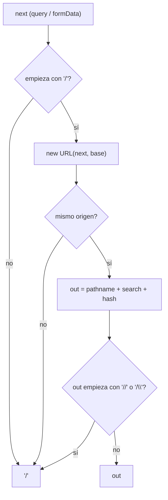
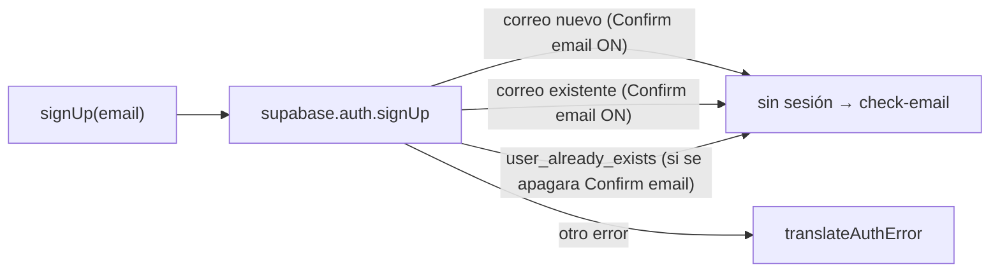

# SPEC 17 — Correcciones de la auditoría de seguridad

> **Estado:** Aprobado

> **Depende de:** 15-autenticacion-oauth-v0.6.0 (`safeNext`, `signUp`, `/auth/callback`), 16-endurecimiento-seguridad-rutas-v0.7.0 (headers, `referenceSecurity.md`), 03-about-contact-email (`/api/contact`)
> **Fecha:** 2026-11-02
> **Versión:** 0.7.0 → 0.7.1 (patch: correcciones de seguridad, sin funcionalidad nueva)
> **Objetivo:** Cerrar los hallazgos abiertos de la auditoría de `@security-guardian` del 2026-10-25 (H1, H2, H3, H5, K10), confirmados de nuevo el 2026-11-02 sobre `62f2554`.

## Contexto

La auditoría [`2026-10-25-completo.md`](../references/security-checklist/auditorias/2026-10-25-completo.md) se hizo sobre `3d68910`. Desde entonces no cambió el código de `app/`, `lib/`, `proxy.ts` ni `sql/`, y el 2026-11-02 se confirmó que los hallazgos siguen abiertos:

| #   | Auditoría | Severidad      | Hallazgo                                                                                                                                                                  | Estado 2026-11-02                                                                       |
| --- | --------- | -------------- | ------------------------------------------------------------------------------------------------------------------------------------------------------------------------- | --------------------------------------------------------------------------------------- |
| 1   | H2        | Alto (latente) | `safeNext` compara el origen **antes** de normalizar el path: `"/..//evil.com"` → `"//evil.com"`, que el navegador resuelve como `http://evil.com`.                       | Reproducido con `node`: `"/..//evil.com"` y `"/%2e%2e//evil.com"` → `http://evil.com/`. |
| 2   | H1        | Alto           | El registro revela qué correos tienen cuenta: con "Confirm email" apagado, Supabase responde `422 user_already_exists` y la app muestra "Ese correo ya tiene una cuenta". | Sigue: `lib/auth-errors.ts:21-22`.                                                      |
| 3   | H3        | Bajo           | `/api/contact`: `request.json()` sin `try` (500), campos sin validar tipo/largo/formato y `error.message` crudo de Resend devuelto al cliente.                            | Sigue: `app/api/contact/route.ts:4-5`, `:18-19`.                                        |
| 4   | K10       | Bajo           | Falta `server-only`: nada impide que un Client Component importe `lib/supabase/admin.ts` y la secret key llegue al bundle.                                                | Sigue: `node_modules/server-only` no existe.                                            |
| 5   | H5        | Info           | `X-Powered-By: Next.js` en todas las respuestas.                                                                                                                          | Sigue: `next.config.ts` sin `poweredByHeader: false`.                                   |

## Alcance

**Incluye:**

- **`safeNext` idempotente** (`lib/auth-errors.ts`): además de exigir el mismo origen, rechaza (→ `"/"`) toda salida normalizada que empiece con `//` o `/\`. Garantía: `safeNext(safeNext(x)) === safeNext(x)` y `new URL(safeNext(x), origin).origin === origin` para cualquier `x`.
- **Registro sin enumeración de correos:**
  - Activar **"Confirm email"** en el dashboard de Supabase (Authentication → Providers → Email). Con eso, Supabase responde igual (usuario sin sesión, sin error) exista o no el correo, y la app ya muestra `notice: "check-email"` en los dos casos.
  - En `signUp` (`app/actions/auth.ts`), defensa en profundidad: si Supabase devuelve `user_already_exists` (`error.code`), responder `{ notice: "check-email" }` en vez del error.
  - Quitar de `TRANSLATIONS` las dos entradas `"user already registered"` / `"already been registered"`.
- **`/api/contact` validado** (`app/api/contact/route.ts`):
  - `request.json()` dentro de `try` → `400` con mensaje fijo si el body no es JSON.
  - `name`, `email`, `message`: `typeof === "string"`, recortados, no vacíos y con largo máximo (`name` ≤ 100, `email` ≤ 254, `message` ≤ 5000).
  - `email` validado con el mismo `EMAIL_RE` de `app/actions/auth.ts` (se mueve a un módulo compartido, ver Plan).
  - En el `catch`: `console.error` con el detalle y respuesta `500` con mensaje fijo en español ("No se pudo enviar el mensaje. Intenta de nuevo."). Nunca el `error.message` del proveedor.
- **`server-only`:** `npm i server-only` y `import "server-only"` en la primera línea de `lib/supabase/admin.ts` y `lib/pwned-password.ts`.
- **`poweredByHeader: false`** en `next.config.ts`.
- **Documentación:** `referenceSecurity.md` (ítems nuevos), la auditoría queda referenciada desde este spec, `package.json` 0.7.1 y `CHANGELOG.md`.

**No incluye** (siguen como pendientes conocidos de la auditoría):

- CSP, `preload` de HSTS, captcha y rate limiting propio (K1, K2, K3).
- Grants por defecto (`TRUNCATE`, etc.) y restricción de columnas en la UPDATE de `profiles` (K4, K5).
- Enlaces de correo atados al navegador por PKCE (K6, limitación 8 del spec 15) — **ver Riesgos**, este spec la hace más visible.
- `callbackUrl()` con `SITE_URL` fijo en vez del header `Origin` (H7): se resuelve al configurar producción.
- Versión de `package.json` en el bundle del cliente (H6): info, no es un secreto.

## Flujo corregido

## Plan de implementación

1. ✅ **`safeNext`** — `lib/auth-errors.ts`: chequeo de la salida normalizada. Comentario que explique por qué (dot-segments: `/..//evil.com`). Probar con un script en el scratchpad (fuera del repo) la batería del spec 15 más los 6 casos de la auditoría: `"/..//evil.com"`, `"/.//evil.com"`, `"/../\\evil.com"`, `"/a/..//evil.com"`, `"/%2e%2e//evil.com"`, `"/.\\/evil.com"` → todos `"/"`; los destinos internos (`/juegos/caida`, `/juegos/caida/jugar?x=1#y`) se conservan; idempotencia en todos.
2. ✅ **Registro neutral** — dashboard: activar "Confirm email" (lo hace el usuario; se documenta fecha y valor). Código: rama `user_already_exists` en `signUp` y quitar las 2 traducciones. Probar: registro con correo nuevo y con uno existente muestran el mismo aviso "REVISA TU CORREO"; el correo de confirmación llega y, abierto en el mismo navegador, inicia sesión.
3. ✅ **`/api/contact`** — mover `EMAIL_RE` a `lib/validation.ts` (lo importan `app/actions/auth.ts` y la ruta) y aplicar la validación. Probar con `curl`: `{bad` → 400, `{}` → 400, `{"name":1,...}` → 400, email inválido → 400, `message` de 5001 caracteres → 400. Sin enviar correos reales salvo una prueba final desde `/about`.
4. **`server-only` + `poweredByHeader`** — instalar, importar y desactivar el header. Probar: `npm run build` sin errores; `curl -sI /` sin `X-Powered-By`; un import temporal de `admin.ts` desde un `"use client"` rompe el build (se revierte).
5. **Cierre** — `npm run lint`, `npm run build`, `referenceSecurity.md`, `package.json` 0.7.1, `CHANGELOG.md`, bitácora y lecciones en este spec. Opcional: `@security-guardian diff` sobre la rama.

## Criterios de aceptación

- [ ] `safeNext` devuelve `"/"` para los 6 casos de dot-segments de la auditoría y conserva los destinos internos.
- [ ] `safeNext` es idempotente y nunca devuelve un valor que resuelva a otro origen (script de prueba con la batería completa).
- [ ] `GET /auth/callback?code=<inválido>&next=/..//evil.com` → `307 /auth?error=enlace` (sin cambios), y con `code` válido el destino queda en el mismo origen.
- [ ] "Confirm email" activado en Supabase (verificado en el dashboard, con fecha en la bitácora).
- [ ] Registrarse con un correo ya registrado muestra el mismo aviso que con uno nuevo; ninguna respuesta contiene "ya tiene una cuenta".
- [ ] `/api/contact`: body inválido, campos de otro tipo, email mal formado o textos demasiado largos → `400` con mensaje propio en español; un fallo de Resend → `500` con mensaje fijo, sin el texto del proveedor.
- [ ] El formulario de `/about` sigue enviando correctamente un mensaje válido.
- [ ] `lib/supabase/admin.ts` y `lib/pwned-password.ts` importan `server-only`; importarlos desde un Client Component rompe el build.
- [ ] Las respuestas no traen `X-Powered-By`.
- [ ] `npm run lint` y `npm run build` sin errores; `package.json` en 0.7.1 y entrada en `CHANGELOG.md`.

## Decisiones tomadas y descartadas

- **Registro: "Confirm email" (dashboard) en vez de solo cambiar el mensaje en el código.** La opción (b) de la auditoría (responder `check-email` ante `user_already_exists`) **no alcanza sola**: con autoconfirm, un correo nuevo inicia sesión y redirige, mientras que uno existente mostraría "REVISA TU CORREO". La diferencia de respuesta sigue revelando la cuenta. Solo con "Confirm email" activo los dos casos son idénticos. El cambio de código queda como defensa en profundidad.
- **`safeNext`: chequear la salida** en vez de normalizar a mano los dot-segments. Es una regla simple que cubre cualquier variante que el parser de URL produzca.
- **Largos máximos de `/api/contact`:** 254 es el máximo de un email (RFC 5321); 100 y 5000 alcanzan de sobra para un formulario de contacto.

## Riesgos identificados

- **Confirm email + PKCE (limitación 8 del spec 15):** el enlace de confirmación solo funciona en el navegador donde se hizo el registro. Con autoconfirm nadie lo notaba; ahora **todo registro por correo** pasa por ese enlace. Si molesta, el arreglo es el spec ya previsto (`{{ .TokenHash }}` + `verifyOtp`). Las cuentas existentes ya están confirmadas y OAuth no se ve afectado.
- **Rate limit de correos de Supabase (plan Free):** con "Confirm email" cada registro manda un correo y el SMTP por defecto tiene un límite bajo por hora. Si se alcanza, Supabase devuelve `rate limit` y la app ya lo traduce ("Demasiados intentos…").
- **`server-only` en `pwned-password.ts`:** si algún test o script de Node lo importa fuera de Next, fallará; hoy no hay ninguno.

## Bitácora de soluciones

### Paso 1 — `safeNext` idempotente (2026-11-02)

- `lib/auth-errors.ts`: después del chequeo de origen, `safeNext` arma `out = pathname + search + hash` y devuelve `"/"` si `out` empieza con `//` o `/\`. El comentario de la función explica el caso de los dot-segments.
- Prueba: `npx tsx safenext-test.ts`, un script en el scratchpad, fuera del repo. Corre 33 verificaciones, todas OK:
  - 22 entradas externas o hostiles (los 13 casos del spec 15, los 6 dot-segments de la auditoría y 3 variantes más). Todas resuelven a `http://localhost:3000` y son idempotentes.
  - 5 rutas internas que se conservan tal cual.
  - Los 6 dot-segments devuelven exactamente `"/"`.
- `"/%09/evil.com"` y `"/%2E%2E/%2Fevil.com"` no devuelven `"/"`. Quedan como rutas internas literales (`/%09/evil.com`, `/%2Fevil.com`), que el navegador no decodifica como separador de host. Terminan en un 404 del mismo origen: es correcto.

### Paso 2 — Registro neutral (2026-11-02)

- **Dashboard:** el usuario activó "Confirm email" (Authentication → Providers → Email). Los `auth_logs` muestran que Supabase recargó la configuración a las 2026-11-02T12:56:20Z.
- `app/actions/auth.ts` (`signUp`): si `error.code === "user_already_exists"`, responde `{ notice: "check-email" }`. Va antes de `translateAuthError`, como respaldo por si se vuelve a apagar "Confirm email".
- `lib/auth-errors.ts`: se quitaron las entradas `"user already registered"` y `"already been registered"` de `TRANSLATIONS`.
- **Prueba con Playwright** en `/auth` → CREAR CUENTA, con el correo de la cuenta `e2e_bot`, que ya existe y está confirmada, y un usuario nuevo `sg17_probe`:
  - Muestra "[OK] Cuenta creada. > REVISA TU CORREO…", el mismo aviso que un alta nueva. Captura: `.playwright-screenshot/spec17-signup-existente.png`.
  - En `auth_logs`, `POST /signup` respondió **`200`** con `action: user_repeated_signup`. La auditoría había visto `422 user_already_exists`. Es decir, el aviso neutral lo da Supabase, no solo la rama de respaldo.
  - No se creó ningún perfil `sg17_probe`.
- **Pendiente del usuario:** registro con un correo nuevo real. El correo de confirmación debe llegar y, abierto en el mismo navegador, iniciar sesión. Se necesita una bandeja real, así que no se automatizó.

### Paso 3 — `/api/contact` validado (2026-11-02)

- `lib/validation.ts` (nuevo): `EMAIL_RE`, que antes vivía en `app/actions/auth.ts`. Ahora lo importan `app/actions/auth.ts` y la ruta.
- `app/api/contact/route.ts`:
  - `request.json()` va dentro de `try`; si falla, responde `400`.
  - Exige que los tres campos sean `string`, los recorta y rechaza los vacíos.
  - Largos máximos (`MAX_LENGTH`): 100 para el nombre, 254 para el correo y 5000 para el mensaje.
  - Valida el correo con `EMAIL_RE`.
  - En el `catch`, el error queda en `console.error` y la respuesta es un `500` con mensaje fijo.
  - A `sendContactEmail` le llegan los valores ya recortados.
- **Prueba con `curl`:** 9 casos inválidos, todos `400` con mensaje en español. Son JSON inválido, `{}`, `null`, `name` numérico, `message` objeto, campos de solo espacios, correo inválido, `name` de 101 caracteres y `message` de 5001.
- **Prueba con Playwright** desde `/about`: un mensaje válido devolvió `200 {"ok":true}` y llegó a `CONTACT_EMAIL`. Captura: `.playwright-screenshot/spec17-contacto-ok.png`.
- **No se probó en vivo** el `500` por una falla de Resend, porque haría falta romper `RESEND_API_KEY`. Está verificado por revisión de código: el `catch` ya no lee `error.message`.
- El formulario de `/about` sigue mostrando `data.error`. Ahora siempre es un texto propio en español.
