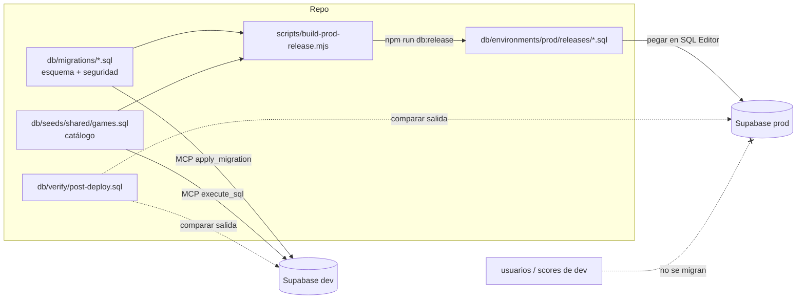

# SPEC 18 — Ambientes dev / prod y migración de la base

> **Estado:** Aprobado

> **Depende de:** 04-supabase-auth-scores (esquema base), 15-autenticacion-oauth-v0.6.0 (redirects y providers OAuth), 16-endurecimiento-seguridad-rutas-v0.7.0 (RLS, HIBP, `politicas-rls.md`), 17-correcciones-auditoria-seguridad-v0.7.1 (`server-only`, `safeNext`)
> **Fecha:** 2026-11-08
> **Versión:** 0.7.1 → 0.8.0 (minor: infraestructura nueva de ambientes y releases de base)
> **Objetivo:** Separar en el repo la información de cada ambiente (dev / prod), que el repo sea la fuente de verdad del esquema y que pasar de dev a prod sea un script SQL generado, idempotente y listo para pegar en el SQL Editor de prod.

## Contexto

Hay dos proyectos Supabase:

| Ambiente | Proyecto                                                        | Acceso                                                                                              |
| -------- | --------------------------------------------------------------- | --------------------------------------------------------------------------------------------------- |
| dev      | `fumwaikjxwrhnuyofdxq`                                          | MCP de Supabase (`.mcp.json`), `apply_migration` / `execute_sql`                                    |
| prod     | (ref de prod, se documenta en `db/environments/prod/README.md`) | **Restringido: solo SQL Editor del dashboard.** Sin CLI, sin MCP, sin connection string para Claude |

Hoy el proyecto funciona como si hubiera un único ambiente:

1. **Base.** No hay `supabase/` ni CLI. El SQL está en `sql/001…007`, pero dev registra **10 migraciones** (`restrict_handle_new_user_execute`, `enable_rls_games` y `handle_new_user_username_completo` no tienen archivo propio). El estado vivo (relevado el 2026-11-08) coincide en lo esencial con `sql/`: índices `profiles_username_lower_key`, `scores_game_id_score_idx` y `scores_user_id_idx`, `ON DELETE CASCADE` hacia `auth.users` y revokes de `handle_new_user` / `email_for_username`. Lo que falta es una secuencia reproducible en un proyecto vacío. Además, el catálogo `games` se siembra **dentro** de una migración de esquema (`sql/004`).
2. **Variables de la app.** Todo sale de `.env.local`. Según la guía de Next 16 (`node_modules/next/dist/docs/01-app/02-guides/environment-variables.md`), el orden de búsqueda es `process.env` → `.env.$(NODE_ENV).local` → **`.env.local`** → `.env.$(NODE_ENV)` → `.env`. O sea, `.env.local` también se carga en `next build` / `next start`, y **un build de prod hecho en esta máquina apuntaría a dev**. Las `NEXT_PUBLIC_*` se inlinean en el bundle durante `next build`: cada ambiente necesita su propio build.
3. **URLs de Auth.** `app/actions/auth.ts:24` cae en `http://localhost:3000` si la request no trae `origin`, y con eso arma `emailRedirectTo`/`redirectTo`. El spec 15 solo registró Site URL y redirects de `localhost`.
4. **Email.** `lib/email.ts` envía desde `onboarding@resend.dev`, que solo entrega al dueño de la cuenta de Resend.

## Qué información pasa de dev a prod

| Objeto                                                                                                                            | ¿Pasa a prod?                            | Motivo                                                                                                | Dónde vive                                                   |
| --------------------------------------------------------------------------------------------------------------------------------- | ---------------------------------------- | ----------------------------------------------------------------------------------------------------- | ------------------------------------------------------------ |
| Esquema `public`: `games`, `profiles`, `scores`, checks, FKs, índices                                                             | **Sí**                                   | Igual en todos los ambientes                                                                          | `db/migrations/`                                             |
| RLS, políticas, `handle_new_user()` y `email_for_username()` (`SECURITY DEFINER`), trigger `on_auth_user_created`, revokes/grants | **Sí**                                   | Es la seguridad (specs 16/17)                                                                         | `db/migrations/`                                             |
| Catálogo `games` (filas)                                                                                                          | **Sí**, upsert por `id`                  | Es contenido, no actividad. `scores.game_id` tiene FK a `games` y `saveScore` cruza con `registry.ts` | `db/seeds/shared/games.sql`                                  |
| `auth.users`, `profiles`                                                                                                          | **No**                                   | Identidades de cada ambiente. `profiles` lo crea el trigger al registrarse                            | —                                                            |
| `scores`                                                                                                                          | **No**                                   | Partidas de prueba con FK a usuarios de dev                                                           | —                                                            |
| Datos de prueba (usuario E2E, scores)                                                                                             | Solo dev, opcional                       | —                                                                                                     | `db/environments/dev/seeds/`                                 |
| Config de Auth: Site URL, Redirect URLs, providers Google/GitHub, confirmación de email, política de contraseñas, SMTP            | Por ambiente, **manual** en el dashboard | No es SQL                                                                                             | `db/environments/<env>/auth-config.md`                       |
| URL y keys de Supabase, `RESEND_API_KEY`, `CONTACT_EMAIL`, `DB_PWD`                                                               | **Nunca se copian**                      | Secretos de cada ambiente                                                                             | `.env.development.local` (dev) / env vars del hosting (prod) |

## Alcance

### Incluye

- Carpeta `db/` con migraciones comunes, seed compartido, verificación y una subcarpeta por ambiente.
- `0000_baseline.sql`: el estado real de dev, idempotente y sin datos. Reemplaza `sql/001–007`, que pasan a `sql/legacy/`.
- Ledger `ops.migration_log` en los dos ambientes.
- `scripts/build-prod-release.mjs` + `npm run db:release`: genera el bundle SQL para prod.
- Separación de variables de la app (`.env.development.local`, `.env.example`) y `lib/env.ts` con validación y una guarda anti-dev-en-prod.
- `callbackUrl` basado en `NEXT_PUBLIC_SITE_URL`. Remitente de email configurable (`RESEND_FROM`).
- Docs: `db/README.md`, `CLAUDE.md`, `/add-game-impl`, `politicas-rls.md`.

### No incluye

- Elegir o configurar el hosting de prod ni el dominio (solo se documentan las variables que necesita).
- Migrar usuarios o scores de dev.
- CI/CD que aplique en prod (prod se aplica a mano por diseño).
- Revocar los grants sobrantes de `anon`/`authenticated` (pendiente desde el spec 16; la baseline reproduce el estado actual).

## Arquitectura



### Estructura de `db/`

```text
db/
  README.md                      # flujo dev → prod
  migrations/                    # COMÚN: solo esquema y seguridad, idempotente, sin datos
    0000_baseline.sql
    0001_<slug>.sql …            # una por spec que toque la base
  seeds/shared/games.sql         # COMÚN: INSERT … ON CONFLICT (id) DO UPDATE
  verify/post-deploy.sql         # COMÚN: políticas, funciones, grants, triggers, ids de games, ledger
  environments/
    dev/
      README.md                  # ref, URL, cómo se aplica (MCP)
      auth-config.md             # Site URL localhost, redirects, OAuth apps de dev
      seeds/sample-data.sql      # opcional, SOLO dev
      .env.example
    prod/
      README.md                  # ref, URL, cómo se aplica (SQL Editor), "nunca MCP"
      auth-config.md             # Site URL del dominio, redirects, OAuth apps de prod
      .env.example
      releases/
        <fecha>_v<versión>.sql   # bundle generado
        applied.md               # release, fecha, quién lo aplicó, resultado de verify
```

### Ledger y bundle

Cada bundle:

```sql
begin;
create schema if not exists ops;
revoke all on schema ops from public, anon, authenticated;
create table if not exists ops.migration_log (
  version text primary key,
  applied_at timestamptz not null default now(),
  checksum text not null
);

-- por cada migración pendiente:
do $mig$ begin
  if not exists (select 1 from ops.migration_log where version = '0000_baseline') then
    -- <contenido de 0000_baseline.sql>
    insert into ops.migration_log (version, checksum) values ('0000_baseline', '<sha256>');
  end if;
end $mig$;

-- seeds compartidos (siempre; son upserts)
-- <contenido de seeds/shared/games.sql>
commit;
```

- Atómico: si algo falla, no queda nada aplicado a medias.
- Idempotente: pegarlo dos veces no hace nada la segunda vez.
- El script toma las migraciones con número mayor que `--from` (la última versión del ledger de prod) y verifica que ninguna migración ya publicada haya cambiado su checksum.
- Las migraciones usan delimitadores `$fn$` dentro de las funciones para no chocar con el `$mig$` externo. El script valida que no aparezca `$mig$` en el contenido.
- `ops` no está en los schemas expuestos de PostgREST.

### Script de salida (qué es, dónde queda, cómo se usa)

- **Qué es:** un único archivo `.sql` por cada pase a prod, generado por `npm run db:release`. Nunca se edita a mano.
- **Dónde queda:** `db/environments/prod/releases/<YYYY-MM-DD>_v<versión de package.json>.sql`. **Se commitea**: el historial de git es el historial de lo que se pegó en prod. Ejemplo: `2026-11-10_v0.8.0.sql` (primer pase: ledger + baseline + games); el siguiente trae solo las migraciones nuevas + el catálogo.
- **Qué nunca contiene:** usuarios, perfiles, scores, keys ni secretos.
- **Cómo se usa:**
  1. `npm run db:release -- --from <última versión del ledger de prod>`. En el primer pase no se pasa `--from`.
  2. Copiar todo el archivo → SQL Editor del proyecto **prod** → Run.
  3. Pegar `db/verify/post-deploy.sql` y comparar con la misma salida en dev.
  4. Agregar una fila en `db/environments/prod/releases/applied.md` y commitear.

`applied.md` es el registro de qué está aplicado en prod:

| Release                 | Aplicado   | Por   | Verify vs dev | Notas       |
| ----------------------- | ---------- | ----- | ------------- | ----------- |
| `2026-11-10_v0.8.0.sql` | 2026-11-10 | Diego | ✅ idéntico   | Primer pase |

### Dónde queda documentado

| Documento                                  | Qué cuenta                                                                                                                 |
| ------------------------------------------ | -------------------------------------------------------------------------------------------------------------------------- |
| Este spec (`specs/18-…`)                   | El porqué y las decisiones (historial)                                                                                     |
| `db/README.md`                             | **Manual operativo**: el flujo dev → prod paso a paso, cómo escribir una migración nueva y cómo generar y pegar un release |
| `db/environments/dev/README.md`            | Ref y URL de dev. Se aplica por MCP                                                                                        |
| `db/environments/prod/README.md`           | Ref y URL de prod. Solo SQL Editor, nunca MCP ni agentes. Link a `releases/` y `applied.md`                                |
| `db/environments/<env>/auth-config.md`     | Checklist de Auth del dashboard de cada ambiente                                                                           |
| `db/environments/prod/releases/applied.md` | Qué release está aplicado en prod y cuándo                                                                                 |
| `CLAUDE.md`                                | Una línea: "cambios de base → `db/` (ver `db/README.md`); prod solo por release"                                           |
| `CHANGELOG.md`                             | Entrada de la 0.8.0                                                                                                        |

## Cambios en el proyecto para respetar ambientes

1. **Variables.** `.env.local` → `.env.development.local` (lo hace el usuario: es su archivo con secretos). `.env.example` en la raíz y en cada `db/environments/<env>/`. `.gitignore`: agregar `!.env.example` y `!db/environments/*/.env.example`.
2. **`lib/env.ts` (`server-only`) y `lib/env.public.ts`:** validan las variables al importarse y fallan con un mensaje claro si falta alguna. Variables:
   - públicas: `NEXT_PUBLIC_SUPABASE_URL`, `NEXT_PUBLIC_SUPABASE_PUBLISHABLE_KEY`, `NEXT_PUBLIC_SITE_URL`, `NEXT_PUBLIC_APP_ENV` (`development` | `production`);
   - servidor: `SUPABASE_SECRET_KEY`, `RESEND_API_KEY`, `RESEND_FROM`, `CONTACT_EMAIL`, `SUPABASE_DEV_PROJECT_REF`.

   **Guarda:** si `NEXT_PUBLIC_APP_ENV=production` y `NEXT_PUBLIC_SUPABASE_URL` contiene `SUPABASE_DEV_PROJECT_REF`, lanza un error. Lo usan `lib/supabase/server.ts`, `lib/supabase/admin.ts`, `lib/proxy/session.ts` y `lib/email.ts`; el proxy, `env.public.ts`.

3. **`app/actions/auth.ts` — `callbackUrl`:** base = `NEXT_PUBLIC_SITE_URL`. En `development` se acepta el `origin` de la request (para entrar por la IP de la LAN, `allowedDevOrigins`). Se elimina el fallback fijo a `localhost`.
4. **`lib/email.ts`:** el remitente sale de `RESEND_FROM`.
5. **`.mcp.json`:** queda solo para dev. Se documenta en `db/environments/prod/README.md` y en `CLAUDE.md` que ningún agente apunta a prod.
6. **`package.json`:** `"db:release": "node scripts/build-prod-release.mjs"`.
7. **Sin cambios:** HSTS en `next.config.ts`, el contador de FPS y la música de dev dependen de `NODE_ENV`, que ya refleja el build.

## Plan de implementación

Con pausa para commit al final de cada paso.

1. ✅ **Baseline.** Volcar el DDL completo de dev (solo lectura) y escribir `db/migrations/0000_baseline.sql` (idempotente: `create table if not exists`, `create or replace function`, `drop policy if exists` + `create policy`, `drop trigger if exists` + `create trigger`, `create index if not exists`, revokes/grants explícitos). Diff contra `sql/001–007` y `politicas-rls.md`. Mover `sql/` a `sql/legacy/` con un README.
2. ✅ **Seed y verificación.** `db/seeds/shared/games.sql`, generado desde las filas de dev. Chequeo de que cada id de `components/games/registry.ts` esté en el seed. `db/verify/post-deploy.sql` con salida ordenada y comparable.
3. ✅ **Ambientes.** `db/environments/{dev,prod}` con README, `auth-config.md` (las checklists del spec 15 por ambiente) y `.env.example`. `db/README.md`.
4. **Código.** `lib/env.ts`, `lib/env.public.ts`, refactor de los 4 consumidores, `callbackUrl`, `RESEND_FROM` y `.gitignore`.
5. **Release.** `scripts/build-prod-release.mjs` + `npm run db:release`. Primer bundle `db/environments/prod/releases/2026-11-xx_v0.8.0.sql` (ledger + baseline + games). Registrar el ledger en dev (`ops.migration_log` con `0000_baseline`).
6. **Despliegue en prod (usuario).** Pegar el bundle en el SQL Editor de prod, correr `verify/post-deploy.sql`, completar `prod/auth-config.md` y anotar en `applied.md`.
7. **Cierre.** `CLAUDE.md` (una línea + link a `db/README.md`), `/add-game-impl` y `politicas-rls.md` apuntando a `db/`, `package.json` 0.8.0 y `CHANGELOG.md`.

## Criterios de aceptación

- [ ] Aplicar `0000_baseline.sql` sobre dev no cambia nada: la salida de `verify/post-deploy.sql` es idéntica antes y después.
- [ ] `get_advisors` (security) en dev, sin hallazgos nuevos.
- [ ] El bundle aplicado en prod deja la salida de `verify/post-deploy.sql` igual a la de dev (filtrando el ledger por fecha).
- [ ] Pegar el bundle por segunda vez en prod no hace nada y no da error.
- [ ] Prod no tiene filas en `profiles` ni `scores` provenientes de dev.
- [ ] `npm run build` sin variables falla con el mensaje de `lib/env.ts`. Con `NEXT_PUBLIC_APP_ENV=production` y la URL de dev, también falla (guarda).
- [ ] `npm run dev` funciona con `.env.development.local`. `npx tsc --noEmit` y `npm run lint` en verde.
- [ ] `emailRedirectTo`/`redirectTo` usan `NEXT_PUBLIC_SITE_URL`.
- [ ] Smoke test en prod: registro (se crea `profiles`), link de confirmación al dominio de prod, login con usuario, OAuth Google/GitHub, catálogo visible, guardar un score y verlo en el ranking, score por encima del cap rechazado, formulario de contacto.

## Decisiones tomadas y descartadas

| Decisión                              | Descartado                              | Por qué                                                                                 |
| ------------------------------------- | --------------------------------------- | --------------------------------------------------------------------------------------- |
| Bundle SQL generado y pegado a mano   | Supabase CLI `db push`, CI/CD           | Prod solo acepta SQL Editor                                                             |
| Ledger propio `ops.migration_log`     | `supabase_migrations.schema_migrations` | Lo maneja la CLI/MCP y en prod no hay. El propio es igual en los dos ambientes          |
| Baseline única desde el estado vivo   | Reproducir `sql/001–007` en orden       | 004 recrea tablas y mezcla datos. La baseline describe el estado final y es idempotente |
| `games` como seed compartido (upsert) | Dentro de la migración                  | Separa contenido de esquema. Un juego nuevo es un cambio de seed, no de esquema         |
| Usuarios y scores no se migran        | Exportar `auth.users`                   | Son del ambiente. Copiarlos llevaría hashes y correos de prueba a prod                  |
| `.env.development.local`              | Mantener `.env.local`                   | `.env.local` también se carga en el build de producción                                 |

## Riesgos identificados

- **Delimitadores `$$` anidados** en el bundle: lo mitiga la convención `$fn$` / `$mig$` y la validación del script.
- **Límite de tamaño o timeout del SQL Editor:** el bundle inicial es chico (unos pocos KB). Si crece, el script puede partirlo en varios archivos.
- **Trigger sobre `auth.users` en prod:** requiere que el SQL Editor corra como `postgres` (es el default). Si falla, el `begin/commit` revierte todo.
- **Config de Auth olvidada:** sin Redirect URLs de prod, OAuth y la confirmación de email fallan. Lo mitiga la checklist de `prod/auth-config.md` y el smoke test.
- **Renombre de `.env.local`:** si no se hace, `lib/env.ts` igual funciona en dev (Next también lee `.env.local`), pero la protección del build no aplica. Se documenta como paso del usuario.

## Bitácora de soluciones

### Paso 1 — Baseline (2026-11-08)

- **Relevamiento de dev (solo lectura, `execute_sql`):** `pg_get_functiondef`, `pg_policies`, `pg_get_triggerdef`, `pg_constraint`, `pg_indexes`, `information_schema.columns`, `routine_privileges`, `role_table_grants`, `pg_class.relrowsecurity` y `pg_extension`.
- **Resultado:** el estado vivo coincide con `sql/001–007` + `politicas-rls.md`. No apareció ningún objeto en la base que no esté en el repo. El drift era solo de numeración: las migraciones `restrict_handle_new_user_execute`, `enable_rls_games` y `handle_new_user_username_completo` de dev están incluidas en `sql/002`, `sql/004` y `sql/005`.
- **`db/migrations/0000_baseline.sql`:** describe el estado final, sin el `drop table games` de `004` ni datos. Es idempotente, sin `begin/commit`, y los cuerpos de función usan `$fn$`.
- **Grants de tabla:** no se declaran, porque Supabase los crea con sus default privileges y en prod pasará lo mismo. Los de función (`revoke … from public, anon, authenticated` + `grant … to service_role`) sí van explícitos.
- **Extensiones** (`pgcrypto`, `uuid-ossp`, `pg_stat_statements`, `supabase_vault`): vienen por defecto en todo proyecto Supabase. La baseline no las usa (`scores.id` es identity, `profiles.id` viene de `auth.users`).
- `sql/001–007` → `sql/legacy/` (`git mv`) + `sql/README.md`. Los specs viejos y las auditorías siguen citando `sql/00N`: son históricos y no se tocan. Los docs vivos se actualizan en el paso 7.
- La baseline todavía no se aplicó en dev: se valida en el paso 5, junto con el ledger.

### Paso 2 — Seed y verificación (2026-11-08)

- **`db/seeds/shared/games.sql`:** las 8 filas de dev, upsert por `id` que no toca `created_at` y nunca borra (`scores.game_id` tiene FK). Incluye los 5 ids de `registry.ts` (`rocas`, `caida`, `bloque-buster`, `serpentina`, `ranaria`) y 3 juegos de catálogo sin motor (`gloton`, `invasores`, `duelo-pixel`).
- **Seed = dev:** un `VALUES` del seed contra `public.games` con `EXCEPT` en los dos sentidos da 0 filas.
- **`db/verify/post-deploy.sql`:** es una sola consulta (el SQL Editor solo muestra el resultado de la última sentencia) y es de solo lectura. La primera fila es la **huella**: el md5 de columnas, constraints, índices, RLS, políticas, md5 de las funciones, `EXECUTE`, triggers, el catálogo y el ledger. La sección `datos_ambiente` (conteos de `auth.users`, `profiles` y `scores`) queda fuera de la huella. El ledger se lee con `query_to_xml` detrás de `to_regclass`, así la consulta no falla si `ops.migration_log` todavía no existe.
- **Huella de dev hoy:** `1e354b4463c99a89623c1d267a667b46`, sin ledger. En dev hay 4 usuarios, 4 perfiles y 35 scores.
- **Corrección de la baseline:** el paso 1 tenía los cuerpos de las funciones en minúscula. Postgres guarda `prosrc` tal cual, así que el md5 habría cambiado al aplicarla, aunque la función hiciera lo mismo. Ahora son copia literal de dev: `md5(prosrc)` coincide (`handle_new_user` `2b3bb3a7…`, `email_for_username` `07692672…`).
- **`.gitattributes`:** `*.sql text eol=lf`, porque con `core.autocrlf=true` un `
` dentro del cuerpo de una función rompería la huella entre ambientes. El script de release igual normaliza a LF (paso 5).

### Paso 3 — Ambientes (2026-11-08)

- **`db/environments/dev/`:** `README.md` (ref, URL, cómo se aplica por MCP y cómo se registra en el ledger), `auth-config.md` (valores actuales del dashboard, de los specs 15, 16 y 17), `.env.example` con los valores no secretos de dev y `seeds/` vacío (`.gitkeep`).
- **`db/environments/prod/`:** `README.md` (reglas: solo SQL Editor y ningún agente; el paso a paso del release; primero la base y después la app), `auth-config.md` como **checklist** (Site URL y redirects del dominio, Confirm email, contraseñas, **SMTP propio** y **apps OAuth nuevas** de prod), `.env.example` y `releases/applied.md`.
- **`db/README.md`:** el manual operativo, con la tabla de ambientes, qué hay en cada carpeta, las reglas para escribir SQL, el flujo dev → prod (Mermaid + pasos) y el ledger.
- **`.env.example`** en la raíz, solo con los nombres de las variables. En `.gitignore` se agregó `!.env.example` y `!db/environments/*/.env.example`. `git check-ignore` confirma que `.env.local` y `.env.development.local` siguen ignorados y que las plantillas se versionan.
- **Datos de prod que faltan** (`<ref-prod>`, `<dominio>`): son placeholders porque el ref de prod no está en el repo. Los completa el usuario.
- **Variable de ambiente:** `NEXT_PUBLIC_APP_ENV` dice en qué ambiente está la app. No se usa `NODE_ENV` porque un `next build` local vale `production` aunque lea variables de dev. Se documentó en `db/README.md` ("Cómo sabe la app en qué ambiente está").
- **Hallazgo:** "Confirm email" está activo en dev desde el spec 17, y en prod tiene que estarlo antes del primer registro. El SMTP por defecto de Supabase no sirve para usuarios reales: está en la checklist de prod.

## Lecciones aprendidas

Se completa al cierre.
