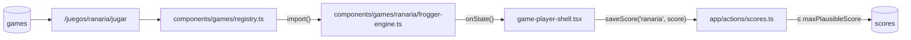

# SPEC — Motor real del juego RANARIA (Frogger)

> **Estado:** Aprobado
> **Depende de:** 05-rocas-asteroids-motor, 06-ranking-global-catalogo-juegos-v0.2.0, 11-score-plausibility-caps-v0.2.5
> **Fecha:** 2026-10-12
> **Versión:** 0.5.0 → 0.5.1 (patch — el juego ya está en el catálogo, esto le agrega su motor real)
> **Objetivo:** Escribir desde cero el motor real de RANARIA (Frogger) — canvas puro, cuadrícula de 40 px con saltos discretos, carretera, río con troncos y tortugas que se sumergen, 5 bocas destino y temporizador — sobre el contrato de motor de la plataforma (`EngineFactory`), registrado en `components/games/registry.ts` y jugado en el reproductor común `/juegos/ranaria/jugar`.

> **Nota de adaptación (2026-10-12):** la versión original de este spec (game jam) proponía un componente React `FroggerGame.tsx` con props/callbacks, una play-page propia `app/games/frogger/play/page.tsx`, una fila nueva `frogger` en `games` y un insert directo a Supabase con `user_id: null`. Nada de eso existe en la plataforma actual: cada juego es un motor detrás del contrato de `components/games/game-engine.ts`, el reproductor y el guardado (`saveScore`, con sesión y `maxPlausibleScore`) son comunes, y el catálogo ya tiene la fila `ranaria` (Frogger) sin motor. Se conservó toda la mecánica; se reemplazó la integración.

---

## Alcance

**Incluye:**

- `components/games/ranaria/frogger-engine.ts`: motor que exporta `createFroggerEngine: EngineFactory`, escrito desde cero (no hay fuente de Frogger en `references/started-games/`).
- Cuadrícula de **16 columnas × 14 filas de 40 × 40 px** (640 × 560), centrada en el arena nativo de 800 × 600 (`ctx.translate(80, 20)`); las franjas sobrantes quedan en negro y la inferior (20 px) aloja la barra de tiempo.
- Zonas fijas por fila (0 = arriba): fila 0 bocas destino, filas 1–6 río (6 carriles), fila 7 franja segura intermedia, filas 8–12 carretera (5 carriles), fila 13 base de inicio.
- Entidades de carretera: coches (1 celda), coches largos (2) y camiones (3), con velocidad y sentido por carril, en loop horizontal continuo; tocar uno es letal.
- Entidades de río: troncos (2–4 celdas) y grupos de tortugas (2–3) por carril, en loop horizontal. La rana solo sobrevive en el río encima de un tronco o de tortugas visibles, y es arrastrada por ellos. Las tortugas alternan visible (3 s) → sumergidas (1,5 s); sumergidas no sostienen.
- Rana: saltos discretos de 1 celda en 4 direcciones (flechas + WASD), cada pulsación = un salto con animación de 120 ms. No puede salir por los bordes laterales ni por debajo de la fila 13 (el salto se ignora).
- 5 bocas destino en la fila 0 (cada una ocupa 2 columnas). Una boca ocupada no se puede reusar en la ronda; llenar las 5 completa la ronda y empieza la siguiente.
- Muerte por: (a) vehículo, (b) caer al agua, (c) tortuga que se sumerge bajo la rana, (d) ser arrastrada fuera del borde lateral en el río, (e) agotar el temporizador, (f) saltar a la fila 0 fuera de una boca o a una boca ya ocupada.
- 3 vidas, puntaje, niveles y temporizador según el Modelo de datos.
- `components/games/registry.ts`: entrada `ranaria` con `load` por `import()` dinámico y `maxPlausibleScore`.
- `references/juegos-implementados.md`: `ranaria` pasa a ✅.
- `package.json` `0.5.0` → `0.5.1` + entrada en `CHANGELOG.md`.

**Lo agregan los agentes de la Fase 5 de `/spec-impl-game` (no son pasos de este plan):**

- Skins `clasico`/`neon`/`retro` → `@skin-designer`.
- `touchControls` (gamepad táctil) → `@mobile-porter`.

**Fuera de alcance:**

- Fila nueva en `games`, SQL o cover CSS — la fila `ranaria` y `.cover-rana` ya existen (Caso B).
- Componente React propio, play-page propia o guardado propio del score — los da el reproductor común.
- HUD de texto dibujado en el canvas (score/vidas/nivel) y overlays propios de pausa o game over — viven en `game-player-shell.tsx`.
- Sonidos (`defineSounds`) y música de fondo (`music` en el registry) — para un spec siguiente.
- Sprites bitmap — todo se dibuja con primitivas canvas.
- Animaciones de muerte elaboradas, mosca bonus y cocodrilo — spec secundario.
- Cambios a `game-player-shell.tsx`, `game-engine.ts` o `app/actions/scores.ts`.

---

## Modelo de datos

Sin tablas nuevas ni SQL — reusa `games`/`scores`. La fila existente:

| id        | title     | cat    | cover        | color   | sort_order |
| --------- | --------- | ------ | ------------ | ------- | ---------- |
| `ranaria` | `RANARIA` | ARCADE | `cover-rana` | `green` | 7          |

**Tabla de puntuación** (todo entero, como exige `saveScore`):

| Evento                                                | Puntos                           |
| ----------------------------------------------------- | -------------------------------- |
| Avanzar a una fila más alta que la máxima de la ronda | +10                              |
| Ocupar una boca libre                                 | +50                              |
| Bonus de tiempo al ocupar una boca                    | +10 × segundos enteros restantes |
| Completar la ronda (5 bocas)                          | +200                             |

**`maxPlausibleScore`: `100_000`** (techo de cordura — el juego no tiene final). Máximo teórico por ronda: 13 filas × 10 + 5 × (50 + 15 × 10) + 200 = 1.330, decreciente con el nivel porque el tiempo baja; 100.000 son ~75 rondas perfectas.

**Mapeo a `EngineState`:**

| Campo   | Valor                                                                                                                                                |
| ------- | ---------------------------------------------------------------------------------------------------------------------------------------------------- |
| `score` | Acumulado según la tabla. Solo se resetea en `restart()`.                                                                                            |
| `lives` | Arranca en `3`; cada muerte resta 1 y la rana vuelve a la fila 13, columna 7. `0` → `"gameover"`.                                                    |
| `level` | Arranca en `1`; +1 al completar una ronda. Al subir se reconstruyen los carriles con todas las velocidades × `1.15^(level-1)` y se vacían las bocas. |
| `badge` | `{ label: "TIEMPO", value: String(segundos restantes, redondeado hacia arriba) }`.                                                                   |
| `phase` | `"paused"` si `isPaused`; `"gameover"` si `lives === 0` o tras `endGame()`; si no, `"playing"`.                                                      |

**Temporizador:** se reinicia en cada viaje de la rana (al arrancar, al morir y al ocupar una boca). Duración `max(8, 16 - level)` s → 15 s en el nivel 1, 1 s menos por nivel, mínimo 8 s. Se dibuja como barra en la franja inferior, verde → amarillo → rojo.

**Velocidades base (nivel 1), en celdas/s:** carretera 2,25–6 (equivale a 1,5–4 px/frame a 60 fps), río 1,5–4,5 (1–3 px/frame); sentidos alternos por carril; huecos de al menos 1 celda entre entidades.

**Controles:**

| Input                 | Acción           | `preventDefault` |
| --------------------- | ---------------- | ---------------- |
| `ArrowUp` / `KeyW`    | Saltar arriba    | Sí               |
| `ArrowDown` / `KeyS`  | Saltar abajo     | Sí               |
| `ArrowLeft` / `KeyA`  | Saltar izquierda | Sí               |
| `ArrowRight` / `KeyD` | Saltar derecha   | Sí               |

Listeners en `window` sobre `e.code`; los `keydown` con `e.repeat` se ignoran (una pulsación = un salto). Un salto pedido durante la animación queda como único salto pendiente. Sin tecla de pausa propia.

---

## Plan de implementación

1. **Esqueleto del motor** en `components/games/ranaria/frogger-engine.ts`: factory `createFroggerEngine`, `ctx`, constantes de cuadrícula y zonas, tipos locales (`Lane`, `Entity`, `Frog`), los 6 métodos de `EngineHandle` con las guardas de idempotencia de `motor-referencia.md` §2, loop RAF con `dt` en segundos, `reportState()` con diff. Dibuja las zonas (bocas, río, franjas seguras, carretera) y la rana quieta en la fila 13. Test manual: `npm run lint`.
2. **Carriles**: `buildLanes(level)` con los 11 carriles y sus entidades; movimiento con wrap (al salir por un lado reaparecen por el otro); ciclo de inmersión por grupo de tortugas; dibujo con primitivas (coches con ruedas, camión con cabina, troncos con vetas, tortugas y su contorno sumergido). Test manual: todo se mueve en loop y las tortugas se sumergen.
3. **Rana**: input de la tabla de Controles, salto discreto con animación de 120 ms (patas extendidas), límites laterales e inferior. Test manual: un salto por pulsación, sin scroll de página.
4. **Colisiones, río y bocas**: choque con vehículos, soporte en el río (arrastre, caída al agua, tortuga sumergida, salida por el borde), llegada a la fila 0 (boca libre / ocupada / fuera de boca), puntuación de la tabla. Test manual: cada causa de muerte y cada evento de puntaje.
5. **Vidas, temporizador y rondas**: `killFrog()` (resta vida, respawn, reinicia tiempo, `"gameover"` en 0), temporizador con su barra y el `badge`, `completeRound()` (+200, nivel +1, carriles más rápidos, bocas vacías). Test manual: perder las 3 vidas; completar una ronda y ver nivel 2 más rápido y con menos tiempo.
6. **Registry**: entrada `ranaria` en `components/games/registry.ts` (`import()` dinámico + `maxPlausibleScore: 100_000`) y `ranaria` → ✅ en `references/juegos-implementados.md`. Test manual: `/juegos/ranaria/jugar` muestra el motor real, no el mock.
7. **Versión**: `package.json` `0.5.0` → `0.5.1` + entrada en `CHANGELOG.md`. Test manual: el Footer muestra `v0.5.1`.
8. **Verificación end-to-end** (sección de `add-game-impl`): lint + build, Playwright, guardado real con sesión, reflejo en rankings, aislamiento de chunk, entrar/salir sin fugas.

---

## Criterios de aceptación

- [ ] El motor exporta `createFroggerEngine` cumpliendo `EngineFactory`; `registry.ts` lo carga con `import()` dinámico.
- [ ] `/juegos/ranaria/jugar` muestra el motor real (no el mock estático) sin errores.
- [ ] La cuadrícula 16 × 14 se ve centrada con las zonas diferenciadas (bocas, río, franjas seguras, carretera).
- [ ] La rana arranca en la fila 13, columna central.
- [ ] Cada pulsación (flechas o WASD) salta exactamente una celda con animación de 120 ms; mantener la tecla no encadena saltos; ninguna tecla scrollea la página.
- [ ] La rana no sale por los bordes laterales ni por debajo de la fila de inicio.
- [ ] Vehículos, troncos y tortugas se mueven en loop y reaparecen por el lado opuesto.
- [ ] Las tortugas alternan visibles (3 s) y sumergidas (1,5 s).
- [ ] La rana muere por: vehículo, agua, tortuga sumergida, arrastre fuera del borde, tiempo agotado, fila 0 fuera de boca o boca ocupada.
- [ ] En el río, la rana es arrastrada por el tronco o las tortugas que la sostienen.
- [ ] Cada muerte resta 1 vida y devuelve la rana a la fila de inicio con el tiempo reiniciado; con 0 vidas pasa a `"gameover"` y se abre el modal del reproductor.
- [ ] Llegar a una boca libre la marca (silueta de rana) y suma +50 + 10 × segundos restantes; la rana vuelve al inicio.
- [ ] Avanzar a una fila nueva de la ronda suma +10; el score siempre es entero.
- [ ] Llenar las 5 bocas suma +200, sube `level`, vacía las bocas, acelera las entidades un 15 % y baja el temporizador 1 s (mínimo 8 s).
- [ ] El HUD del reproductor muestra score, vidas, nivel y el badge TIEMPO reales; el canvas no dibuja texto de HUD ni overlays propios.
- [ ] PAUSA cancela el RAF; REANUDAR continúa sin saltos (el tiempo pausado no cuenta para el temporizador).
- [ ] FIN fuerza game over con el score actual; JUGAR DE NUEVO reinicia (score 0, 3 vidas, nivel 1).
- [ ] Con sesión, una partida terminada crea exactamente una fila en `scores` con `game_id = 'ranaria'`, reflejada en `/juegos/ranaria`, `/games` y `/salon-de-la-fama`; sin sesión, el modal muestra el CTA a `/auth`.
- [ ] Visitar otro juego no descarga el chunk de `frogger-engine.ts`; entrar y salir varias veces no acumula listeners ni RAF.
- [ ] El motor no lee `localStorage` ni toca el DOM fuera del canvas.
- [ ] `npm run lint` y `npm run build` sin errores.

---

## Decisiones

- **Sí: id `ranaria`, no `frogger`.** El catálogo ya tiene RANARIA ("Cruza la autopista de pixeles", ARCADE, `cover-rana`, `green`) como el Frogger de la plataforma, sin motor. Crear `frogger` duplicaría el juego; además `lime` no pasa el `check` de `games.color`.
- **Sí: motor detrás de `EngineFactory`, no componente React con props.** Es el contrato de todos los juegos; el reproductor común ya da HUD, pausa, modal, guardado con sesión y gamepad táctil.
- **Sí: cuadrícula 16 × 14 de 40 px centrada (letterbox) en el arena 800 × 600.** Conserva el diseño original; las franjas negras alojan la barra de tiempo.
- **Sí: temporizador por viaje, no por ronda.** 15 s para las 5 bocas de una ronda serían imposibles; por viaje es la mecánica original y la que el spec describía al reiniciarlo al morir.
- **Sí: +10 solo por filas nuevas de la ronda**, como decía el spec original (impide farmear yendo y viniendo).
- **Sí: `maxPlausibleScore = 100_000`** como techo de cordura (juego sin final), mismo criterio que serpentina.
- **Sí: primitivas canvas, saltos discretos, 3 vidas, tortugas con inmersión, 5 bocas** — sin cambios respecto del spec original.
- **Sí: bump patch** (`0.5.0 → 0.5.1`): el juego ya estaba en el catálogo, se le agrega el motor (mismo criterio que specs 09 y 10).
- **No: sonidos ni música en este spec** — el spec original no los definía; van en uno siguiente.
- **No: tocar `game-player-shell.tsx`, `game-engine.ts` o `app/actions/scores.ts`.**

---

## Riesgos

| Riesgo                                                                                            | Mitigación                                                                                                                              |
| ------------------------------------------------------------------------------------------------- | --------------------------------------------------------------------------------------------------------------------------------------- |
| El arrastre en el río deja a la rana en columnas fraccionarias y desalinea los saltos o las bocas | La rana guarda `x` continua en el río; al saltar se redondea a la columna más cercana, y la detección de boca usa la columna redondeada |
| `resume()` cuenta el tiempo pausado y descuenta el temporizador de golpe                          | El temporizador solo avanza con el `dt` del loop, que se resetea con `lastTime = null` y está acotado a 0,05 s                          |
| Huecos imposibles en carriles rápidos (carretera infranqueable)                                   | `buildLanes` deja al menos 1 celda de hueco y la verificación manual cruza cada nivel probado                                           |
| Score fraccionario por el bonus de tiempo                                                         | Bonus = `10 × Math.floor(segundos restantes)`                                                                                           |
