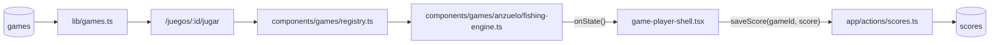
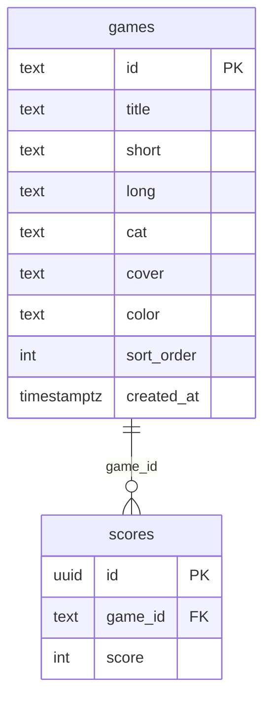
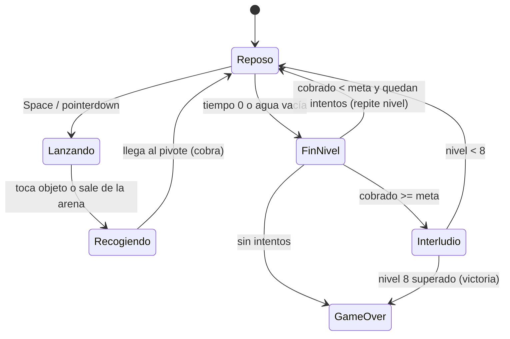

# SPEC GAME-JAM — ANZUELO (fondo del mar)

> **Estado:** Borrador
> **Tema:** fondo del mar
> **Depende de:** 05-rocas-asteroids-motor, 06-ranking-global-catalogo-juegos-v0.2.0, 11-score-plausibility-caps-v0.2.5
> **Fecha:** 2026-10-18
> **Versión:** a asignar al promover (minor — package.json es la fuente de verdad; hoy sería `0.5.3 → 0.6.0`)
> **Objetivo:** Escribir desde cero el motor de ANZUELO, un juego de pesca de timing en el que un anzuelo pendular se lanza al fondo del mar para cobrar peces, perlas y cofres antes de que se acabe el tiempo de cada nivel, y sumarlo al catálogo como juego nuevo (fila en `games` + portada CSS propia).

## Alcance

**Incluye:**

- `components/games/anzuelo/fishing-engine.ts`: motor que exporta `createFishingEngine: EngineFactory`, escrito desde cero (no hay fuente en `references/started-games/`), nativo 800×600, sin assets binarios, con sonido propio declarado con `defineSounds` + `beep` de `components/games/audio.ts`.
- `components/games/registry.ts`: agrega la entrada `anzuelo: { load: () => import("./anzuelo/fishing-engine").then((m) => m.createFishingEngine), maxPlausibleScore: 21_480, skins: ["clasico", "neon", "retro"], music: "jardin", touchControls: {...} }` — **tope exacto**: el juego tiene un final enumerable (8 niveles con contenido fijo; cálculo en Modelo de datos).
- Skins `clasico` (default), `neon` y `retro` dentro del motor, según `components/games/README.md` § Skins (patrón de CAÍDA). Solo visual: no tocan hitboxes, velocidades, valores ni sonidos.
- `sql/00N_add_game_anzuelo.sql` (`N` = siguiente número libre de `sql/` al promover; hoy sería `005`): `insert ... on conflict (id) do nothing` de la fila `anzuelo` en `games` — idempotente, nunca un `INSERT` a secas ni un `DROP`/`UPDATE` de filas existentes. Aplicado al proyecto real vía el MCP de Supabase (`apply_migration`), igual que specs 04/05/06.
- `app/globals.css`: bloque `.cover-anzuelo` en la sección "Cover art generators" (portada nueva, solo CSS con los tokens `var(--cyan|--magenta|--yellow|--ink)`).
- `references/juegos-implementados.md`: fila nueva `anzuelo` con su motor (regla de `CLAUDE.md`).
- `package.json`: bump minor de versión.
- `CHANGELOG.md`: entrada para la versión nueva enlazando a este spec.

**Fuera de alcance (para futuros specs):**

- Cardúmenes que nadan, medusas/tiburones que roban la captura, dinamita o cualquier power-up / tienda entre niveles (la economía del minero clásico).
- Más de 8 niveles, niveles aleatorios o semilla diaria.
- Movimiento fino del anzuelo con joystick virtual o swipe: el único input es "lanzar".
- Audio con archivos (`.mp3`/`.wav`) — todo sintetizado con `beep`.
- `devicePixelRatio` / escalado por densidad de píxeles.
- Validación en build de que cada clave de `registry.ts` tenga fila en `games`.
- Cambios a `game-player-shell.tsx`, `game-engine.ts` o `app/actions/scores.ts` — el contrato ya cubre este juego sin tocarlos.

## Modelo de datos

Sin nuevas tablas — reusa `scores`/`games` de specs 04/06. Caso **C**: agrega una fila nueva a `games` (ver abajo).

**Geometría (800×600 nativo):**

| Elemento | Valor |
| --- | --- |
| Superficie / bote | Bote dibujado en `y ∈ [40, 90]`, centrado en `x = 400`. Cielo: `y < 100`. Agua: `y ≥ 100`. |
| Pivote del anzuelo | Fijo en `(400, 90)`. |
| Péndulo | Ángulo `θ` medido desde la vertical (positivo = derecha): `θ(t) = 1.2 · sin(1.5 · t)` rad (≈ ±69°), con `t` acumulado solo mientras el anzuelo está en reposo (no avanza mientras se lanza o recoge). |
| Anzuelo | Punta circular de radio 10. Dirección de lanzamiento = `(sin θ, cos θ)` fijada al momento de lanzar. |
| Lanzar | Velocidad de salida `420 px/s` en línea recta. Si la punta sale de la arena (`x < 0`, `x > 800` o `y > 600`) o toca un objeto, empieza a recoger. |
| Colisión | **Barrido**: se testea el segmento `(posición previa → posición nueva)` contra cada objeto (círculo). Con `dt` topado a 0,05 s la punta avanza ≤ 21 px/frame, y la suma de radios mínima es 20 (anzuelo + perla de r=10), así que sin barrido ya casi no habría túnel; con barrido, ninguno. |
| Recoger | Velocidad de retorno según peso del objeto enganchado (tabla abajo); sin objeto, `420 px/s`. El objeto viaja pegado a la punta. Llegar al pivote cobra el objeto. |
| Zona de objetos | `x ∈ [30, 770]`, `y ∈ [160, 570]`. |

**Objetos (estáticos, no nadan) — valor y peso:**

| Objeto | Radio | Valor | Peso | Velocidad de retorno | Zona (`y`) |
| --- | --- | --- | --- | --- | --- |
| SARDINA (pez chico) | 12 | 30 | 1 | 400 px/s | `[160, 570]` |
| PEZ | 18 | 80 | 2 | 280 px/s | `[160, 570]` |
| ROCA | 24 | 20 | 4 | 140 px/s | `[160, 570]` |
| COFRE | 22 | 400 | 3 | 190 px/s | `[300, 570]` |
| PERLA | 10 | 250 | 1 | 400 px/s | `[380, 570]` |

**Contenido y meta por nivel `L ∈ 1..8`:** 6 sardinas, 4 peces, 3 rocas, `L` perlas y `ceil(L/2)` cofres. Tiempo: 60 s por nivel (se congela durante el interludio entre niveles).

Colocación determinista (misma disposición cada vez que se juega el nivel): PRNG `mulberry32` con semilla `L · 7919`; muestreo por rechazo con separación mínima entre centros `r1 + r2 + 8` y hasta 200 intentos por objeto, relajando la separación a `r1 + r2` si no cabe. Se colocan en orden cofres → perlas → rocas → peces → sardinas para que lo valioso tenga lugar.

**Tabla de puntuación (todo entero) y tope exacto:**

| Nivel | Valor total del nivel (`560 + 250·L + 400·ceil(L/2)`) | Meta |
| --- | --- | --- |
| 1 | 1.210 | 600 |
| 2 | 1.460 | 900 |
| 3 | 2.110 | 1.400 |
| 4 | 2.360 | 1.700 |
| 5 | 3.010 | 2.200 |
| 6 | 3.260 | 2.500 |
| 7 | 3.910 | 3.000 |
| 8 | 4.160 | 3.400 |
| **Total** | **21.480** | |

(`560 = 6·30 + 4·80 + 3·20`.) La meta es ~50–80 % del valor del nivel, así que se exige ir a lo valioso y no vaciar el nivel. **No hay bonos de tiempo, multiplicadores ni rachas**: el score del juego es la suma de lo cobrado, y cada objeto se cobra una sola vez. → `maxPlausibleScore = 21_480` exacto (cobrar todo en los 8 niveles).

**Mapeo a `EngineState`:**

- `score`: suma de lo cobrado (entero). Si se pierde un nivel (ver abajo) vuelve al valor que tenía al empezar ese nivel — el tope sigue valiendo porque nunca puede superar la suma de los valores de los niveles superados + el actual.
- `lives`: **intentos** — empieza en 3. Terminar un nivel sin llegar a la meta resta 1 y repite el nivel (misma disposición, mismo tiempo, score restaurado); al llegar a 0 → `gameover`.
- `level`: nivel actual `1..8`.
- `badge`: `{ label: "T-<segundosRestantes>", value: "<cobrado en el nivel>/<meta>" }`. Cambia ≤ 1 vez por segundo o al cobrar — nunca por frame.
- `phase`: `"playing"` mientras se juega; `"gameover"` al quedarse sin intentos, al superar el nivel 8 (la **victoria se mapea a `gameover`**) o con FIN. `"paused"` solo desde `pause()`.

**Fin de nivel:** el nivel termina cuando se acaba el tiempo **o** cuando no queda ningún objeto en el agua (lo que ocurra antes) y el anzuelo está en reposo. Si `cobradoEnNivel ≥ meta` → interludio de 1,5 s (sin input, tiempo congelado) y siguiente nivel; si no, pierde un intento.

**Controles:**

| Entrada | Acción | `preventDefault()` |
| --- | --- | --- |
| `Space` / `ArrowDown` | Lanzar el anzuelo (solo si está en reposo; se ignora `e.repeat`) | sí |
| `pointerdown` en el `canvas` | Lanzar | sí |

Táctil: `touchControls: { actions: [{ code: "Space", label: "LANZAR" }] }`, sin cruceta (el péndulo no se controla). El motor escucha `keydown` en `window`, compara `e.code` y no filtra `isTrusted`.

**Sonidos (`defineSounds`):** `lanzar` (tono corto descendente), `enganchar` (golpe seco), `cobrar` (tono ascendente; más agudo cuanto más vale), `perla` (acorde de dos `beep` simultáneos, sin `setTimeout`), `nivel` (arpegio de tres `beep` simultáneos), `fallo` (tono grave).

**Fila nueva de `games` (caso C):**

| Columna | Valor |
| --- | --- |
| `id` | `anzuelo` |
| `title` | `ANZUELO` |
| `short` | `Lanza el anzuelo y pesca lo que más vale.` |
| `long` | `Un bote, un anzuelo y 60 segundos para vaciar el fondo del mar. El anzuelo se balancea y tú decides cuándo soltarlo: las perlas y los cofres pagan mucho, pero pesan, y cada segundo cuenta para llegar a la meta.` |
| `cat` | `ARCADE` |
| `cover` | `cover-anzuelo` |
| `color` | `cyan` |
| `sort_order` | siguiente libre al promover (leer `select max(sort_order) from games`) |

**Portada `.cover-anzuelo`:** fondo vertical `linear-gradient(180deg, #003a4a 0%, #001018 60%, var(--ink))`; `::after` dibuja una línea fina `var(--cyan)` desde arriba al centro con un gancho (círculo abierto) en `var(--yellow)`, y `::before` un par de burbujas (`radial-gradient`) en `var(--cyan)` a baja opacidad, mismo patrón de gradientes que `.cover-snake`/`.cover-rana`.

Estados internos del motor (colapsan a `EnginePhase`):

## Plan de implementación

1. `sql/00N_add_game_anzuelo.sql` con `insert ... on conflict (id) do nothing` de la fila. Aplicar con el MCP de Supabase (`apply_migration`) y verificar con `list_tables`/`get_advisors`. Test manual: `select * from games where id = 'anzuelo'` devuelve la fila.
2. Bloque `.cover-anzuelo` en `app/globals.css`. Test manual: `/games` muestra la portada nueva.
3. Esqueleto del motor en `components/games/anzuelo/fishing-engine.ts`: factory, `ctx`, los 6 métodos del `EngineHandle` (+ `setSkin`), loop RAF con `dt` topado a 0,05 s, `reportState()` sin lógica todavía. Test manual: `npm run lint`.
4. Entrada en `components/games/registry.ts` (`load` con `import()` dinámico, `maxPlausibleScore: 21_480`, `skins`, `music`, `touchControls`). Test manual: `/juegos/anzuelo/jugar` carga el motor real.
5. Escenario: fondo (cielo, agua, bote) y colocación determinista de objetos (PRNG `mulberry32`, orden cofres → perlas → rocas → peces → sardinas). Test manual: nivel 1 y nivel 8 muestran siempre la misma disposición y cuentan 6/4/3 + `L` perlas + `ceil(L/2)` cofres.
6. Péndulo y lanzamiento: `θ(t)`, input (`Space`/`ArrowDown`/`pointerdown`, ignorando `e.repeat`), anzuelo recto hasta salir de la arena. Test manual: el anzuelo se balancea, se lanza en el ángulo del momento y vuelve vacío.
7. Colisión por barrido, enganche, retorno según peso y cobro (`score += valor`, objeto eliminado). Test manual: una roca tarda visiblemente más que una sardina; el score suma exactamente los valores de la tabla.
8. Tiempo, meta, intentos, interludio y victoria: `badge` actualizado ≤ 1/s, repetir nivel con score restaurado, `gameover` tras el nivel 8. Test manual: no llegar a la meta resta un intento y repite el nivel con la misma disposición; con 0 intentos abre el modal.
9. Sonidos con `defineSounds` y las 3 skins. Test manual: cambiar de skin en vivo no altera la partida.
10. `package.json` version bump + entrada en `CHANGELOG.md`. Test manual: el Footer muestra la versión nueva.
11. Verificación end-to-end completa (ver `add-game-impl/SKILL.md`). Test manual: partida con sesión activa, una fila nueva en `scores` reflejada en `/juegos/anzuelo`, `/games` y `/salon-de-la-fama`.

## Criterios de aceptación

- [ ] El motor exporta `createFishingEngine` cumpliendo `EngineFactory`.
- [ ] `registry.ts` carga el motor con `import()` dinámico (no import estático) y declara `maxPlausibleScore: 21_480`.
- [ ] El HUD (`player-hud`) refleja score/intentos/nivel/badge reales del motor, nada hardcodeado.
- [ ] El canvas no dibuja texto de HUD ni overlay de pausa/game over.
- [ ] PAUSA congela la simulación real (el RAF se cancela, no solo un flag visual) y REANUDAR no produce salto (`dt` no incluye el tiempo en pausa).
- [ ] FIN fuerza `gameover` con el score actual en cualquier momento.
- [ ] El anzuelo solo se lanza en reposo; mantener la tecla (auto-repeat) no lanza varias veces.
- [ ] Las disposiciones de los 8 niveles son idénticas en cada partida y respetan los conteos de la tabla.
- [ ] El valor total cobrable de los 8 niveles es exactamente 21.480 y ningún score del motor lo supera (probar cobrando todo).
- [ ] Un objeto cobrado no reaparece ni se cobra dos veces.
- [ ] Fallar la meta resta un intento, repite el nivel y restaura el score de inicio de nivel; con 0 intentos abre el modal de game over.
- [ ] Superar el nivel 8 pasa a `phase: "gameover"` (victoria).
- [ ] `onState` no se llama por frame (badge ≤ 1 vez por segundo, más cobros).
- [ ] Con sesión activa, una partida terminada crea exactamente una fila nueva en `scores`; sin sesión, el modal muestra el CTA a `/auth`; si falla el guardado, aparece REINTENTAR.
- [ ] "JUGAR DE NUEVO" reinicia sin remontar el componente; "VOLVER AL VAULT" navega a `/juegos/anzuelo`.
- [ ] Salir de la página cancela el RAF y quita los listeners (`window` y `canvas`) del motor; visitar otro juego no descarga este chunk.
- [ ] En celular el gamepad muestra el botón LANZAR y funciona.
- [ ] Las skins `clasico`, `neon` y `retro` cambian solo lo visual.
- [ ] La fila de `games` tiene RLS de solo lectura y `get_advisors` no reporta hallazgos nuevos.
- [ ] `/juegos/anzuelo` y `/salon-de-la-fama` reflejan la partida sin intervención manual.
- [ ] `npm run lint` y `npm run build` sin errores.

## Decisiones

- **Sí:** caso **C** — ninguna fila sin motor del catálogo (GLOTÓN, INVASORES, DUELO PIXEL) se parece a pescar. _(decidido por game-jam — revisar)_
- **Sí:** mecánica de **timing de un solo input** (lanzar el péndulo) con decisión de riesgo/recompensa (lo valioso está profundo y pesa). _(decidido por game-jam — revisar)_ Ningún juego con motor usa un péndulo ni un "lanzar y recoger"; se diferencia de ROCAS/CAZADRONES (disparos) y de RANARIA/AUTOPISTA (movimiento).
- **Sí:** objetos **estáticos** y disposición **determinista** por nivel. _(decidido por game-jam — revisar)_ Hace el tope exacto y verificable y el leaderboard justo (todos juegan los mismos tableros); el costo es que se puede memorizar un nivel, lo que se acepta como "dominio" del juego.
- **Sí:** tope **exacto** 21.480 (suma de los valores de los 8 niveles), sin bonos de tiempo ni multiplicadores. _(decidido por game-jam — revisar)_ Como COLAPSO/PICOS en la bitácora, es un juego con cap enumerable; un bono de tiempo habría obligado a un cálculo de peor caso mucho más frágil.
- **Sí:** `lives` = intentos (3) para repetir un nivel fallido con score restaurado. _(decidido por game-jam — revisar)_ El juego original no tiene vidas; esto da tolerancia sin romper el tope (el score nunca excede la suma de valores de niveles superados + el actual).
- **Sí:** victoria al superar el nivel 8 mapeada a `gameover`; sin nivel 9. _(decidido por game-jam — revisar)_
- **Sí:** metas al 50–80 % del valor del nivel. _(decidido por game-jam — revisar)_ Números a ajustar con playtest; si el nivel 1 resulta imposible o trivial se retocan en la implementación sin cambiar el tope (que depende solo de los valores, no de las metas).
- **Sí:** ROCA vale 20 y pesa 4 (trampa de tiempo). _(decidido por game-jam — revisar)_ Es la única decisión "mala" del tablero: pescarla suma poco y cuesta ~5 s.
- **Sí:** colisión por barrido de segmento. _(decidido por game-jam — revisar)_ Evita tunelar objetos pequeños (perlas) a 420 px/s aunque el `dt` tope falle.
- **Sí:** input aplicado directo en el handler, ignorando `e.repeat`; `pointerdown` en el `canvas`, no en `window`. Mismo criterio que AUTOPISTA NEÓN: los clics en botones del shell no lanzan el anzuelo.
- **Sí:** `preventDefault()` en `Space`/`ArrowDown` y en el `pointerdown` del canvas, como specs 07/09/10.
- **Sí:** `badge` combina tiempo restante y progreso hacia la meta; cambia ≤ 1/s. _(decidido por game-jam — revisar)_ Es el dato central del juego y no cabe en score/vidas/nivel.
- **Sí:** `music: "jardin"` (la pista más calma del catálogo musical, por la ambientación acuática). _(decidido por game-jam — revisar)_ No se agrega pista nueva a `music-tracks.ts` para no ampliar el alcance.
- **Sí:** `title` "ANZUELO", `cat` ARCADE, `color` cyan, `cover` `cover-anzuelo`. _(decidido por game-jam — revisar)_ El cian ya lo usa BLOQUE BUSTER, pero el agua pide cian y la categoría ARCADE es la más cercana (un puzzle de pescar no lo es).
- **Sí:** bump **minor** — agrega un juego nuevo visible (caso C). El número exacto se fija al promover leyendo `package.json`.
- **Sí (superposición con la bitácora):** sin superposición mecánica con candidatos evaluados. PUENTE (Stick Hero, "mantener/soltar") es el más cercano por ser timing de un input, pero allí se mide una distancia sobre un eje; acá se elige un ángulo y se recoge con peso. Si se implementa ANZUELO, PUENTE queda como alternativa distinta y no sobra.
- **No:** nadadores, enemigos, power-ups, tienda ni dinamita.
- **No:** assets binarios. Todo con primitivas de canvas; sonidos sintetizados.
- **No:** tocar `game-player-shell.tsx`, `game-engine.ts` o `app/actions/scores.ts`.

## Riesgos

| Riesgo | Mitigación |
| --- | --- |
| Una partida completa (8 × 60 s ≈ 8–10 min) es larga para un arcade | El tiempo es por nivel y se puede terminar antes vaciando el agua; si resulta largo se baja a 45 s/nivel sin tocar el tope (depende de valores, no de tiempos). |
| Tablero con objetos inalcanzables (tapados detrás de una roca pesada) | El anzuelo corta en línea recta y recoge el primer objeto tocado; el muestreo debe garantizar que cada objeto es alcanzable desde algún ángulo de `±69°`. Verificar con un barrido de ángulos en los 8 niveles durante la implementación. |
| Score no entero o que supere 21.480 | Todos los valores son enteros constantes; el score solo se incrementa con valores de la tabla y se restaura (no se acumula) al repetir un nivel. Probar cobrando todo en los 8 niveles. |
| Coordenadas de puntero mal escaladas (no aplica a la posición: el click solo dispara) | El `pointerdown` no usa coordenadas; no hay escalado que errar. |
| Memorización de tableros hace el leaderboard saturar en 21.480 | Aceptado: es el tope exacto por diseño. Si pasa, un spec futuro puede sumar semilla diaria o variación. |
| Péndulo atado a `dt`: framerates altos aceleran el juego | `θ` depende del tiempo acumulado con `dt` topado a 0,05 s, no de frames. Verificar a 60 y 120 Hz. |
| Metas mal calibradas | Marcadas como ajustables en la implementación; no afectan `maxPlausibleScore`. |

## Lo que **no** está en este spec

- Cardúmenes móviles, enemigos, power-ups, tienda ni dinamita.
- Más de 8 niveles, niveles aleatorios o semilla diaria.
- Controles táctiles más allá del botón LANZAR.
- Audio con archivos, `devicePixelRatio`, validación en build del registro.
- Cambios a `game-player-shell.tsx`, `game-engine.ts` o `app/actions/scores.ts`.
