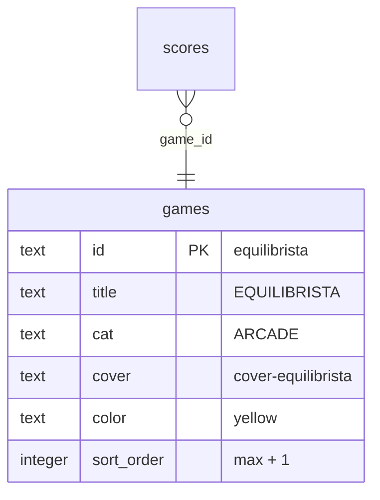
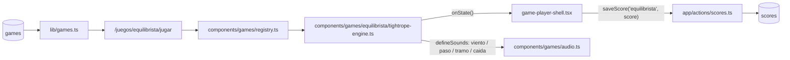

# SPEC GAME-JAM — EQUILIBRISTA (circo nocturno)

> **Estado:** Borrador
> **Tema:** circo nocturno
> **Depende de:** 05-rocas-asteroids-motor, 06-ranking-global-catalogo-juegos-v0.2.0, 11-score-plausibility-caps-v0.2.5
> **Fecha:** 2026-10-19
> **Versión:** a asignar al promover (minor — package.json es la fuente de verdad; hoy sería `0.5.3 → 0.6.0`)
> **Objetivo:** Escribir desde cero el motor de EQUILIBRISTA, un juego de equilibrio sobre cuerda floja en el que se empuja la garrocha a izquierda/derecha para no caer mientras el artista avanza solo y el viento sopla en ráfagas, y sumarlo al catálogo como juego nuevo (fila en `games` + portada CSS propia).

## Alcance

**Incluye:**

- `components/games/equilibrista/tightrope-engine.ts`: motor que exporta `createTightropeEngine: EngineFactory`, escrito desde cero (no hay fuente en `references/started-games/`), nativo 800×600, sin assets binarios, con sonido propio declarado con `defineSounds` + `beep` de `components/games/audio.ts` (`audio.ts` no se modifica).
- `components/games/registry.ts`: agrega la entrada `equilibrista: { load: () => import("./equilibrista/tightrope-engine").then((m) => m.createTightropeEngine), maxPlausibleScore: 50_000, skins: ["clasico", "neon", "retro"], music: "jardin", touchControls: {...} }` — **techo de cordura** (el juego es sin fin; cálculo en Modelo de datos).
- Skins `clasico` (default), `neon` y `retro` dentro del motor, según `components/games/README.md` § Skins (patrón de CAÍDA). Solo visual: no tocan física, viento, puntaje, controles ni sonidos.
- `sql/00N_add_game_equilibrista.sql` (`N` = siguiente número libre de `sql/` al promover): `insert ... on conflict (id) do nothing` de la fila `equilibrista` en `games` — idempotente, nunca un `INSERT` a secas ni un `DROP`/`UPDATE` de filas existentes. Aplicado vía el MCP de Supabase (`apply_migration`), igual que specs 04/05/06.
- `app/globals.css`: bloque `.cover-equilibrista` en la sección "Cover art generators" (solo CSS con los tokens `var(--cyan|--magenta|--yellow|--green|--ink)`).
- `references/juegos-implementados.md`: fila nueva `equilibrista` con su motor (regla de `CLAUDE.md`).
- `package.json`: bump minor de versión.
- `CHANGELOG.md`: entrada para la versión nueva enlazando a este spec.

**Fuera de alcance (para futuros specs):**

- Obstáculos sobre la cuerda (pájaros, aros de fuego, saltos), coleccionables, monociclo, o un segundo artista.
- Freno / control de la velocidad de avance: el artista siempre camina.
- Semilla diaria o ráfagas deterministas para un leaderboard "justo".
- Audio con archivos (`.mp3`/`.wav`) — todo sintetizado con `beep`.
- `devicePixelRatio` / escalado por densidad de píxeles.
- Validación en build de que cada clave de `registry.ts` tenga fila en `games`.
- Cambios a `game-player-shell.tsx`, `game-engine.ts` o `app/actions/scores.ts`.

## Modelo de datos

Sin nuevas tablas — reusa `scores`/`games` de specs 04/06. Caso C: una fila nueva en `games`.

**Fila nueva de `games`:**

| Columna      | Valor                                                                                                                                                                      |
| ------------ | -------------------------------------------------------------------------------------------------------------------------------------------------------------------------- |
| `id`         | `equilibrista`                                                                                                                                                             |
| `title`      | `EQUILIBRISTA`                                                                                                                                                             |
| `short`      | `Cruza la cuerda floja sin perder el equilibrio.`                                                                                                                          |
| `long`       | `Bajo los focos de la carpa, un artista cruza una cuerda sin fin con una garrocha en las manos. Empuja a izquierda y derecha para compensar cada ráfaga de viento: cada tramo es más rápido y más ventoso que el anterior. La red aguanta tres caídas.` |
| `cat`        | `ARCADE`                                                                                                                                                                   |
| `cover`      | `cover-equilibrista`                                                                                                                                                       |
| `color`      | `yellow`                                                                                                                                                                   |
| `sort_order` | `max(sort_order) + 1` al momento de aplicar la migración — por `sql/004_…` hoy el máximo es `8`, pero otras specs de jams pendientes también piden `9`: confirmar contra la base en vivo al promover. |



**Física (paso fijo de 1/120 s, acumulando `dt`; `dt` recortado a 0,05 s por frame):**

El artista es un péndulo invertido con ángulo `θ` (rad, 0 = vertical, positivo = hacia la derecha) y velocidad angular `ω`:

```
α = K·sin(θ) + U·dir + W(t) − C·ω        // aceleración angular
ω += α·dt;  θ += ω·dt
```

| Constante | Valor | Qué es |
| --------- | ----- | ------ |
| `K`       | 3,0 s⁻² | Inestabilidad (la gravedad lo tira hacia donde ya se inclina). |
| `U`       | 7,0 rad/s² | Empuje de la garrocha. `dir` ∈ {−1, 0, +1} según las teclas apretadas (ambas = 0). |
| `C`       | 0,6 s⁻¹ | Amortiguación. |
| `W(t)`    | ver abajo | Aceleración angular del viento. |
| Caída     | `|θ| > 1,0` rad | El artista cae. |

El empuje `U` siempre supera lo que `K·sin(θ)` puede aportar dentro del rango útil (`K·sin(1,0) ≈ 2,5 < U`), así que el juego es siempre recuperable salvo por ráfagas mal respondidas.

**Viento:** cada `gap` s empieza una ráfaga de 0,8 s con perfil `A·sin(π·t/0,8)` y signo aleatorio. Antes de empezar, durante 0,7 s, se dibujan rayas de viento que entran por el lado de origen (aviso visual y sonoro, sin efecto sobre la física).

| Variable | Fórmula |
| -------- | ------- |
| `A` (amplitud) | `min(2,5, 0,8 + 0,15·(level − 1))` rad/s² |
| `gap` (pausa entre ráfagas) | aleatorio uniforme en `[max(2,0, 6,0 − 0,4·(level − 1)), max(3,5, 8,0 − 0,4·(level − 1))]` s |

**Avance:** el artista camina solo, sin input, a `v(level) = min(4,0, 1,5 + 0,25·(level − 1))` m/s. Escala: 1 m = 40 px; la cuerda, el fondo y los focos hacen parallax hacia la izquierda mientras el artista queda fijo en x = 300.

**Caída y respawn:** al caer, `lives −= 1`, suena `caida`, la red se dibuja 0,6 s y el artista reaparece **en el mismo punto de la cuerda** (la distancia no retrocede, para que no se pueda re-sumar el mismo tramo), con `θ = 0`, `ω = 0` y 2 s sin ráfagas ni avance. Si `lives === 0` → `gameover`.

**Tabla de puntuación (todo entero):**

| Evento | Puntos |
| ------ | ------ |
| Cada metro recorrido (cruzar `floor(x/40)` hacia arriba) | +1 |
| Completar un tramo (cada 100 m) | +50 y `level += 1` |

Solo suma avanzar: nada resta puntos y la distancia nunca retrocede (ver respawn). Los 2 s de calma tras una caída no suman metros.

**Techo de cordura (`maxPlausibleScore = 50_000`):** a velocidad tope (4,0 m/s, nivel ≥ 11) cada tramo son 100 m + 50 de bonus = 150 pts en 25 s = 6 pts/s → 2 h de caminata perfecta sin una sola caída ≈ 43.200 pts. Redondeado a 50.000 (≈ 2 h 19 min). Una partida realista dura 1–6 min y termina en 300–2.000 pts.

**Mapeo a `EngineState`:**

| Campo   | Valor |
| ------- | ----- |
| `score` | Metros + bonos de tramo (acumulado; nunca se resetea al caer, solo en `restart()`). |
| `lives` | Arranca en `3`; −1 por caída. |
| `level` | `1 + floor(metros / 100)`, sin techo (la velocidad y la amplitud se topan, ver fórmulas). |
| `badge` | `{ label: "METROS", value: String(metros) }`. |
| `phase` | `"paused"` si `isPaused`; `"gameover"` si `lives === 0`; si no, `"playing"`. |

`onState` solo se llama cuando cambia `score`, `lives`, `level`, `phase` o `badge` (cada metro cambia `score` y `badge`; nunca por frame).

**Controles:**

| Input | Acción | `preventDefault` |
| ----- | ------ | ---------------- |
| `ArrowLeft` / `KeyA` (mantener) | `dir −1`: empuja la garrocha a la izquierda | Sí |
| `ArrowRight` / `KeyD` (mantener) | `dir +1`: empuja a la derecha | Sí |
| Puntero: mantener en la mitad izquierda / derecha del canvas | Igual que las flechas | Sí (`pointerdown`) |

El motor lleva el estado de teclas apretadas por polling (`keydown`/`keyup` en `window`, sin filtrar `repeat` ni `isTrusted`, así los eventos sintéticos del gamepad táctil funcionan); `blur` de la ventana suelta todas las teclas.

`touchControls`: `{ dpad: { left: { code: "ArrowLeft", label: "◀" }, right: { code: "ArrowRight", label: "▶" } } }` — sin `repeat` (el motor usa polling, no auto-repeat).

**Sonido (`defineSounds` dentro del motor):**

| Nombre | Dispara en |
| ------ | ---------- |
| `viento` | Comienzo del aviso de una ráfaga (ruido grave corto). |
| `paso` | Cada metro (blip muy corto y silencioso; con mute activo no genera nodos). |
| `tramo` | Completar un tramo de 100 m (arpegio ascendente corto). |
| `caida` | Caer a la red (tono descendente). |

**Resolución:** 800×600 nativo. Cuerda a y = 380 con la red en y = 560; focos y carpa de fondo en parallax.

**Skins (solo visual):** `clasico` — carpa roja/amarilla, artista de rectángulos; `neon` — contornos de tubo de neón con glow sobre violeta; `retro` — 4 tonos, bordes duros, sin glow.

**Cover `.cover-equilibrista`:** fondo degradado nocturno (`#1a0a2a → #0a0a18`), una diagonal fina `var(--yellow)` (la cuerda) con un punto `var(--magenta)` encima (artista) y dos conos de luz `var(--cyan)` semitransparentes desde arriba.



## Plan de implementación

1. `sql/00N_add_game_equilibrista.sql` con `insert into games (...) values (...) on conflict (id) do nothing` de la fila de arriba (`sort_order` = máximo actual + 1, confirmado contra la base en vivo). Aplicar con el MCP de Supabase (`apply_migration`) y verificar con `list_tables`/`get_advisors`. Test manual: `select * from games where id = 'equilibrista'` devuelve la fila.
2. Bloque `.cover-equilibrista` en `app/globals.css`. Test manual: `/games` y `/juegos/equilibrista` muestran la portada.
3. Esqueleto del motor en `components/games/equilibrista/tightrope-engine.ts`: factory, `ctx`, los 6 métodos del `EngineHandle`, loop RAF con `lastTime` y paso fijo, `reportState()` con diff campo por campo, `destroy()` que saca listeners y cancela el RAF. Test manual: `npm run lint`; el canvas se ve con la cuerda y el artista quieto.
4. Física: `θ`/`ω`, constantes `K/U/C`, input por polling (flechas, A/D, mitades del canvas con `pointer*`), `preventDefault`, soltar teclas en `blur`. Test manual: sin input el artista se inclina y cae; con flechas se lo puede sostener.
5. Avance y parallax: camina a `v(level)`, cuerda/fondo scrollean; metros y `score`/`badge`. Test manual: `score` sube 1 por metro, siempre entero.
6. Viento: scheduler de ráfagas con aviso de 0,7 s, `A` y `gap` por nivel; `level` por tramo y bono +50. Test manual: se ven las rayas antes de cada ráfaga; al cruzar 100 m `level` pasa a 2 y el bono suma 50.
7. Caída y vidas: umbral `|θ| > 1,0`, red, respawn en el mismo punto con 2 s de calma, `lives`, `gameover` en 0. Test manual: las 3 caídas — el juego sigue tras la 1ª y 2ª, termina en la 3ª, y la distancia no retrocede.
8. Sonidos con `defineSounds` (`viento`, `paso`, `tramo`, `caida`). Test manual: suenan en sus eventos; con mute no hay nodos de audio.
9. Skins `clasico`/`neon`/`retro` + `setSkin` (patrón de CAÍDA; correr `@skin-designer equilibrista` si faltan) y, luego, `@mobile-porter equilibrista` para el gamepad. Test manual: cambiar de skin en vivo sin reiniciar la partida.
10. Entrada en `components/games/registry.ts` (`load` con `import()` dinámico, `maxPlausibleScore: 50_000`, `skins`, `music`, `touchControls`) y fila en `references/juegos-implementados.md`. Test manual: `/juegos/equilibrista/jugar` carga el motor real en vez del mock.
11. `package.json` bump minor + entrada en `CHANGELOG.md`. Test manual: el Footer muestra la versión nueva.
12. Verificación end-to-end completa (sección homónima de `add-game-impl/SKILL.md`). Test manual: partida real con sesión activa, una fila nueva en `scores`, visible en `/juegos/equilibrista`, `/games` y `/salon-de-la-fama`.

## Criterios de aceptación

- [ ] El motor exporta `createTightropeEngine` cumpliendo `EngineFactory`.
- [ ] `registry.ts` carga el motor con `import()` dinámico y declara `maxPlausibleScore: 50_000`.
- [ ] Sin input, el artista se inclina y cae; con `ArrowLeft/Right`, `KeyA/D` o mantener en una mitad del canvas se lo puede sostener.
- [ ] Ninguna de las flechas scrollea la página.
- [ ] La física usa paso fijo atado a `dt`: la dificultad es la misma a 60 y a 144 Hz.
- [ ] Cada metro suma +1 y cada tramo de 100 m +50 y sube `level`; `score` es siempre entero.
- [ ] Las ráfagas se anuncian 0,7 s antes (rayas + sonido `viento`) y su amplitud/frecuencia siguen las fórmulas por nivel, con `A` y `v` topadas.
- [ ] Caer resta 1 vida, muestra la red, reaparece en el mismo punto con 2 s de calma, y la distancia no retrocede ni se puede re-sumar.
- [ ] `lives === 0` dispara `phase: "gameover"` y abre el modal de fin de partida.
- [ ] El HUD refleja `score`/`lives`/`level` reales; el `badge` muestra "METROS".
- [ ] El canvas no dibuja su propio texto de HUD ni overlay de pausa/game over.
- [ ] PAUSA congela la simulación (RAF cancelado); REANUDAR no produce salto (el acumulador de paso fijo se resetea).
- [ ] FIN fuerza game over con el score actual.
- [ ] Con sesión activa, una partida terminada crea exactamente una fila nueva en `scores`; sin sesión, el modal muestra el CTA a `/auth` y no guarda nada.
- [ ] Si el guardado falla, se muestra el error con botón REINTENTAR.
- [ ] "JUGAR DE NUEVO" reinicia el motor (score 0, 3 vidas, nivel 1) sin remontar el componente; "VOLVER AL VAULT" navega a `/juegos/equilibrista`.
- [ ] Salir de la página cancela el RAF y saca los listeners (`keydown`, `keyup`, `blur`, `pointer*`) sin fugas al entrar/salir repetidas veces.
- [ ] Visitar otro juego no descarga el chunk de este motor.
- [ ] Las skins `clasico`, `neon` y `retro` cambian en vivo y no alteran física, puntaje ni sonido.
- [ ] En un teléfono el gamepad táctil (◀ ▶) permite jugar en vertical y horizontal.
- [ ] `/juegos/equilibrista` y `/salon-de-la-fama` (tab del juego y GLOBAL) reflejan la partida sin intervención manual.
- [ ] La fila de `games` tiene RLS de solo lectura y `get_advisors` no reporta hallazgos nuevos.
- [ ] `npm run lint` y `npm run build` sin errores.
- [ ] El motor no lee `localStorage` ni toca el DOM fuera del canvas recibido.

## Decisiones

- **Sí:** avance automático sin freno. Es la fuente de presión: si el artista pudiera quedarse quieto, bastaría estabilizarse y esperar (decidido por game-jam — revisar).
- **Sí:** respawn en el mismo punto y sin retroceso de distancia. Evita que caer sea "farmeable" (re-recorrer tramos ya puntuados) y mantiene el `maxPlausibleScore` defendible (decidido por game-jam — revisar).
- **Sí:** techo de cordura de 50.000 en vez de un final con N tramos. El juego se queda infinito porque `v` y `A` se topan y no hay un final natural; el cálculo (6 pts/s máx. ≈ 2 h) deja margen sin dejar pasar puntajes absurdos (decidido por game-jam — revisar).
- **Sí:** `lives` = caídas a la red (3), `level` = tramo de 100 m, mismo espíritu que SERPENTINA/RANARIA (decidido por game-jam — revisar).
- **Sí:** input por polling de teclas apretadas (no por auto-repeat), alias flechas + A/D y mitades del canvas para puntero, mismo patrón que el teclado+mouse de BLOQUE BUSTER (decidido por game-jam — revisar).
- **Sí:** viento aleatorio (no determinista). Introduce algo de azar, pero con aviso de 0,7 s y amplitud siempre recuperable (`U > K·sin(1,0)`) un jugador hábil siempre puede responder; semilla diaria queda para un spec futuro (decidido por game-jam — revisar).
- **Sí:** sin obstáculos ni coleccionables en v1, para un alcance bajo-medio: una sola mecánica (equilibrio) bien afinada.
- **No:** tocar `game-player-shell.tsx`, `game-engine.ts`, `audio.ts` ni `app/actions/scores.ts`; el contrato alcanza.
- **Sí:** bump **minor** (juego nuevo visible en el catálogo, caso C).
- **Diferencia con juegos del catálogo:** ningún motor existente usa un sistema inestable controlado con empuje (ROCAS tiene inercia pero controla posición, no equilibrio); RANARIA es esquivar por casillas. Sin superposición mecánica.

## Riesgos

| Riesgo | Mitigación |
| ------ | ---------- |
| La dificultad depende del framerate si la física se integra por frame | Paso fijo 1/120 s con acumulador; recortar `dt` a 0,05 s; resetear acumulador en `resume()`/`restart()` |
| Ráfagas injustas (azar) que hacen caer a jugadores hábiles | Aviso de 0,7 s, `U > K·sin(1,0)`, amplitud topada en 2,5 y 2 s de calma tras cada caída; probar con el valor máximo de `A` que sigue siendo recuperable |
| Teclas "pegadas" (`keyup` perdido al cambiar de pestaña) | Soltar todas en `blur` y en `pause()`; el gamepad táctil emite `keyup` en `pointerup`/`pointercancel` |
| Score no entero o que retrocede | Solo eventos +1 / +50 enteros; distancia monótona; verificar `Number.isInteger(score)` |
| Partidas muy largas (jugador perfecto) | `maxPlausibleScore` = 50.000 como techo; si en la práctica se alcanza, subirlo o agregar obstáculos en un spec futuro |
| Número de migración y `sort_order` en conflicto con otras specs de jams | Tomar el siguiente `sql/00N_` libre y `max(sort_order) + 1` al promover, contra la base en vivo |
| Superposición con candidatos: ALUNIZAJE (física con inercia) y ALETEO (reflejos de un input) | Mecánica distinta (equilibrio vs. empuje/aterrizaje vs. tap); si se implementa este, re-evaluar con `@game-planner` |

## Lo que **no** está en este spec

- Obstáculos, coleccionables, monociclo o segundo artista.
- Freno o control de velocidad.
- Semilla diaria / ráfagas deterministas.
- Audio con archivos.
- `devicePixelRatio`.
- Validación en build de ids de `registry.ts` contra `games`.
- Cambios a `game-player-shell.tsx`, `game-engine.ts`, `audio.ts` o `app/actions/scores.ts`.

Cada uno de estos, si se implementa, va en su propio spec.
