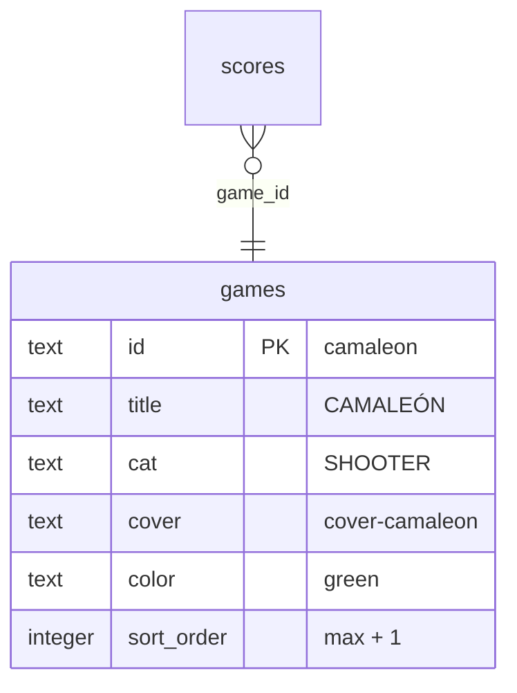
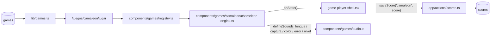

# SPEC GAME-JAM — CAMALEÓN (selva tropical)

> **Estado:** Borrador
> **Tema:** selva tropical
> **Depende de:** 05-rocas-asteroids-motor, 06-ranking-global-catalogo-juegos-v0.2.0, 11-score-plausibility-caps-v0.2.5
> **Fecha:** 2026-10-26
> **Versión:** a asignar al promover (minor — package.json es la fuente de verdad; hoy sería `0.7.0 → 0.8.0`)
> **Objetivo:** Escribir desde cero el motor de CAMALEÓN, un juego de puntería de lengua en el que un camaleón cambia de color para comerse solo los insectos de su mismo color mientras evita avispas, y sumarlo al catálogo como juego nuevo (fila en `games` + portada CSS propia).

## Alcance

**Incluye:**

- `components/games/camaleon/chameleon-engine.ts`: motor que exporta `createChameleonEngine: EngineFactory`, escrito desde cero (no hay fuente en `references/started-games/`), nativo 800×600, sin assets binarios, con sonido propio declarado con `defineSounds` + `beep` de `components/games/audio.ts` (`audio.ts` no se modifica).
- `components/games/registry.ts`: agrega la entrada `camaleon: { load: () => import("./camaleon/chameleon-engine").then((m) => m.createChameleonEngine), maxPlausibleScore: 500_000, skins: ["clasico", "neon", "retro"], music: "jardin", touchControls: {...} }` — **techo de cordura** (juego sin fin; cálculo en Modelo de datos).
- Skins `clasico` (default), `neon` y `retro` dentro del motor, según `components/games/README.md` § Skins (patrón de CAÍDA). Solo visual: no tocan física, puntaje, controles ni sonidos.
- `sql/00N_add_game_camaleon.sql` (`N` = siguiente número libre de `sql/` al promover): `insert ... on conflict (id) do nothing` de la fila `camaleon` en `games` — idempotente, nunca un `INSERT` a secas ni un `DROP`/`UPDATE` de filas existentes. Aplicado vía el MCP de Supabase (`apply_migration`), igual que specs 04/05/06.
- `app/globals.css`: bloque `.cover-camaleon` en la sección "Cover art generators" (solo CSS con los tokens `var(--cyan|--magenta|--yellow|--green|--ink)`).
- `references/juegos-implementados.md`: fila nueva `camaleon` con su motor (regla de `CLAUDE.md`).
- `package.json`: bump minor de versión.
- `CHANGELOG.md`: entrada para la versión nueva enlazando a este spec.

**Fuera de alcance (para futuros specs):**

- Más de 3 colores, insectos con patrones/efectos (congelar, doble puntos, power-ups), jefes.
- Varias lenguas a la vez o lengua que "agarra" varios insectos (una lengua = como máximo un impacto).
- Ranas/predadores que persiguen al camaleón o movimiento del camaleón: está fijo.
- Audio con archivos (`.mp3`/`.wav`) — todo sintetizado con `beep`.
- `devicePixelRatio` / escalado por densidad de píxeles.
- Semilla diaria para un leaderboard "justo".
- Validación en build de que cada clave de `registry.ts` tenga fila en `games`.
- Cambios a `game-player-shell.tsx`, `game-engine.ts` o `app/actions/scores.ts`.

## Modelo de datos

Sin nuevas tablas — reusa `scores`/`games` de specs 04/06. Caso C: una fila nueva en `games`.

**Fila nueva de `games`:**

| Columna      | Valor |
| ------------ | ----- |
| `id`         | `camaleon` |
| `title`      | `CAMALEÓN` |
| `short`      | `Cambia de color y caza solo lo que combina.` |
| `long`       | `Desde una rama de la selva, un camaleón dispara su lengua a los insectos que cruzan el follaje. Solo puede comer los de su mismo color: cambia de piel al vuelo, encadena capturas para multiplicar los puntos y esquiva avispas y errores. Tres fallos y la selva te traga.` |
| `cat`        | `SHOOTER` |
| `cover`      | `cover-camaleon` |
| `color`      | `green` |
| `sort_order` | `max(sort_order) + 1` al momento de aplicar la migración — por `sql/004_…` hoy el máximo es `8`, pero otras specs de jams pendientes también piden `9`+: confirmar contra la base en vivo al promover. |

**Escena (800×600):** el camaleón está fijo en (400, 540) sobre una rama; el follaje ocupa y ∈ [0, 500]. La lengua sale de la boca (400, 520) hacia un ángulo de puntería `φ` (rad, 0 = vertical hacia arriba, rango `[−1,2 ; +1,2]`).

**Colores:** tres, `verde`, `rosa` y `amarillo` (tokens `--green`, `--magenta`, `--yellow`); además de la señal de color, cada uno tiene forma distinta (círculo / rombo / triángulo) para accesibilidad. El camaleón empieza en `verde`. Cambiar de color es instantáneo pero tiene **enfriamiento de 0,25 s** (ignorar cambios durante ese lapso).

**Insectos (paso fijo de 1/120 s, acumulando `dt`; `dt` recortado a 0,05 s):**

| Tipo | Probabilidad al aparecer | Efecto al ser alcanzado por la lengua |
| ---- | ------------------------ | ------------------------------------- |
| Mosca (color c ∈ {verde, rosa, amarillo}) | 85 % (c uniforme) | Si c = color del camaleón → se come, suma puntos. Si no → **error**. |
| Avispa (negra) | 15 % (0 % hasta `level` 2) | **Error**, siempre, sin importar el color. |

Los insectos entran por el borde izquierdo o derecho a una altura `y` uniforme en [60, 440], cruzan en línea con ondulación senoidal (amplitud 30 px) a velocidad `vi(level) = min(260, 110 + 15·(level − 1))` px/s y salen por el otro lado; **salir sin ser tocados no cuesta nada**. Radio de colisión: 18 px (mosca), 22 px (avispa). Cadencia de aparición: uno cada `max(0,4, 1,2 − 0,08·(level − 1))` s, con un máximo de 8 insectos en pantalla a la vez.

**Lengua:** una sola a la vez. Disparo → extiende a 1.400 px/s hasta tocar el primer insecto a lo largo del rayo o llegar a 520 px de largo; luego retrae a 1.800 px/s. Mientras la lengua está fuera no se puede disparar de nuevo, así que el ciclo mínimo es ≈ 0,3–0,5 s y el máximo teórico de capturas es **2 por segundo**.

**Errores:** un error (color distinto o avispa) hace `lives −= 1`, rompe el combo (`combo = 1`), suena `error`, el insecto desaparece y el camaleón queda aturdido 0,5 s (no dispara; sí puede cambiar de color). Una lengua que no toca nada no cuesta nada (solo un ciclo perdido).

**Tabla de puntuación (todo entero):**

| Evento | Puntos |
| ------ | ------ |
| Comer una mosca del color correcto | `10 × combo` |
| Combo | `combo` empieza en 1, +1 por cada captura correcta consecutiva, **tope 5**; vuelve a 1 con cualquier error |
| Cada 10 capturas correctas (acumuladas) | `level += 1`, sin puntos extra |

Solo suma comer bien: nada resta puntos. Lo máximo por captura es 50.

**Techo de cordura (`maxPlausibleScore = 500_000`):** capturas máx. 2/s × 50 pts = 100 pts/s con combo ×5 sostenido, imposible en la práctica porque la cadencia de aparición topa en 0,4 s (2,5 insectos/s, de los cuales ≤ 85 % moscas y solo 1/3 del color actual sin cambiar). 100 pts/s ≈ 360.000/h; 500.000 ≈ 1 h 23 min de juego perfecto sin un solo error. Una partida realista dura 2–8 min y termina en 300–3.000 pts.

**Mapeo a `EngineState`:**

| Campo   | Valor |
| ------- | ----- |
| `score` | Puntos acumulados (nunca se resetea salvo en `restart()`). |
| `lives` | Arranca en `3`; −1 por error. |
| `level` | `1 + floor(capturas / 10)`, sin techo (la velocidad y la cadencia se topan, ver fórmulas). |
| `badge` | `{ label: "COMBO", value: "x" + combo }`. |
| `phase` | `"paused"` si `isPaused`; `"gameover"` si `lives === 0`; si no, `"playing"`. |

`onState` solo se llama cuando cambia `score`, `lives`, `level`, `phase` o `badge` (nunca por frame; el color actual del camaleón no va al estado, se dibuja en el canvas).

**Controles:**

| Input | Acción | `preventDefault` |
| ----- | ------ | ---------------- |
| `Digit1` / `Digit2` / `Digit3` (o `KeyQ` / `KeyW` / `KeyE`) | Cambia a verde / rosa / amarillo | Sí |
| `ArrowLeft` / `KeyA` (mantener) | Gira la puntería a la izquierda (1,6 rad/s) | Sí |
| `ArrowRight` / `KeyD` (mantener) | Gira la puntería a la derecha | Sí |
| `Space` | Dispara la lengua | Sí |
| Puntero: mover | Apunta la lengua hacia el cursor | No |
| Puntero: clic / toque en el follaje (y < 500) | Apunta a ese punto y dispara | Sí (`pointerdown`) |
| Puntero: clic / toque en la franja inferior (y ≥ 500) | Cicla el color (verde → rosa → amarillo) | Sí (`pointerdown`) |

El motor lleva las teclas apretadas por polling (`keydown`/`keyup` en `window`, sin filtrar `repeat` ni `isTrusted`, así los eventos sintéticos del gamepad táctil funcionan); `blur` suelta todas.

`touchControls`: `{ dpad: { left: { code: "ArrowLeft", label: "◀" }, right: { code: "ArrowRight", label: "▶" } }, actions: [{ code: "Digit1", label: "VERDE" }, { code: "Digit2", label: "ROSA" }, { code: "Digit3", label: "AMARILLO" }, { code: "Space", label: "LENGUA" }] }` — sin `repeat`.

**Sonido (`defineSounds` dentro del motor):**

| Nombre | Dispara en |
| ------ | ---------- |
| `lengua` | Disparo de la lengua (chasquido corto agudo). |
| `captura` | Comer una mosca (blip ascendente; el tono sube con el combo). |
| `color` | Cambiar de color (blip muy corto). |
| `error` | Error (zumbido grave descendente). |
| `nivel` | Subir de nivel (arpegio ascendente corto). |

**Resolución:** 800×600 nativo. Fondo: follaje en parallax estático, rama en y = 560.

**Skins (solo visual):** `clasico` — selva verde, camaleón de rectángulos y círculos; `neon` — contornos de neón con glow sobre fondo violeta; `retro` — 4 tonos, bordes duros, sin glow (las formas siguen distinguiendo los colores de insecto).

**Cover `.cover-camaleon`:** fondo degradado verde oscuro (`#06240f → #020a05`), un círculo `var(--green)` grande (cuerpo) con un círculo `var(--ink)` pequeño (ojo), una línea fina `var(--magenta)` diagonal (la lengua) terminando en un punto `var(--yellow)` (el insecto).

## Plan de implementación

1. `sql/00N_add_game_camaleon.sql` con `insert into games (...) values (...) on conflict (id) do nothing` de la fila de arriba (`sort_order` = máximo actual + 1, confirmado contra la base en vivo). Aplicar con el MCP de Supabase (`apply_migration`) y verificar con `list_tables`/`get_advisors`. Test manual: `select * from games where id = 'camaleon'` devuelve la fila.
2. Bloque `.cover-camaleon` en `app/globals.css`. Test manual: `/games` y `/juegos/camaleon` muestran la portada.
3. Esqueleto del motor en `components/games/camaleon/chameleon-engine.ts`: factory, `ctx`, los 6 métodos del `EngineHandle`, loop RAF con `lastTime` y paso fijo, `reportState()` con diff campo por campo, `destroy()` que saca listeners y cancela el RAF. Test manual: `npm run lint`; el canvas muestra el camaleón sobre la rama.
4. Insectos: spawner con cadencia y velocidad por nivel, trayectoria senoidal, salida por el borde opuesto, tope de 8 en pantalla. Test manual: cruzan y desaparecen sin afectar el estado.
5. Lengua: puntería (teclas y puntero), disparo, extensión/retracción, colisión con el primer insecto del rayo, una sola lengua a la vez. Test manual: no se puede disparar con la lengua afuera.
6. Colores y reglas: cambio con enfriamiento, captura correcta, error por color/avispa, aturdimiento, combo con tope 5. Test manual: `score` solo sube con color correcto; combo vuelve a 1 con un error.
7. Niveles y vidas: `level` cada 10 capturas, avispas desde nivel 2, `gameover` en 0 vidas. Test manual: tres errores terminan la partida.
8. Sonidos con `defineSounds` (`lengua`, `captura`, `color`, `error`, `nivel`). Test manual: suenan en sus eventos; con mute no hay nodos de audio.
9. Skins `clasico`/`neon`/`retro` + `setSkin` (patrón de CAÍDA; correr `@skin-designer camaleon` si faltan) y, luego, `@mobile-porter camaleon` para el gamepad. Test manual: cambiar de skin en vivo sin reiniciar la partida.
10. Entrada en `components/games/registry.ts` (`load` con `import()` dinámico, `maxPlausibleScore: 500_000`, `skins`, `music`, `touchControls`) y fila en `references/juegos-implementados.md`. Test manual: `/juegos/camaleon/jugar` carga el motor real en vez del mock.
11. `package.json` bump minor + entrada en `CHANGELOG.md`. Test manual: el Footer muestra la versión nueva.
12. Verificación end-to-end completa (sección homónima de `add-game-impl/SKILL.md`). Test manual: partida real con sesión activa, una fila nueva en `scores`, visible en `/juegos/camaleon`, `/games` y `/salon-de-la-fama`.

## Criterios de aceptación

- [ ] El motor exporta `createChameleonEngine` cumpliendo `EngineFactory`.
- [ ] `registry.ts` carga el motor con `import()` dinámico y declara `maxPlausibleScore: 500_000`.
- [ ] Comer una mosca del color del camaleón suma `10 × combo` (combo tope 5); `score` es siempre entero.
- [ ] Un insecto de otro color o una avispa resta 1 vida, rompe el combo y aturde 0,5 s.
- [ ] Solo existe una lengua a la vez; el ciclo de disparo no permite más de ~2 capturas por segundo.
- [ ] El cambio de color respeta el enfriamiento de 0,25 s.
- [ ] Los insectos que salen sin ser tocados no cuestan vidas ni puntos.
- [ ] Ninguna de las flechas ni el espacio scrollea la página.
- [ ] La física usa paso fijo atado a `dt`: la dificultad es la misma a 60 y a 144 Hz.
- [ ] `level` sube cada 10 capturas; la velocidad y la cadencia se topan en sus fórmulas; las avispas aparecen desde nivel 2.
- [ ] `lives === 0` dispara `phase: "gameover"` y abre el modal de fin de partida.
- [ ] El HUD refleja `score`/`lives`/`level` reales; el `badge` muestra "COMBO".
- [ ] El canvas no dibuja su propio texto de HUD ni overlay de pausa/game over.
- [ ] PAUSA congela la simulación (RAF cancelado); REANUDAR no produce salto (el acumulador de paso fijo se resetea).
- [ ] FIN fuerza game over con el score actual.
- [ ] Con sesión activa, una partida terminada crea exactamente una fila nueva en `scores`; sin sesión, el modal muestra el CTA a `/auth` y no guarda nada.
- [ ] Si el guardado falla, se muestra el error con botón REINTENTAR.
- [ ] "JUGAR DE NUEVO" reinicia el motor (score 0, 3 vidas, nivel 1) sin remontar el componente; "VOLVER AL VAULT" navega a `/juegos/camaleon`.
- [ ] Salir de la página cancela el RAF y saca los listeners (`keydown`, `keyup`, `blur`, `pointer*`) sin fugas al entrar/salir repetidas veces.
- [ ] Visitar otro juego no descarga el chunk de este motor.
- [ ] Las skins `clasico`, `neon` y `retro` cambian en vivo y no alteran física, puntaje ni sonido; los tres colores se distinguen también por forma.
- [ ] En un teléfono el gamepad táctil permite apuntar, cambiar de color y disparar en vertical y horizontal.
- [ ] `/juegos/camaleon` y `/salon-de-la-fama` (tab del juego y GLOBAL) reflejan la partida sin intervención manual.
- [ ] La fila de `games` tiene RLS de solo lectura y `get_advisors` no reporta hallazgos nuevos.
- [ ] `npm run lint` y `npm run build` sin errores.
- [ ] El motor no lee `localStorage` ni toca el DOM fuera del canvas recibido.

## Decisiones

- **Sí:** el color como regla de decisión (comer solo lo que combina) con enfriamiento de 0,25 s; sin enfriamiento cambiar de color sería gratis y la mecánica no tendría tensión (decidido por game-jam — revisar).
- **Sí:** el error cuesta vida, no puntos. Mantiene el puntaje monótono y el `maxPlausibleScore` defendible; la presión viene de las 3 vidas y de perder el combo (decidido por game-jam — revisar).
- **Sí:** techo de cordura de 500.000 en vez de un final con N niveles; el cap lo fijan la cadencia topada y el ciclo mínimo de la lengua, no el jugador (decidido por game-jam — revisar).
- **Sí:** `lives` = errores tolerados, `level` = cada 10 capturas, `badge` = combo, mismo espíritu que SERPENTINA/RANARIA (decidido por game-jam — revisar).
- **Sí:** puntería por teclas y por puntero, y gamepad táctil con botones de color, para cubrir escritorio y móvil sin tocar la plataforma (decidido por game-jam — revisar).
- **Sí:** formas distintas por color para no depender solo del color (accesibilidad), aunque el nombre del juego gire en torno al color.
- **Sí:** insectos aleatorios (sin semilla). El azar es de aparición, no de resultado: el jugador siempre puede decidir cuándo disparar y qué color usar (decidido por game-jam — revisar).
- **No:** tocar `game-player-shell.tsx`, `game-engine.ts`, `audio.ts` ni `app/actions/scores.ts`; el contrato alcanza.
- **Sí:** bump **minor** (juego nuevo visible en el catálogo, caso C).
- **Diferencia con juegos del catálogo:** ROCAS e INVASORES disparan sin restricción de objetivo; acá la puntería es la parte fácil y la decisión (qué color, a quién) es lo que puntúa. Se parece superficialmente a ARENA/CAZADRONES (apuntar con el mouse) pero con un único disparo a la vez, sin movimiento del jugador y con regla de color. Sin superposición mecánica real.

## Riesgos

| Riesgo | Mitigación |
| ------ | ---------- |
| La dificultad depende del framerate si el movimiento se integra por frame | Paso fijo 1/120 s con acumulador; recortar `dt` a 0,05 s; resetear acumulador en `resume()`/`restart()` |
| Penalizaciones injustas (avispa que cruza el rayo justo antes de una mosca) | La lengua impacta al primer insecto del rayo y se dibuja el rayo de puntería; avispas recién desde nivel 2 y en 15 % |
| Daltonismo | Forma distinta por color además del tono, también en la skin `retro` |
| Teclas "pegadas" (`keyup` perdido al cambiar de pestaña) | Soltar todas en `blur` y en `pause()`; el gamepad táctil emite `keyup` en `pointerup`/`pointercancel` |
| Score no entero o que retrocede | Solo eventos enteros `10 × combo`; verificar `Number.isInteger(score)` |
| Partidas muy largas (jugador perfecto) | `maxPlausibleScore` = 500.000 como techo; si en la práctica se alcanza, subirlo o agregar variedad en un spec futuro |
| Muchos controles en pantallas táctiles (◀ ▶ + 3 colores + lengua) | Probar con `@mobile-porter` (spec 12); si no entra, quitar los botones de color y usar solo el toque en la franja inferior |
| Número de migración y `sort_order` en conflicto con otras specs de jams | Tomar el siguiente `sql/00N_` libre y `max(sort_order) + 1` al promover, contra la base en vivo |
| Superposición con candidatos: ARENA (Robotron) y CAZADRONES (apuntar con mouse), BOMBAS (reflejos de puntero) | Reglas y objetivo distintos; si se implementa este, re-evaluar con `@game-planner` |

## Lo que **no** está en este spec

- Más colores, power-ups, jefes.
- Varias lenguas o capturas múltiples.
- Predadores o movimiento del camaleón.
- Audio con archivos.
- `devicePixelRatio`.
- Semilla diaria.
- Validación en build de ids de `registry.ts` contra `games`.
- Cambios a `game-player-shell.tsx`, `game-engine.ts`, `audio.ts` o `app/actions/scores.ts`.

Cada uno de estos, si se implementa, va en su propio spec.
