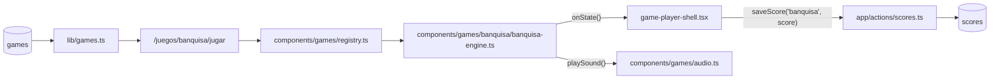
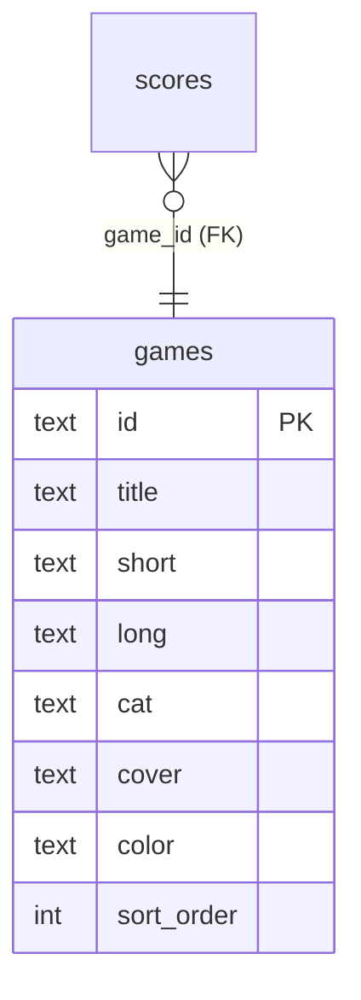
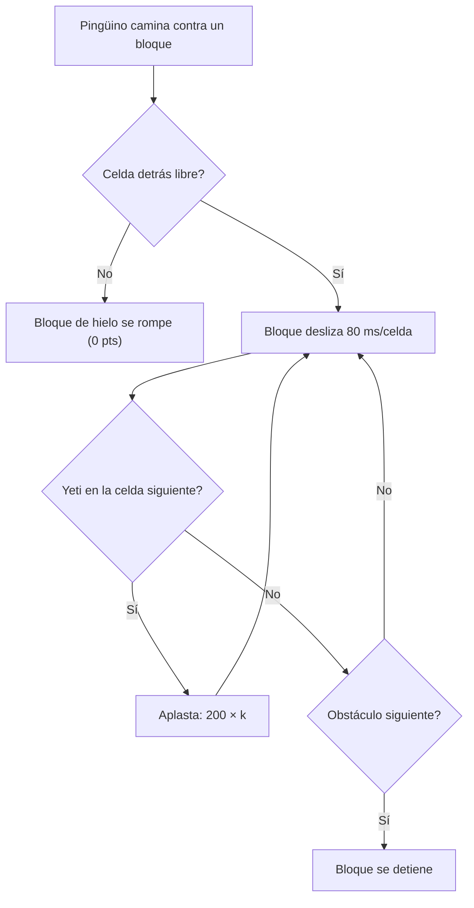

# SPEC GAME-JAM — BANQUISA (expedición polar)

> **Estado:** Borrador
> **Tema:** expedición polar
> **Depende de:** 05-rocas-asteroids-motor, 06-ranking-global-catalogo-juegos-v0.2.0, 11-score-plausibility-caps-v0.2.5
> **Fecha:** 2026-11-09
> **Versión:** a asignar al promover (minor — package.json es la fuente de verdad; hoy `0.7.1 → 0.8.0`)
> **Objetivo:** Escribir desde cero el motor de BANQUISA, un puzzle de acción sobre una grilla de hielo en el que un pingüino empuja bloques que se deslizan para aplastar yetis, y sumarlo al catálogo como juego nuevo (fila en `games` + portada CSS propia).

## Alcance

**Incluye:**

- `components/games/banquisa/banquisa-engine.ts`: motor que exporta `createBanquisaEngine: EngineFactory`, escrito desde cero (no hay fuente en `references/started-games/`), sobre una grilla de 15×11 celdas de 48 px dibujada con rectángulos y círculos (sin assets binarios).
- `components/games/registry.ts`: agrega `banquisa: { load: () => import("./banquisa/banquisa-engine").then((m) => m.createBanquisaEngine), maxPlausibleScore: 1_000_000, skins: ["clasico", "neon", "retro"], touchControls: {...} }` (techo de cordura, ver Modelo de datos; `music` con una pista ya existente de `music-tracks.ts`, a elegir al implementar).
- Sonidos propios dentro del motor con `defineSounds` + `beep` (`audio.ts` no se modifica): `step`, `push`, `shatter`, `crush`, `diamond`, `hurt`, `clear`.
- Skins `clasico` (default), `neon` y `retro` dentro del motor, según `components/games/README.md` § Skins (patrón de CAÍDA).
- `sql/00N_add_game_banquisa.sql`: `insert ... on conflict (id) do nothing` de la fila `banquisa` en `games` (idempotente, sin `DROP`/`UPDATE`). Aplicado vía el MCP de Supabase (`apply_migration`).
- `app/globals.css`: bloque `.cover-banquisa` en la sección "Cover art generators".
- `references/juegos-implementados.md` y `references/security-checklist/politicas-rls.md` (solo si la migración cambiara políticas; no debería) se actualizan al implementar, no ahora.
- `package.json` y `CHANGELOG.md`: bump minor + entrada que enlaza este spec.

**Fuera de alcance (para futuros specs):**

- Multijugador o modo 2 jugadores.
- Enemigos distintos al yeti, huevos que eclosionan, jefes.
- Editor o selección de niveles; los niveles son procedurales con semilla por número de nivel.
- Música nueva (se reusa una pista del catálogo) y audio con archivos.
- Cambios a `game-player-shell.tsx`, `game-engine.ts`, `audio.ts` o `app/actions/scores.ts`.
- `devicePixelRatio`.

## Modelo de datos

Sin tablas nuevas: reusa `scores`/`games` (specs 04/06). Sí hay una **fila nueva** en `games` (caso C).

### Reglas del juego

Tablero de 15×11 celdas (720×528 px) con origen en (40, 36) del arena de 800×600; el marco exterior es un muro de hielo fijo dibujado en el margen.

- **Pingüino:** una celda, 4 direcciones, un paso cada 130 ms mientras se mantiene una dirección (lectura por polling de teclas, no auto-repeat). Orientación = última dirección movida.
- **Bloques de hielo:** ocupan ~40 % de las celdas libres. **Empujar = caminar contra el bloque.** El bloque sale deslizándose a 12,5 celdas/s (80 ms/celda) hasta chocar con otro bloque, un diamante o el marco.
- **Bloque contra obstáculo pegado:** si el bloque empujado tiene un obstáculo en la celda inmediatamente detrás, **se rompe** (desaparece, 0 puntos) en vez de deslizar; si el obstáculo es un diamante, el bloque de hielo también se rompe. Esto abre pasillos.
- **Diamantes:** 3 por nivel. Se empujan y deslizan como el hielo, pero nunca se rompen. Alinearlos (3 celdas contiguas en fila o columna) suma `+1.000` una sola vez por nivel y aturde a todos los yetis 5 s (no se mueven ni dañan al pingüino; siguen siendo aplastables).
- **Yetis:** `E = min(3 + floor((nivel − 1) / 2), 6)` por nivel. Se mueven una celda cada `max(220, 420 − (nivel − 1) × 20)` ms: 70 % hacia el pingüino (reducir la distancia Manhattan en el eje libre), 30 % dirección aleatoria libre. Si el camino hacia el pingüino lo bloquea un bloque de hielo, lo rompe tras 800 ms (grieta visible). Tocar al pingüino (misma celda) lo hace perder una vida.
- **Aplastar:** un bloque deslizante que entra en la celda de un yeti lo elimina y sigue deslizando. El k-ésimo yeti aplastado por el **mismo** deslizamiento vale `200 × k`.
- **Pingüino aplastado:** un bloque deslizante nunca daña al pingüino (se detiene al verlo como obstáculo; el bloque no sale si el pingüino está pegado detrás).
- **Nivel completo:** al eliminar a todos los yetis → bono y siguiente nivel (otra semilla, +1 `level`).
- **Generación (semilla = nivel):** el pingüino arranca al centro-abajo; su celda y las 4 vecinas quedan libres; los yetis aparecen en celdas libres a distancia Manhattan ≥ 8 del pingüino; ningún yeti nace encerrado (si lo está, se rompe un bloque adyacente). Al perder una vida el nivel se regenera con la **misma** semilla (mismo layout), sin repetir bonos ya cobrados de diamantes (se pierden, el nivel arranca de cero) y manteniendo el score.

### Tabla de puntuación (todos enteros)

| Evento | Puntos |
| ------ | ------ |
| Yeti aplastado, k-ésimo del mismo deslizamiento | `200 × k` (200, 400, 600, …) |
| Diamantes alineados (una vez por nivel) | +1.000 |
| Nivel completo | +1.000 |
| Bono de tiempo del nivel | `max(0, 60 − segundosDelNivel) × 10`, tope 600 |
| Bloque roto, pasos, muerte | 0 |

### Cálculo del `maxPlausibleScore` (techo de cordura = 1.000.000)

- Máximo teórico por nivel con `E = 6` (nivel ≥ 7): cadena perfecta de 6 yetis = `200 × (1+2+3+4+5+6) = 4.200` + 1.000 diamantes + 1.000 nivel + 600 tiempo = **6.800**. Con `E = 3` (niveles 1–2) el máximo es `1.200 + 1.000 + 1.000 + 600 = 3.800`.
- Realista: 1.500–3.500 por nivel (una cadena perfecta de 6 exige que los 6 yetis estén alineados en la misma fila, algo casi imposible).
- `1.000.000 / 6.800 ≈ 147` niveles perfectos; con yetis a 220 ms por celda y niveles que exigen ≥ 15 s, equivale a > 35 min de juego perfecto sin perder una vida. Es un techo de cordura: nadie lo alcanza jugando de verdad (juego sin fin, sin final enumerable).

### Mapeo a `EngineState`

| Campo | Valor |
| ----- | ----- |
| `score` | Acumulado, nunca se resetea al perder una vida (solo en `restart()`). |
| `lives` | Arranca en `3`. Tocar un yeti activo resta 1, regenera el nivel y reinicia su cronómetro. `0` → `gameover`. |
| `level` | `1` + niveles completados, sin techo. |
| `badge` | `{ label: "YETIS", value: String(restantes) }`. |
| `phase` | `"paused"` si pausa; `"gameover"` si `lives === 0` o `endGame()`; si no `"playing"`. |

### Controles

| Input | Acción | `preventDefault` |
| ----- | ------ | ---------------- |
| `ArrowUp/Down/Left/Right` y `KeyW/A/S/D` | Mover; contra un bloque, empujarlo | Sí |

Sin puntero. `touchControls`: cruceta completa (`up/down/left/right`, sin `repeat` porque el motor lee teclas mantenidas por polling), sin botones de acción.

### Fila nueva de `games`

| Columna | Valor |
| ------- | ----- |
| `id` | `banquisa` |
| `title` | `BANQUISA` |
| `short` | `Desliza bloques de hielo y aplasta a los yetis.` |
| `long` | `Un pingüino atrapado en la banquisa, rodeado de yetis hambrientos. Empuja los bloques de hielo para que salgan disparados, aplasta a toda la manada y alinea los tres diamantes para congelarlos. Cada nivel trae más yetis y menos paciencia.` |
| `cat` | `PUZZLE` |
| `cover` | `cover-banquisa` |
| `color` | `cyan` |
| `sort_order` | siguiente libre al implementar (`select max(sort_order) + 1 from games`) |

**Portada `.cover-banquisa`:** fondo `linear-gradient(180deg,#00263a,#0a0a18)`; `::after` con 3 cuadrados de 28 px `var(--cyan)` en escalera, un círculo `var(--magenta)` (yeti) y un cuadrado `var(--yellow)` (pingüino) en `background-image` con `radial-gradient`/`linear-gradient`, más `filter: drop-shadow(0 0 6px rgba(0,229,255,0.6))`, igual de patrón que `.cover-snake`.

**Sonidos (`defineSounds` dentro del motor):** `step` (blip corto muy bajo), `push` (cuadrada grave), `shatter` (ruido corto agudo), `crush` (barrido descendente, más agudo con `k`), `diamond` (arpegio), `hurt` (descendente), `clear` (arpegio ascendente).

## Plan de implementación

1. `sql/00N_add_game_banquisa.sql` con `insert ... on conflict (id) do nothing` de la fila. Aplicar con el MCP de Supabase y verificar con `get_advisors`. Test manual: `select * from games where id = 'banquisa'` devuelve la fila.
2. Bloque `.cover-banquisa` en `app/globals.css`. Test manual: `/games` muestra la portada nueva.
3. Esqueleto del motor: factory, `ctx`, los 6 métodos del `EngineHandle` (+ `setSkin`), loop RAF con freeze tras game over, `reportState()` con diff, `bgCache` del tablero. Test manual: `npm run lint`.
4. Grilla y generador de niveles con PRNG sembrado (nivel), bloques y diamantes, pingüino con movimiento por polling a 130 ms. Test manual: el pingüino camina por el hielo y no atraviesa bloques ni el marco.
5. Empuje: deslizamiento a 80 ms/celda, rotura contra obstáculo pegado, diamantes indestructibles. Test manual: empujar un bloque libre (desliza hasta el fondo), uno pegado a otro (se rompe), un diamante (nunca se rompe).
6. Yetis: IA 70/30, velocidad por nivel, rotura de bloques con grieta de 800 ms, aplastamiento con cadena `200 × k`, `badge` YETIS. Test manual: aplastar 2 yetis con un solo bloque y ver `+200` y `+400`.
7. Vidas y niveles: contacto con yeti resta vida y regenera con la misma semilla, nivel completo con bonos (nivel, tiempo), alineación de diamantes con aturdimiento de 5 s. Test manual: perder 3 vidas llega a game over; limpiar nivel 1 pasa a nivel 2.
8. Sonidos con `defineSounds`, skins `clasico`/`neon`/`retro` con paleta tipada y sprites cacheados (reglas de Rendimiento del README: dibujo sin allocaciones, glow en sprites). Test manual: cambiar skin en vivo y oír los 7 sonidos; con mute no suenan.
9. Entrada en `registry.ts` (`load` dinámico, `maxPlausibleScore: 1_000_000`, `skins`, `touchControls`, `music`), `references/juegos-implementados.md`, bump de versión y `CHANGELOG.md`. Test manual: `/juegos/banquisa/jugar` muestra el motor real; el Footer muestra la versión nueva.
10. Verificación end-to-end con Playwright MCP contra `npm run dev` (teclado y touch en móvil), partida hasta game over, fila nueva en `scores`, reflejo en `/juegos/banquisa`, `/games` y `/salon-de-la-fama`; `npm run lint` y `npm run build` sin errores. Se pueden correr después `@skin-designer` y `@mobile-porter` (secuenciales).

## Criterios de aceptación

- [ ] El motor exporta `createBanquisaEngine` cumpliendo `EngineFactory`; `registry.ts` lo carga con `import()` dinámico.
- [ ] El HUD refleja `score`/`lives`/`level` reales; el `badge` YETIS muestra los restantes.
- [ ] El canvas no dibuja HUD ni overlay de pausa/game over.
- [ ] Las 8 teclas de movimiento (flechas + WASD) mueven al pingüino y no scrollean la página.
- [ ] Caminar contra un bloque con la celda de atrás libre lo hace deslizar; con obstáculo pegado detrás se rompe sin sumar puntos.
- [ ] Los diamantes nunca se rompen; alinear los 3 suma +1.000 una sola vez por nivel y aturde a los yetis 5 s.
- [ ] El k-ésimo yeti aplastado por un mismo deslizamiento suma `200 × k`.
- [ ] Un bloque nunca daña al pingüino; un yeti activo en su celda sí le resta 1 vida.
- [ ] Perder una vida regenera el mismo layout del nivel y conserva el score.
- [ ] Eliminar a todos los yetis suma +1.000 + bono de tiempo (0–600) y pasa al nivel siguiente.
- [ ] Todo valor de `score` es entero (`Number.isInteger`) y nunca supera `maxPlausibleScore`.
- [ ] Ningún nivel generado deja al pingüino encerrado ni a un yeti nacido encerrado.
- [ ] La velocidad de pingüino, bloques y yetis se calcula con `dt`/tiempo acumulado, no depende de los FPS (igual en 60 y 144 Hz).
- [ ] PAUSA cancela el RAF; REANUDAR no produce saltos (`dt` no incluye la pausa; los timers de rotura/aturdimiento no avanzan en pausa).
- [ ] FIN fuerza game over con el score actual; perder la 3ª vida abre el modal.
- [ ] Con sesión, una partida terminada crea una fila en `scores`; sin sesión, el modal muestra el CTA a `/auth`.
- [ ] "JUGAR DE NUEVO" reinicia (0 puntos, 3 vidas, nivel 1) sin remontar; "VOLVER AL VAULT" navega a `/juegos/banquisa`.
- [ ] Salir de la página limpia RAF y listeners; visitar otro juego no descarga este chunk.
- [ ] Las 3 skins cambian en vivo sin tocar hitboxes, velocidades ni puntaje; el canvas se congela tras el game over y `draw()` no aloca.
- [ ] En un celular, la cruceta táctil permite jugar completo.
- [ ] `/juegos/banquisa` y `/salon-de-la-fama` reflejan la partida; la fila de `games` tiene RLS de solo lectura y `get_advisors` no reporta hallazgos nuevos.
- [ ] `npm run lint` y `npm run build` sin errores.

## Decisiones

- **Sí:** el juego es un Pengo genérico: pingüino y yetis sin nombre ni diseño de marca; la jerga y el arte son propios (decidido por game-jam — revisar).
- **Sí:** empujar = caminar contra el bloque, sin botón de acción. Mapea 1:1 a la cruceta táctil y evita un contrato nuevo (decidido por game-jam — revisar).
- **Sí:** techo de cordura (1.000.000) y no cap exacto: los niveles son infinitos y procedurales. La cadena `200 × k` es lineal (no exponencial), pues sin eso el cap no aguantaría (decidido por game-jam — revisar).
- **Sí:** sin huevos ni eclosión del original; los yetis son un número fijo por nivel, así el nivel termina siempre y el bono de tiempo es acotado (decidido por game-jam — revisar).
- **Sí:** perder una vida regenera el nivel con la misma semilla en vez de continuar donde quedó; simplifica el estado y evita niveles irrecuperables (decidido por game-jam — revisar).
- **Sí:** categoría `PUZZLE`, color `cyan`; aunque tiene enemigos en tiempo real, el eje es planificar empujes (decidido por game-jam — revisar).
- **Sí:** se diferencia de SERPENTINA (grilla): allí el cuerpo crece y hay un solo objetivo; acá hay terreno destructible, física de deslizamiento y enemigos con IA. Con CAZADRONES/ROCAS no comparte mecánica (decidido por game-jam — revisar).
- **Sí:** bump **minor** (juego nuevo visible en el catálogo).
- **No:** tocar `game-player-shell.tsx`, `game-engine.ts`, `audio.ts` ni `app/actions/scores.ts`.

## Riesgos

| Riesgo | Mitigación |
| ------ | ---------- |
| Layout aleatorio que deja yetis o pingüino encerrados o un nivel irresoluble | El generador garantiza celdas libres alrededor del pingüino y rompe un bloque adyacente a cualquier yeti encerrado; los yetis rompen bloques por sí mismos, así que siempre llegan al pingüino |
| El cap de 1.000.000 es muy holgado y no frena a un cliente tramposo con score de 900.000 | Es un techo de cordura (spec 11): detiene los absurdos, no los puntajes verosímiles; la cadena lineal acota el máximo por nivel |
| Dos yetis o un yeti y un bloque en la misma celda en el mismo tick (orden de actualización) | Resolver en orden fijo: primero deslizamientos y aplastes, luego yetis, luego contacto con el pingüino |
| Velocidad dependiente del framerate (bloques o yetis más rápidos a 144 Hz) | Acumuladores de tiempo por entidad con `dt`, no un paso por frame |
| Timers de rotura/aturdimiento siguen corriendo durante la pausa | Medirlos con tiempo de juego acumulado (suma de `dt`), no con `Date.now()` |
| Se superpone con candidatos de la bitácora (ninguno es Pengo; el más cercano es CAÑERÍA/HACKEO por ser puzzle de grilla) | Mecánica distinta (empuje y física de deslizamiento), no hay que re-evaluar a ninguno |
| Puntaje no entero por el bono de tiempo | Calcular con `Math.floor(segundos)` antes de multiplicar por 10 |
| Migración SQL escrita sin consultar la base en vivo (el MCP de Supabase no estaba disponible al escribir esta spec) | Antes de implementar, correr `select id, sort_order from games` y confirmar que `banquisa` no existe y qué `sort_order` toca |

## Lo que **no** está en este spec

- Multijugador / 2 jugadores.
- Huevos, enemigos adicionales y jefes.
- Editor o selector de niveles.
- Música nueva y audio con archivos.
- Cambios a `game-player-shell.tsx`, `game-engine.ts`, `audio.ts` o `app/actions/scores.ts`.
- `devicePixelRatio`.

Cada uno de estos, si se implementa, va en su propio spec.
