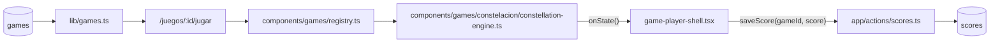
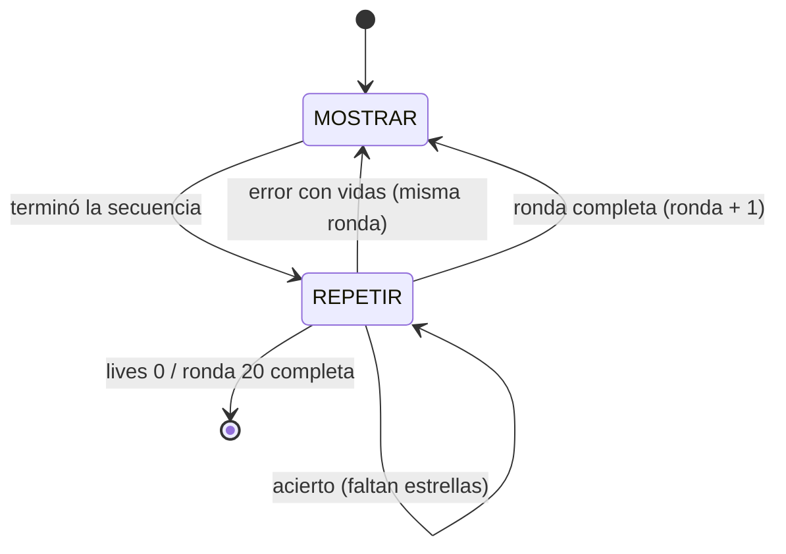
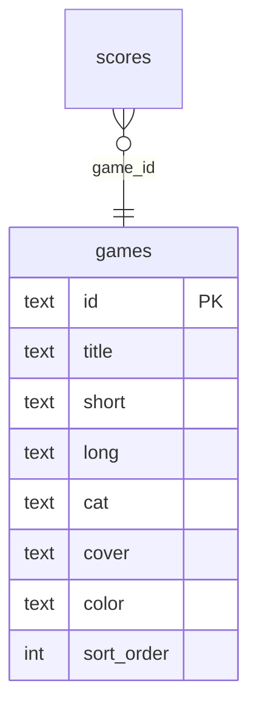

# SPEC GAME-JAM — CONSTELACIÓN (observatorio estelar)

> **Estado:** Borrador
> **Tema:** observatorio estelar
> **Depende de:** 05-rocas-asteroids-motor, 06-ranking-global-catalogo-juegos-v0.2.0, 11-score-plausibility-caps-v0.2.5
> **Fecha:** 2026-11-16
> **Versión:** a asignar al promover (minor — package.json es la fuente de verdad)
> **Objetivo:** Escribir desde cero el motor de CONSTELACIÓN, un juego de memoria de secuencias en el que una constelación de 9 estrellas se ilumina en un orden que crece cada ronda y hay que repetirlo tocando las estrellas, y sumarlo al catálogo como juego nuevo (fila en `games` + portada CSS propia).

## Alcance

**Incluye:**

- `components/games/constelacion/constellation-engine.ts`: motor que exporta `createConstellationEngine: EngineFactory`, escrito desde cero (no hay fuente en `references/started-games/`), sobre el arena de 800×600 dibujado solo con círculos, líneas y rectángulos (sin assets binarios).
- `components/games/registry.ts`: agrega `constelacion: { load: () => import("./constelacion/constellation-engine").then((m) => m.createConstellationEngine), maxPlausibleScore: 14_650, skins: ["clasico", "neon", "retro"] }` — **cap exacto** (acotado, ver Modelo de datos). `music`: una pista ya existente de `music-tracks.ts`, a elegir al implementar. Sin `touchControls`: el juego es de puntero puro y el toque ya funciona como puntero; `@mobile-porter` lo confirma.
- Sonidos propios dentro del motor con `defineSounds` + `beep` (`audio.ts` no se modifica): `note` (una nota por estrella, 9 tonos de una escala pentatónica; al mostrar y al tocar), `wrong`, `round`, `win`.
- Skins `clasico` (default), `neon` y `retro` dentro del motor, según `components/games/README.md` § Skins (patrón de CAÍDA).
- `db/seeds/shared/games.sql`: una tupla más en el upsert del catálogo con la fila `constelacion` (spec 18). Se aplica solo en dev con el MCP; prod la recibe en `npm run db:release`.
- `app/globals.css`: bloque `.cover-constelacion` en la sección "Cover art generators".
- `package.json` y `CHANGELOG.md`: bump minor + entrada que enlaza este spec.

**Fuera de alcance (para futuros specs):**

- Modos extra (secuencia inversa, dos estrellas a la vez, semilla diaria).
- Música nueva y audio con archivos.
- `touchControls` (d-pad/botones): no aplican a un juego de puntero.
- Cambios a `game-player-shell.tsx`, `game-engine.ts`, `audio.ts` o `app/actions/scores.ts`.
- `devicePixelRatio`.

## Modelo de datos

Sin tablas nuevas: reusa `scores`/`games` (specs 04/06). Sí hay una **fila nueva** en `games` (caso C).

### Reglas del juego

- **Tablero:** 9 estrellas en una grilla 3×3 con jitter. Al iniciar/reiniciar una partida, cada estrella `i` (0–8, orden de lectura) se ubica en el centro de su celda de 200×140 sobre la región x∈[100,700], y∈[130,550], más un desplazamiento aleatorio de ±30 px por eje. Las posiciones se fijan toda la partida (no cambian entre rondas). Radio visual 26 px, radio de acierto 40 px (tolerante al dedo). Cada estrella tiene su nota fija.
- **Rondas 1–20:** en la ronda `r` la secuencia tiene `r` estrellas. La secuencia es la de la ronda anterior más una estrella nueva al azar (no igual a la última). Todo el RNG vive en el motor (`Math.random`).
- **Fase MOSTRAR:** cada estrella de la secuencia se ilumina `on = max(280, 620 − 20·(r−1))` ms, con un hueco de 160 ms entre una y otra, y suena su nota. Los clics se ignoran. Las líneas de la constelación se dibujan solo entre estrellas ya acertadas en el intento actual.
- **Fase REPETIR:** el jugador toca las estrellas en el orden mostrado (clic/tap, o teclas `Digit1`–`Digit9` = estrella en orden de lectura, también `Numpad1`–`Numpad9`). Cada acierto ilumina la estrella, suena su nota y avanza `badge`. Tiene 5 s por estrella; si vence, cuenta como error.
- **Error** (estrella equivocada o tiempo vencido): `−1` vida, suena `wrong`, se pierden los puntos pendientes de la ronda y se **repite la misma ronda** (misma secuencia, vuelve a MOSTRAR tras 900 ms). Con `lives === 0` → `gameover`.
- **Ronda completa:** se acreditan los puntos y suena `round`; tras 700 ms arranca la ronda siguiente. Completar la ronda 20 suma el bono final, suena `win` y termina con `phase: "gameover"` (una victoria se mapea a `gameover`).
- **Vidas:** 3.

### Tabla de puntos (todos enteros)

| Evento | Puntos | Cuándo se acredita |
| ------ | ------ | ------------------ |
| Estrella acertada | +10 | **pendiente**: se acredita al completar la ronda |
| Rapidez: acierto dentro de 1.500 ms desde que terminó MOSTRAR (la 1ª) o desde el acierto anterior | +5 por estrella | pendiente: al completar la ronda |
| Ronda `r` completa | +50 × `r` | al completar la ronda |
| Ronda 20 completa | +1.000 | al completar la ronda 20 |

**Los puntos de estrellas son pendientes por diseño:** un error los descarta y la ronda se repite. Así repetir una ronda tras un error nunca vuelve a pagar aciertos ya cobrados y el cap es exacto.

### `maxPlausibleScore` — acotado (exacto): **14.650**

- Por ronda `r`: `r × (10 + 5) + 50 × r = 65 × r`.
- Rondas 1–20: `65 × (20·21/2) = 65 × 210 = 13.650`.
- Bono final: `+1.000` → **14.650**. Es el máximo teórico (20 rondas perfectas y rápidas, sin errores); no hay ninguna otra fuente de puntos. Realista: 6–10 rondas ≈ 1.400–3.600.

### Mapeo a `EngineState`

| Campo | Valor |
| ----- | ----- |
| `score` | puntos acreditados (solo cambia al completar rondas) |
| `lives` | 3 → 0 |
| `level` | ronda actual (1–20) |
| `badge` | `{ label: "PASO", value: "<acertadas>/<largo>" }` en REPETIR; `{ label: "PASO", value: "VER" }` en MOSTRAR. Cambia por clic, no por frame |
| `phase` | `playing` / `paused` / `gameover` (derivada de `lives === 0` o ronda 20 completa) |

### Controles

| Entrada | Acción |
| ------- | ------ |
| Clic / tap sobre una estrella | Elige esa estrella (solo en REPETIR) |
| `Digit1`–`Digit9`, `Numpad1`–`Numpad9` | Elige la estrella `n` en orden de lectura de la grilla |

`preventDefault()` en las teclas numéricas que se usan, para evitar efectos del navegador. El auto-repeat (`e.repeat`) se ignora.

### Fila nueva de `games`

| Columna | Valor |
| ------- | ----- |
| `id` | `constelacion` |
| `title` | `CONSTELACIÓN` |
| `short` | `Repite la secuencia de estrellas sin perder el hilo.` |
| `long` | `Las estrellas del observatorio se encienden en un orden secreto, una más en cada ronda. Memoriza el trazo, tócalas en el mismo orden y completa la constelación antes de que se apaguen tus tres vidas.` |
| `cat` | `PUZZLE` |
| `cover` | `cover-constelacion` |
| `color` | `yellow` |
| `sort_order` | siguiente libre al implementar (`select max(sort_order) + 1 from games`) |

**Portada `.cover-constelacion`:** fondo `radial-gradient(circle at 50% 40%, #0a0a30, #0a0a18)`; `::after` con 5 puntos `var(--yellow)` (radial-gradients de 8 px) en zigzag unidos por líneas finas `var(--ink)` al 40 % (linear-gradients rotados) y `filter: drop-shadow(0 0 6px rgba(255,214,0,0.6))`, mismo patrón que `.cover-snake`.

## Plan de implementación

1. Agregar la tupla `constelacion` a `db/seeds/shared/games.sql`. Aplicar el seed en dev con el MCP y verificar con `node scripts/build-prod-release.mjs --stdout`. Test manual: `select * from games where id = 'constelacion'` devuelve la fila.
2. Bloque `.cover-constelacion` en `app/globals.css`. Test manual: `/games` muestra la portada nueva.
3. Esqueleto del motor en `components/games/constelacion/constellation-engine.ts`: factory, los 6 métodos del `EngineHandle`, loop RAF con `dt`, `reportState()`. Test manual: `npm run lint`.
4. Tablero: generación de las 9 posiciones con jitter, dibujo de estrellas y fondo cacheado (spec 14). Test manual: se ven 9 estrellas distintas en cada partida nueva.
5. Fase MOSTRAR: máquina de estados por tiempo (acumulador de `dt`, sin `setTimeout`, para que pausa/resume no desincronice), secuencia creciente sin repetir consecutivas, destello + nota. Test manual: la ronda 3 muestra 3 estrellas en orden.
6. Fase REPETIR: hit-test por puntero (escalado al arena de 800×600) y teclas, timeout de 5 s, errores, repetición de ronda, puntos pendientes. Test manual: un error descuenta 1 vida, repite la misma secuencia y no suma puntos.
7. Puntaje y fin: acreditar al completar ronda, bono de ronda 20, victoria → `gameover`, `badge`, `level`. Test manual: completar rondas 1–3 perfectas suma `65×(1+2+3) = 390`.
8. Sonidos (`defineSounds`) y skins `clasico`/`neon`/`retro`. Test manual: las 9 notas son distintas; con mute no hay nodos de audio.
9. Entrada en `registry.ts` (`maxPlausibleScore: 14_650`). Test manual: `/juegos/constelacion/jugar` carga el motor real.
10. `package.json` + `CHANGELOG.md`. Test manual: el Footer muestra la versión nueva.
11. Verificación end-to-end: partida completa con sesión, una fila nueva en `scores`, reflejada en `/juegos/constelacion`, `/games` y `/salon-de-la-fama`.

## Criterios de aceptación

- [ ] El motor exporta `createConstellationEngine` cumpliendo `EngineFactory`.
- [ ] `registry.ts` carga el motor con `import()` dinámico y declara `maxPlausibleScore: 14650`.
- [ ] Hay 9 estrellas en grilla 3×3 con jitter; las posiciones no cambian dentro de una partida y sí entre partidas.
- [ ] En la ronda `r` se muestran exactamente `r` estrellas; la secuencia de la ronda `r` empieza con la de `r−1`.
- [ ] Durante MOSTRAR los clics y teclas se ignoran.
- [ ] Un acierto suena la nota de esa estrella y avanza el `badge`; una estrella equivocada o 5 s sin tocar resta 1 vida y repite la **misma** ronda.
- [ ] Los puntos de estrellas solo se acreditan al completar la ronda; repetir una ronda tras un error nunca suma más que una vez.
- [ ] Ronda `r` perfecta y rápida suma exactamente `65×r`; completar la ronda 20 suma además 1.000 y abre el modal de fin.
- [ ] Ninguna partida posible puede superar 14.650 y `score` siempre es entero.
- [ ] El tercer error (`lives === 0`) dispara `phase: "gameover"`.
- [ ] El HUD refleja `score`/`lives`/`level` reales; `badge` "PASO" muestra `acertadas/largo` o `VER`.
- [ ] El canvas no dibuja HUD ni overlay de pausa/game over.
- [ ] PAUSA congela la simulación real (RAF cancelado); REANUDAR no produce salto (los tiempos de MOSTRAR y del timeout usan `dt` acumulado).
- [ ] FIN fuerza game over con el score actual.
- [ ] Con sesión, una partida terminada crea exactamente una fila en `scores`; sin sesión, el modal ofrece `/auth`.
- [ ] "JUGAR DE NUEVO" reinicia (score 0, 3 vidas, ronda 1, posiciones nuevas) sin remontar el componente; "VOLVER AL VAULT" navega a `/juegos/constelacion`.
- [ ] Salir de la página cancela el RAF y saca los listeners; el chunk solo se descarga al jugar este juego.
- [ ] Se puede jugar con teclado (`Digit1`–`Digit9`) y con toque en un viewport móvil.
- [ ] Skins `clasico`/`neon`/`retro` cambian solo lo visual.
- [ ] Cumple las reglas de "Rendimiento" del README (freeze tras game over, fondo cacheado, `draw` sin allocaciones).
- [ ] La fila de `games` existe en dev con RLS de solo lectura y `get_advisors` no reporta hallazgos nuevos.
- [ ] `npm run lint` y `npm run build` sin errores.
- [ ] El motor no lee `localStorage` ni toca el DOM fuera del canvas.

## Decisiones

- **Sí:** puntaje **pendiente por ronda** (se acredita al completarla) — _decidido por game-jam — revisar_. Es lo que hace exacto el cap: sin esto, un error a mitad de ronda seguido de la repetición pagaría dos veces los mismos aciertos.
- **Sí:** victoria en la ronda 20 con bono +1.000 y fin de partida — _decidido por game-jam — revisar_. Da un techo exacto (14.650) en vez de un techo de cordura; una secuencia de 20 es muy difícil, así que el tope no recorta partidas reales.
- **Sí:** error = repetir la misma ronda (no reiniciar desde la 1) con 3 vidas — _decidido por game-jam — revisar_. Penaliza sin volver la sesión eterna.
- **Sí:** bono de rapidez de +5 por estrella dentro de 1,5 s — _decidido por game-jam — revisar_. Sin él, a igual memoria los puntajes se juntarían en el máximo (el problema que la bitácora marcó en PAREJAS); con él se separa por reflejos y confianza.
- **Sí:** posiciones al azar con jitter por partida — _decidido por game-jam — revisar_. Evita memorizar una disposición fija; el orden también es aleatorio, así que no hay respuestas memorizables (motivo del descarte de TRIVIA).
- **Sí:** tiempos con acumulador de `dt` en lugar de `setTimeout`, para que pausa y reanudar sean exactos.
- **Sí:** sin `touchControls`; el puntero táctil es la entrada nativa. Radio de acierto de 40 px por el dedo.
- **Sí:** bump minor: es un juego nuevo visible en el catálogo (caso C).
- **Superposición con juegos existentes:** ninguna mecánica de `juegos-implementados.md` es de memoria. Con candidatos de la bitácora: **PAREJAS** (Memory) es también memoria pero de emparejar cartas con puntaje casi plano; CONSTELACIÓN es de secuencia con dificultad creciente y bono de rapidez. Si se implementa este, conviene re-evaluar PAREJAS con `@game-planner`.
- **No:** tocar `game-player-shell.tsx`, `game-engine.ts`, `audio.ts` ni `scores.ts`.

## Riesgos

| Riesgo | Mitigación |
| ------ | ---------- |
| Secuencias de 15–20 estrellas son casi imposibles y la mayoría juega 5–8 rondas | Es esperado: el ranking se decide en esa zona por rapidez; la velocidad de MOSTRAR topa en 280 ms para que 20 siga siendo legible |
| El bono de rapidez castiga a quien usa táctil con latencia | Ventana de 1,5 s amplia; el bono es solo +5 de 15 por estrella |
| Hit-test descalibrado cuando el shell escala el canvas por CSS | Convertir con `getBoundingClientRect` a coordenadas 800×600, como en los motores de puntero existentes |
| Pausar durante MOSTRAR deja la secuencia a medias o permite "espiar" sin costo | Un único acumulador de `dt`; al reanudar continúa donde estaba. El timeout de 5 s tampoco corre en pausa |
| Auto-repeat de teclas o doble toque cuentan como dos aciertos | Ignorar `e.repeat`; un solo evento por `pointerdown` |
| El cap exacto se rompe si se agrega luego un multiplicador | Cualquier cambio de puntos exige recalcular `maxPlausibleScore` (spec 11) |
| Fila de `games` escrita sin consultar la base en vivo (el MCP de Supabase no estaba disponible al escribir este spec; se usó `db/seeds/shared/games.sql` y `sql/004_...`) | Antes de implementar, confirmar que `constelacion` no exista y qué `sort_order` toca |

## Lo que **no** está en este spec

- Modos extra, semilla diaria o secuencias inversas.
- Música y audio con archivos nuevos.
- Controles táctiles tipo d-pad.
- Rankings por rapidez separados del puntaje.
- Cambios a la plataforma genérica.

Cada uno, si se implementa, va en su propio spec.
