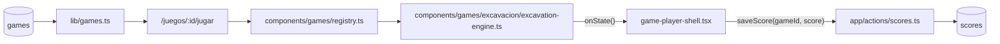
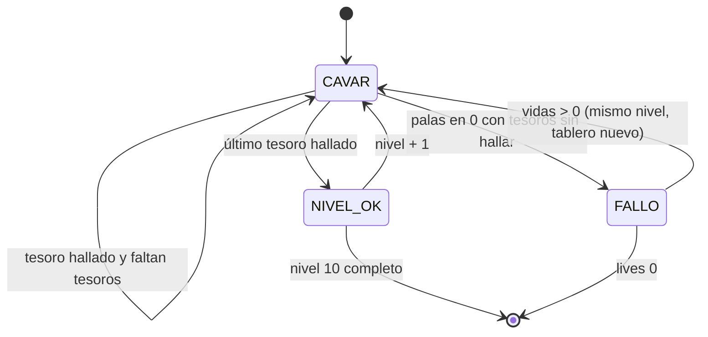
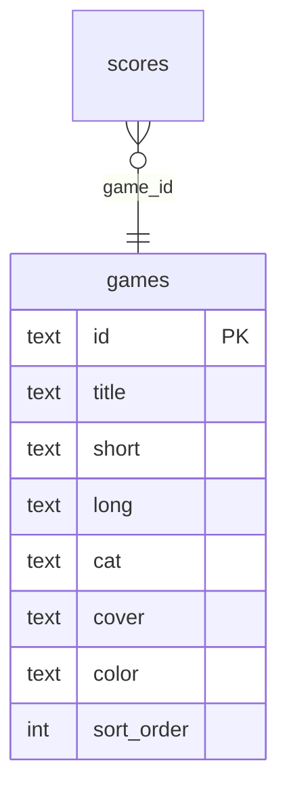

# SPEC GAME-JAM — EXCAVACIÓN (desierto de los faraones)

> **Estado:** Borrador
> **Tema:** desierto de los faraones
> **Depende de:** 05-rocas-asteroids-motor, 06-ranking-global-catalogo-juegos-v0.2.0, 11-score-plausibility-caps-v0.2.5
> **Fecha:** 2026-11-23
> **Versión:** a asignar al promover (minor — package.json es la fuente de verdad)
> **Objetivo:** Escribir desde cero el motor de EXCAVACIÓN, un puzzle de deducción por turnos en el que se cavan casillas de arena con un número limitado de palas y un radar que indica la distancia al tesoro más cercano, y sumarlo al catálogo como juego nuevo (fila en `games` + portada CSS propia).

## Alcance

**Incluye:**

- `components/games/excavacion/excavation-engine.ts`: motor que exporta `createExcavationEngine: EngineFactory`, escrito desde cero (no hay fuente en `references/started-games/`), sobre 800×600 dibujado solo con rectángulos, círculos y líneas (sin assets binarios).
- `components/games/registry.ts`: agrega `excavacion: { load: () => import("./excavacion/excavation-engine").then((m) => m.createExcavationEngine), maxPlausibleScore: 10_100, skins: ["clasico", "neon", "retro"] }` — **cap exacto** (acotado, ver Modelo de datos). `music`: una pista existente de `music-tracks.ts`, a elegir al implementar. Sin `touchControls`: puntero puro; el toque ya funciona como puntero (`@mobile-porter` lo confirma).
- Sonidos propios dentro del motor con `defineSounds` + `beep` (`audio.ts` no se modifica): `dig`, `ping` (tono según distancia: más agudo = más cerca), `treasure`, `clear`, `fail`, `win`.
- Skins `clasico` (default), `neon` y `retro` dentro del motor, según `components/games/README.md` § Skins (patrón de CAÍDA).
- `db/seeds/shared/games.sql`: una tupla más en el upsert del catálogo con la fila `excavacion` (spec 18). Solo dev vía MCP; prod en `npm run db:release`.
- `app/globals.css`: bloque `.cover-excavacion` en "Cover art generators".
- `package.json` y `CHANGELOG.md`: bump minor + entrada que enlaza este spec.

**Fuera de alcance (para futuros specs):**

- Trampas/momias, dinamita, objetos de varias casillas, semilla diaria.
- Música nueva y audio con archivos.
- `touchControls` (no aplican a un juego de puntero).
- Cambios a `game-player-shell.tsx`, `game-engine.ts`, `audio.ts` o `app/actions/scores.ts`.
- `devicePixelRatio`.

## Modelo de datos

Sin tablas nuevas: reusa `scores`/`games` (specs 04/06). Sí hay una **fila nueva** en `games` (caso C).

### Reglas del juego

- **Tablero:** grilla de 10×8 casillas de arena (80×64 px cada una, ocupando x∈[0,800] e y∈[88,600]; la franja superior y∈[0,88] muestra tesoros hallados/restantes). Cada nivel esconde `T` tesoros en casillas distintas.
- **Colocación:** al empezar cada intento de un nivel, `T` casillas al azar con distancia Manhattan **≥ 3** entre sí (evita lecturas ambiguas). Todo el RNG vive en el motor (`Math.random`).
- **Excavar** (clic/tap sobre una casilla sin cavar, o cursor con flechas + `Space`/`Enter`): gasta 1 pala y revela la casilla.
  - Si hay tesoro: suena `treasure`, la casilla muestra el artefacto y deja de contar para el radar. Puntos **pendientes**.
  - Si no: muestra el número del **radar** = distancia Manhattan al tesoro **aún no hallado** más cercano, topada en 9. Color: 1–2 magenta (caliente), 3–5 amarillo, 6–9 cian (frío). Suena `ping` con tono por distancia.
  - Las casillas ya cavadas no se pueden volver a cavar (no gasta pala).
- **Fin de nivel:**
  - Todos los tesoros hallados → se acreditan los puntos pendientes, suena `clear`, y tras 900 ms arranca el nivel siguiente.
  - Palas en 0 con tesoros sin hallar → `−1` vida, suena `fail`, se **pierden los puntos pendientes**, se revela el tablero 1,2 s y el mismo nivel se reinicia con un tablero **nuevo**. Con `lives === 0` → `gameover`.
- **Niveles:** 10, con final. Completar el nivel 10 suma el bono final, suena `win` y termina con `phase: "gameover"` (una victoria se mapea a `gameover`).
- **Tesoros por nivel** `T(L) = 2 + floor((L+1)/2)`: 2, 3, 3, 4, 4, 5, 5, 6, 6, 7 (Σ = 45).
- **Palas por nivel** `P(L) = 4 + 3·T(L)`: 10, 13, 13, 16, 16, 19, 19, 22, 22, 25.
- **Vidas:** 3. No hay reloj: el juego es por turnos (sin dependencia de dt salvo animaciones).

### Tabla de puntos (todos enteros)

| Evento | Puntos | Cuándo se acredita |
| ------ | ------ | ------------------ |
| Tesoro hallado | +100 | **pendiente**: al completar el nivel |
| Pala sobrante al completar el nivel | +20 por pala | al completar el nivel |
| Nivel completo | +200 | al completar el nivel |
| Nivel 10 completo | +1.000 | al completar el nivel 10 |

**Los puntos son pendientes por diseño:** reintentar un nivel tras fallar nunca vuelve a pagar tesoros ya hallados, así que no se puede farmear y el cap es exacto.

### `maxPlausibleScore` — acotado (exacto): **10.100**

- Máximo por nivel `L`: `100·T + 20·(P − T) + 200`, con `P − T = 4 + 2T` → `140·T + 280`.
- Σ niveles 1–10: `140 × 45 + 280 × 10 = 6.300 + 2.800 = 9.100`.
- Bono final: `+1.000` → **10.100**. Es el máximo teórico (cada pala cavada acertaría un tesoro, imposible en la práctica porque el primer tesoro exige varias palas de búsqueda). Realista: 3–6 niveles ≈ 900–2.500.

### Mapeo a `EngineState`

| Campo | Valor |
| ----- | ----- |
| `score` | puntos acreditados (solo cambia al completar niveles) |
| `lives` | 3 → 0 |
| `level` | nivel actual (1–10) |
| `badge` | `{ label: "PALAS", value: "<restantes>" }` (cambia por excavación, no por frame) |
| `phase` | `playing` / `paused` / `gameover` (derivada de `lives === 0` o nivel 10 completo) |

Tesoros hallados/restantes se dibujan en el canvas del tablero (franja superior), no en el HUD del shell.

### Controles

| Entrada | Acción |
| ------- | ------ |
| Clic / tap sobre una casilla | Excava esa casilla |
| `ArrowLeft/Right/Up/Down` | Mueve el cursor de casilla |
| `Space` / `Enter` | Excava la casilla del cursor |

`preventDefault()` en flechas, `Space` y `Enter`. Se ignora `e.repeat` en `Space`/`Enter`.

### Fila nueva de `games`

| Columna | Valor |
| ------- | ----- |
| `id` | `excavacion` |
| `title` | `EXCAVACIÓN` |
| `short` | `Cava la arena y sigue el radar hasta el tesoro.` |
| `long` | `Bajo las dunas del faraón duermen tesoros olvidados. Cada pala te revela qué tan cerca estás del próximo: lee el radar, deduce y cava con cabeza antes de que se acaben tus palas y tus tres vidas.` |
| `cat` | `PUZZLE` |
| `cover` | `cover-excavacion` |
| `color` | `magenta` |
| `sort_order` | siguiente libre al implementar (`select max(sort_order) + 1 from games`) |

**Portada `.cover-excavacion`:** fondo `linear-gradient(180deg,#2a1a00,#0a0a18)`; `::after` con una grilla de casillas (`repeating-linear-gradient` 0° y 90° con `var(--yellow)` al 20 %) y un círculo `var(--magenta)` de 14 px con una "X" fina `var(--ink)` encima, más `filter: drop-shadow(0 0 8px rgba(255,0,170,0.5))`, mismo patrón que `.cover-rana`.

## Plan de implementación

1. Agregar la tupla `excavacion` a `db/seeds/shared/games.sql`. Aplicar en dev con el MCP y verificar con `node scripts/build-prod-release.mjs --stdout`. Test manual: `select * from games where id = 'excavacion'` devuelve la fila.
2. Bloque `.cover-excavacion` en `app/globals.css`. Test manual: `/games` muestra la portada.
3. Esqueleto del motor en `components/games/excavacion/excavation-engine.ts`: factory, los 6 métodos del `EngineHandle`, loop RAF con `dt` (solo animaciones), `reportState()`. Test manual: `npm run lint`.
4. Tablero: grilla 10×8, fondo cacheado (spec 14), cursor y hit-test escalado a 800×600. Test manual: el clic resalta la casilla correcta con el canvas escalado por CSS.
5. Colocación de `T` tesoros con separación Manhattan ≥ 3 (con reintentos acotados) y cálculo del radar topado en 9. Test manual: con el tablero revelado en el fallo, cada número coincide con la distancia al tesoro no hallado más cercano.
6. Excavar, palas y `badge`; tesoros hallados dejan de contar para el radar. Test manual: re-excavar una casilla no gasta pala.
7. Fin de nivel y fallo: puntos pendientes, bonus de palas, `−1` vida, tablero nuevo en reintento, victoria en nivel 10 → `gameover`. Test manual: nivel 1 perfecto (2 tesoros con 2 palas) suma `200 + 160 + 200 = 560`.
8. Sonidos (`defineSounds`) y skins `clasico`/`neon`/`retro`. Test manual: `ping` cambia de tono con la distancia; con mute no hay nodos de audio.
9. Entrada en `registry.ts` (`maxPlausibleScore: 10_100`). Test manual: `/juegos/excavacion/jugar` carga el motor real.
10. Simulación de balance: un bot greedy (excava la casilla que mejor reduce candidatas) debe completar los 10 niveles con holgura de palas; un bot aleatorio debe fallar los niveles altos. Ajustar `P(L)` si no, **recalculando el cap**.
11. `package.json` + `CHANGELOG.md`. Test manual: el Footer muestra la versión nueva.
12. Verificación end-to-end: partida completa con sesión, fila nueva en `scores`, reflejada en `/juegos/excavacion`, `/games` y `/salon-de-la-fama`.

## Criterios de aceptación

- [ ] El motor exporta `createExcavationEngine` cumpliendo `EngineFactory`.
- [ ] `registry.ts` carga el motor con `import()` dinámico y declara `maxPlausibleScore: 10100`.
- [ ] El nivel `L` esconde exactamente `T(L)` tesoros con distancia Manhattan ≥ 3 entre sí y da `P(L)` palas.
- [ ] Cada excavación vacía muestra la distancia Manhattan al tesoro no hallado más cercano, topada en 9; un tesoro hallado deja de contar.
- [ ] Excavar una casilla ya cavada no gasta pala ni cambia el estado.
- [ ] Los puntos de tesoros solo se acreditan al completar el nivel; reintentar tras un fallo nunca suma más de una vez.
- [ ] Nivel `L` perfecto suma exactamente `140·T + 280` como máximo; completar el nivel 10 suma además 1.000 y abre el modal de fin.
- [ ] Ninguna partida posible puede superar 10.100 y `score` siempre es entero.
- [ ] Quedarse sin palas con tesoros sin hallar resta 1 vida y reinicia el mismo nivel con tablero nuevo; el tercer fallo (`lives === 0`) dispara `phase: "gameover"`.
- [ ] El HUD refleja `score`/`lives`/`level` reales; `badge` "PALAS" muestra las restantes.
- [ ] El canvas no dibuja HUD del shell ni overlay de pausa/game over.
- [ ] PAUSA congela la simulación real (RAF cancelado) y bloquea excavaciones; REANUDAR no produce saltos.
- [ ] FIN fuerza game over con el score actual.
- [ ] Con sesión, una partida terminada crea exactamente una fila en `scores`; sin sesión, el modal ofrece `/auth`.
- [ ] "JUGAR DE NUEVO" reinicia (score 0, 3 vidas, nivel 1, tablero nuevo) sin remontar el componente; "VOLVER AL VAULT" navega a `/juegos/excavacion`.
- [ ] Salir de la página cancela el RAF y saca los listeners; el chunk solo se descarga al jugar este juego.
- [ ] Se puede jugar con teclado (flechas + `Space`) y con toque en un viewport móvil.
- [ ] Skins `clasico`/`neon`/`retro` cambian solo lo visual.
- [ ] Cumple las reglas de "Rendimiento" del README (freeze tras game over, fondo cacheado, `draw` sin allocaciones).
- [ ] La fila de `games` existe en dev con RLS de solo lectura y `get_advisors` no reporta hallazgos nuevos.
- [ ] `npm run lint` y `npm run build` sin errores.
- [ ] El motor no lee `localStorage` ni toca el DOM fuera del canvas.

## Decisiones

- **Sí:** puntos **pendientes por nivel** (se acreditan al completarlo) — _decidido por game-jam — revisar_. Hace exacto el cap: sin esto, fallar y reintentar pagaría dos veces los mismos tesoros.
- **Sí:** radar = distancia Manhattan al tesoro no hallado más cercano, topada en 9 — _decidido por game-jam — revisar_. Da una deducción tipo triangulación, sin azar injusto: todo tablero es resoluble con información.
- **Sí:** separación Manhattan ≥ 3 entre tesoros — _decidido por game-jam — revisar_. Evita que dos tesoros adyacentes confundan el radar.
- **Sí:** `P(L) = 4 + 3·T(L)` y bono de 20 por pala sobrante — _decidido por game-jam — revisar_. Separa a los jugadores por eficiencia de deducción (la crítica de la bitácora a PAREJAS: puntajes planos cerca del máximo); el valor exacto se calibra con el bot del paso 10.
- **Sí:** 10 niveles con final y bono de 1.000 — _decidido por game-jam — revisar_. Cap exacto en vez de techo de cordura.
- **Sí:** fallo = −1 vida y mismo nivel con tablero nuevo (no volver al nivel 1), 3 vidas — _decidido por game-jam — revisar_.
- **Sí:** sin reloj; por turnos. Elimina la dependencia de FPS/dt en el puntaje.
- **Sí:** bump minor: juego nuevo visible (caso C).
- **Superposición con juegos existentes:** ninguna mecánica de `juegos-implementados.md` es de deducción por turnos. Con candidatos de la bitácora: el más cercano es **COLAPSO** (puzzle de puntero por turnos con cap exacto) y **PAREJAS** (memoria) — acá no hay grupos ni memoria sino inferencia espacial. Con las jams previas: **CONSTELACIÓN** es memoria de secuencias; **HACKEO** es de circuitos. Sin superposición directa.
- **No:** tocar `game-player-shell.tsx`, `game-engine.ts`, `audio.ts` ni `scores.ts`.

## Riesgos

| Riesgo | Mitigación |
| ------ | ---------- |
| Balance de palas: demasiado fácil/difícil | Simulación con bots (paso 10); cualquier ajuste de `P(L)` o puntos exige recalcular `maxPlausibleScore` (spec 11) |
| Primera excavación del nivel es pura suerte | Es esperado y barato (1 de ≥10 palas); el radar de ese primer pozo ya informa |
| Hit-test descalibrado cuando el shell escala el canvas por CSS | Convertir con `getBoundingClientRect` a 800×600, como en los motores de puntero existentes |
| Doble toque cuenta como dos excavaciones | Un evento por `pointerdown`; la casilla cavada ignora repeticiones |
| Colocación con separación ≥ 3 sin solución en 10×8 | Máximo 7 tesoros caben holgados; reintentos acotados y, como último recurso, relajar a ≥ 2 |
| El cap exacto se rompe si se agrega luego un multiplicador | Recalcular `maxPlausibleScore` ante cualquier cambio |
| Fila de `games` escrita sin consultar la base en vivo (MCP de Supabase no disponible; se usó `db/seeds/shared/games.sql`, `sql/004_...` y las ramas de jams previas) | Antes de implementar, confirmar que `excavacion` no exista y qué `sort_order` toca |

## Lo que **no** está en este spec

- Trampas, momias, dinamita u objetos de varias casillas.
- Semilla diaria o ranking por eficiencia separado del puntaje.
- Música y audio con archivos nuevos.
- Controles táctiles tipo d-pad.
- Cambios a la plataforma genérica.

Cada uno, si se implementa, va en su propio spec.
